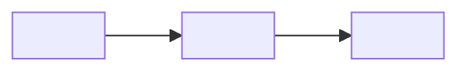

<!--
Variant: mermaid
Selected when: state.userPreferences.diagramFormat == "mermaid"
Purpose: lightweight starting scaffold for Mermaid flowchart diagrams in ADRs
IaC-derived diagrams: populate this scaffold from verified resources, connections, and boundaries in the supplied source. An available architecture-diagrams Mermaid rendering can replace the scaffold.
-->

# Diagram (Mermaid)

