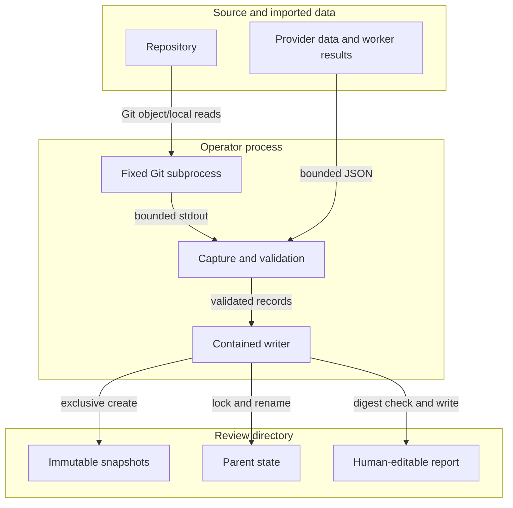

<!-- markdownlint-disable-file -->
# Code Review Core Skill Security Model

The Node entry point `scripts/review.mjs` uses `scripts/lib/model.mjs`,
`snapshot.mjs`, `storage.mjs`, and `operations.mjs` to capture Git evidence,
validate worker results, and write local review records. Two trust buckets cover
source/imported data and durable output. Each bucket enumerates all six STRIDE
categories with the in-code mitigations that address them.

> See also: [repo-wide STRIDE model](../../../../docs/security/security-model.md).

## Executive Summary

The helper has no provider client or credential store. It executes fixed Git
operations without a shell and writes only within the selected review root.
Parent decisions and human reports have separate ownership. The operator and
other processes running as that operator remain trusted.

### Security Posture Overview

| Dimension          | Value                                                    |
|--------------------|----------------------------------------------------------|
| Runtime surface    | Node built-ins, Git reads, JSON and unified-diff parsing |
| Trust buckets      | B1 source/imports; B2 local persistence                  |
| Credentials        | None requested, stored, or transmitted                   |
| Network egress     | None                                                     |
| Open residual gaps | Three; maximum project-assessed residual severity Medium |

## Contents

* [System Description](#system-description)
* [Trust Boundaries](#trust-boundaries)
* [Assets](#assets)
* [Adversaries](#adversaries)
* [Bucket B1: Source and imported evidence](#bucket-b1-source-and-imported-evidence)
* [Bucket B2: Durable review output](#bucket-b2-durable-review-output)
* [Enterprise Readiness Gaps](#enterprise-readiness-gaps)
* [References](#references)

## System Description

### Components

* `snapshot.mjs` captures explicit revisions, local changes, or selected code.
* `model.mjs` validates identities, assignments, anchors, coverage, and outcomes.
* `storage.mjs` resolves paths, bounds reads, locks records, and writes atomically.
* `operations.mjs` merges worker results and preserves human-edited reports.

### Data Flow



## Trust Boundaries

### Boundary Diagram

```text
+----------------------------+
| Repository / imported JSON |
+-------------+--------------+
              | bounded reads
+-------------v--------------+
| Local helper and Git       |
| schema / identity checks   |
+-------------+--------------+
              | contained writes
+-------------v--------------+
| Review evidence and report |
+----------------------------+
```

### Boundary Descriptions

| Boundary             | Assets Protected      | Controls Enforced                         |
|----------------------|-----------------------|-------------------------------------------|
| Source/import parser | Evidence identity     | Explicit revisions, schemas, read budgets |
| Local filesystem     | Review and user files | No-follow reads, path checks, write locks |

## Assets

| Id | Asset               | Lifetime        | Notes                                       |
|----|---------------------|-----------------|---------------------------------------------|
| A1 | Captured evidence   | Review lifetime | Immutable snapshot and changed-line anchors |
| A2 | Parent decisions    | Review lifetime | Revision-checked state                      |
| A3 | Human-edited report | User-controlled | Digest conflict stops regeneration          |

## Adversaries

| Id    | Adversary                        | In-scope mitigations                        |
|-------|----------------------------------|---------------------------------------------|
| ADV-a | Author of reviewed content       | No shell evaluation; text treated as data   |
| ADV-b | Malformed or stale worker output | Assignment, snapshot, and anchor validation |
| ADV-c | Concurrent cooperating process   | Atomic writes and exclusive record locks    |

## Bucket B1: Source and imported evidence

### Spoofing

PR/MR snapshots require provider identity and resolved base/head revisions.
Imported diffs must match the target revisions. Provider provenance is supplied
by the host and is not independently authenticated by this helper.

### Tampering

Immutable evidence and strict result identities prevent mixing snapshots.
Local index/worktree signatures are compared before and after capture.
Finding snippets are compared with captured lines before merging.

### Repudiation

Snapshots record capture time and target revisions. Findings retain source work
IDs and parent decision reasons. These records are local evidence, not signed
audit attestations.

### Information Disclosure

Sensitive filenames, symbolic links, submodules, and non-text content receive
explicit omissions. The helper performs no network operations. Filename checks
cannot identify every secret embedded in an ordinary source file.

### Denial of Service

Git execution has a 30-second timeout and an 8 MiB output budget. Text previews
are bounded at 256 KiB per file and 4 MiB per snapshot; JSON records are bounded
at 8 MiB. Oversized evidence fails or remains explicitly omitted.

### Elevation of Privilege

Git uses argument arrays, literal pathspecs, explicit revision boundaries,
disabled external diffs/text conversion, and no shell. Imported instructions
are never executed.

### Risk Rating

| Threat                     | Likelihood | Impact | Residual Risk | Status              |
|----------------------------|------------|--------|---------------|---------------------|
| Forged imported provenance | Low        | Med    | Low           | Partially Mitigated |
| Secret in ordinary source  | Med        | Med    | Med           | Partially Mitigated |
| Oversized input            | Low        | Low    | Low           | Mitigated           |

## Bucket B2: Durable review output

### Spoofing

The resolved repository, review directory, state, and snapshot identities must
agree. A panel identifier is not a storage identity.

### Tampering

Paths reject traversal and symbolic links. Reads use a no-follow file handle.
Writes use exclusive temporary files and rename under a cooperative lock.
Revision checks reject stale state updates. Report digest conflicts preserve
the current human-edited file.

### Repudiation

Result digests make replay idempotent and reject a different result under an
already merged assignment. Local files remain editable by the operator.

### Information Disclosure

New review directories use mode `0700`; new files use `0600`. The operator must
manage workspace sharing and platform ACLs. The helper does not publish reports.

### Denial of Service

A live or abandoned lock returns a visible busy error. Recovery is an explicit
operator action; the helper does not guess whether another writer is dead.

### Elevation of Privilege

All helper writes remain in the selected review directory. It does not modify
source, execute feedback, approve reviews, or contact a hosting provider.

### Risk Rating

| Threat                            | Likelihood | Impact | Residual Risk | Status              |
|-----------------------------------|------------|--------|---------------|---------------------|
| Same-user filesystem races        | Low        | Med    | Med           | Partially Mitigated |
| Cooperating writers lose updates  | Low        | Med    | Low           | Mitigated           |
| Abandoned lock interrupts updates | Med        | Low    | Low           | Accepted            |

## Enterprise Readiness Gaps

Ratings are project assessments, not CVSS scores.

| Id      | Gap                                                                                    | Severity     | Status                                        |
|---------|----------------------------------------------------------------------------------------|--------------|-----------------------------------------------|
| G-INF-1 | Filename-based exclusions cannot recognize all secrets in ordinary source.             | InfoDisc-Med | Operator must review source disclosure scope. |
| G-TAM-1 | Same-user hostile path replacement and non-cooperating editor races are not sandboxed. | Tamper-Med   | Trusted local operator boundary.              |
| G-REP-1 | Host-supplied provenance and local records are not cryptographically attested.         | Repud-Low    | Do not use records as certification.          |

## References

* [STRIDE threat categories](https://learn.microsoft.com/azure/security/develop/threat-modeling-tool-threats)
* [Git diff options](https://git-scm.com/docs/git-diff)
* [Node filesystem API](https://nodejs.org/api/fs.html)
* [Repository security model](../../../../docs/security/security-model.md)

🤖 Crafted with precision by ✨Copilot following brilliant human instruction, then carefully refined by our team of discerning human reviewers.
