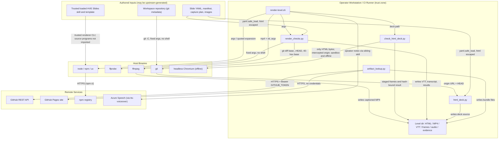

<!-- markdownlint-disable-file -->
# HVE Demo Material Skill Security Model

This document records the STRIDE threat model for the hve-demo-material skill (`scripts/artifact_lookup.py`, `scripts/html_deck.py`, `scripts/render-level.sh`, `scripts/render_checks.py`, and `scripts/check_html_deck.py`). The model is organized by trust bucket: GitHub API client and token handling (B1), Published site recovery and staging (B2), Deck source generation from authored content (B3), External program orchestration (B4), and CLI caller process and filesystem (B5). Each bucket enumerates all six STRIDE categories with the in-code mitigations that address them. Assets and adversaries are enumerated first. Acknowledged enterprise readiness gaps are listed at the end.

The skill renders HTML decks and narrated or silent videos. `artifact_lookup.py` reads GitHub artifacts/Pages. The adapter generates data-only source; the trusted loaded HVE Slides CLI bundles it. The offline browser serves only those HTML bytes on an intercepted origin, rejects external requests, blocks service workers/WebSockets/popups, and exports ordered JPEG canvas frames. `render_checks.py` verifies hashes, dimensions, styling, captions and media evidence. Narration, assembly and live capture use the retained tts-voiceover, demo-video and vscode-playwright entrypoints with caller-owned environments. Their implementations and host binaries remain trust boundaries (G-SUP-2).

> **See also: repo-wide STRIDE model.** This skill participates in the repository-wide threat model at [`docs/security/security-model.md`](../../../../docs/security/security-model.md) and is registered in its [Skill Security Models](../../../../docs/security/security-model.md#skill-security-models) section.

## Executive Summary

The adapter rejects unsupported meaningful content and confines image/source writes with link checks and fixed-file rollback. HTML scoring requires current content/build/browser/frame identity. The shell no longer executes a source-supplied bundler or recursively deletes the source directory. Chromium enables its sandbox and serves only the standalone bytes; failures do not install partial frames. Residual risk includes token endpoint/redirect handling, unbounded input size, local filesystem races, unclassified private content and operator-selected host/skill identity. Hashes provide local consistency, not signed attestations or independent visual-quality proof.

### Security Posture Overview

| Dimension          | Value                                                                                                                                           |
|--------------------|-------------------------------------------------------------------------------------------------------------------------------------------------|
| Runtime surface    | GitHub REST API and Pages downloads; local file writes and deletes; node, npm, ffmpeg, ffprobe, uv, git subprocesses; offline headless Chromium |
| Trust buckets      | B1 API client and token, B2 site recovery, B3 deck generation, B4 program orchestration, B5 caller and files                                    |
| Credentials        | GITHUB_TOKEN read from the environment and sent as a bearer header; Azure Speech credentials only inherited                                     |
| Network egress     | api.github.com (or GITHUB_API_URL), the repository's GitHub Pages site, the npm registry during npm ci                                          |
| Residual gaps | Token endpoint/redirect handling, input size, private content, local races and operator-managed runtime/skill provenance |

## Contents

* [System Description](#system-description)
* [Trust Boundaries](#trust-boundaries)
* [Assets](#assets)
* [Adversaries](#adversaries)
* [Bucket B1: GitHub API client and token handling](#bucket-b1-github-api-client-and-token-handling)
* [Bucket B2: Published site recovery and staging](#bucket-b2-published-site-recovery-and-staging)
* [Bucket B3: Deck source generation from authored content](#bucket-b3-deck-source-generation-from-authored-content)
* [Bucket B4: External program orchestration](#bucket-b4-external-program-orchestration)
* [Bucket B5: CLI caller process and filesystem](#bucket-b5-cli-caller-process-and-filesystem)
* [Enterprise Readiness Gaps](#enterprise-readiness-gaps)
* [References](#references)

## System Description

### Components

1. `scripts/artifact_lookup.py` — `find` pages through completed workflow runs and artifacts on the GitHub REST API with `GITHUB_TOKEN`; `recover` downloads the published bundle over HTTPS using `index.json` as the file list. Standard library only.
2. `scripts/html_deck.py` — maps a level's slide YAML and manifest sources to an HVE Slides source folder, embeds images as CSS data URLs, and runs read-only `git` queries to build citation links.
3. `scripts/render-level.sh`: rejects unsupported character/clip inputs, obtains required live captures, generates HTML through trusted HVE Slides, checks/exports frames, generates WAVs, assembles/finalizes media, and scores delivery. Frozen Python environments live under the level, not skill installations.
4. `scripts/render_checks.py` — reads the level contracts and pinned sources from `references/curriculum.md`; `levels` and `changed` use only the standard library, and `changed` diffs against a recorded 40-hex commit; `segments`, `captions`, and `transcript` write the demo-video segments manifest, WebVTT captions, and an escaped transcript page; `evaluate` scores criteria T-04 to T-10 by reading local files and running `ffprobe`.
5. `scripts/check_html_deck.py`: offline sandboxed Chromium receives only the standalone HTML on a synthetic intercepted origin. It checks readiness/assets/order/overflow and optionally exports 1920x1080 JPEG frames with hash-bound schema2 evidence, using the existing Playwright project.
6. External trust boundaries (G-SUP-2): HVE Slides canonical modules/runtime and retained narration, media and live-capture skills. Their local security models own their internal controls.

### Data Flow



## Trust Boundaries

### Boundary Diagram

```text
┌─────────────────────────────────────────────────────────────────────┐
│ TRUST BOUNDARY: Operator Workstation / CI Runner                    │
│  ┌──────────────────┐  ┌──────────────┐  ┌───────────────────────┐  │
│  │ artifact_lookup  │  │ html_deck    │  │ render-level.sh       │  │
│  │ (token in env)   │  │ (rollback)   │  │ (node/npm/ffmpeg/uv)  │  │
│  └──────────────────┘  └──────────────┘  └───────────────────────┘  │
│                    Level directory (caller-chosen)                  │
└───────┬─────────────────────┬───────────────────────┬───────────────┘
        │ HTTPS (+ token)     │ parse (safe_load)     │ argv / exec
┌───────▼───────────────┐ ┌───▼───────────────────┐ ┌─▼───────────────────────┐
│ BOUNDARY: Remote      │ │ BOUNDARY: Authored    │ │ BOUNDARY: Host binaries │
│ GitHub API, Pages,    │ │ inputs and template   │ │ uv, Chromium, siblings  │
│ npm, Azure Speech     │ │ (untrusted upstream)  │ │ node ffmpeg ffprobe git │
└───────────────────────┘ └───────────────────────┘ └─────────────────────────┘
```

### Boundary Descriptions

| Boundary                      | Assets Protected                | Controls Enforced                                                                                                                                                                                                         |
|-------------------------------|---------------------------------|---------------------------------------------------------------------------------------------------------------------------------------------------------------------------------------------------------------------------|
| Operator Workstation / Runner | Level directory, token, outputs | `set -euo pipefail`; validated level, narration, and capture values; quoted expansions; argument-list subprocesses; no shell eval                                                                                         |
| Remote services               | GITHUB_TOKEN, bundle integrity  | HTTPS-only site URL; request timeouts; owner/name check on the repository; file-name allowlist for downloaded bundle files                                                                                                |
| Authored inputs and template  | Build integrity, host files     | `yaml.safe_load`; HTML and caption escaping; content security policy on the transcript page; sanitized citation paths; HTTPS repo URL check; template must contain `bundle.mjs`                                           |
| Host binaries and siblings    | Host process integrity          | Fixed program arguments; `npm ci --ignore-scripts`; 30 s timeout on `git` in `html_deck.py`; 40-hex check on the `git diff` base; offline Chromium for the deck check; no credentials passed explicitly to child programs |

## Assets

| Id | Asset                                  | Lifetime         | Notes                                                                                                                                                                                   |
|----|----------------------------------------|------------------|-----------------------------------------------------------------------------------------------------------------------------------------------------------------------------------------|
| A1 | `GITHUB_TOKEN`                         | Process lifetime | Read from the environment by `artifact_lookup.py find` and sent as a bearer header on every API request. Never written to output or logs.                                               |
| A2 | Azure Speech credentials               | Process lifetime | `SPEECH_KEY` or `SPEECH_RESOURCE_ID` plus `SPEECH_REGION`; inherited by child processes and used only by the tts-voiceover sibling skill.                                               |
| A3 | Authored level content                 | Command lifetime | Slide YAML, speaker notes, manifest, capture plan, and referenced images; may originate from an upstream pipeline fed by untrusted material.                                            |
| A4 | Captured frames and narration audio    | Command lifetime | Live VS Code captures and speaker-note audio; can contain confidential on-screen material; notes are sent to Azure Speech under `azure`.                                                |
| A5 | Published bundle and artifact metadata | Per-invocation   | `index.json` and level files on GitHub Pages; run and artifact identifiers from the GitHub API.                                                                                         |
| A6 | Rendered outputs | Command lifetime | HTML, MP4, WebVTT, transcript, segments, JPEG frames and build/browser/media evidence under the level directory |
| A7 | Level directory and surrounding files | Persistent | Adapter uses checked fixed-file rollback writes; shell cleanup and other media writes remain separate controls. |
| A8 | HVE Slides template                    | Per-invocation   | `bundle.mjs`, `package.json`, `package-lock.json`, and `.npmrc` copied into the deck folder and executed or consumed by node and npm; its deck runtime also runs in the Chromium check. |
| A9 | Host binaries                          | Per-invocation   | `node`, `npm`, `uv`, `ffmpeg`, `ffprobe`, `git`, and the Chromium that Playwright launches, resolved from the caller's PATH or the Playwright browser install.                          |

## Adversaries

| Id    | Adversary                                   | In-scope mitigations                                                                                                                                                                                                                                                                                                                                                                  |
|-------|---------------------------------------------|---------------------------------------------------------------------------------------------------------------------------------------------------------------------------------------------------------------------------------------------------------------------------------------------------------------------------------------------------------------------------------------|
| ADV-a | Hostile or malformed authored content | Safe YAML parsing, escaped text/attributes, validated identities and mappings, confined image reads with link refusal; approved-root content still requires disclosure review (G-INF-1). |
| ADV-b | Spoofed or compromised API or site endpoint | The site URL must start with `https://` and every request has a 60 s timeout. `GITHUB_API_URL` is not validated and redirects use urllib defaults (G-TLS-1).                                                                                                                                                                                                                          |
| ADV-c | Hostile published bundle | v2 identities, fixed file inventories, SHA-256 and linked HTML/media evidence are checked. Known obsolete metadata can select regeneration but cannot supply delivery files. Unsigned publisher authenticity remains a residual (G-TAM-3). |
| ADV-d | Hostile template or dependency              | `npm ci` runs with `--ignore-scripts` against the template's lockfile, and the Chromium check opens the bundle with the network disabled and fails on any external request. The template's `bundle.mjs` and `.npmrc` are still executed or honored, and its deck runtime runs in the browser (G-EOP-1, G-EOP-2, G-SUP-1).                                                             |
| ADV-e | Hostile workspace repository                | Only fixed read-only git subcommands run (`remote get-url origin`, `rev-parse HEAD`) with a 30 s timeout. Only owner and repository name survive into the deck, so credentials in the remote URL are dropped, and the commit must be 40 hex characters.                                                                                                                               |
| ADV-f | Hostile caller controlling argv or env | Quoted arguments, validated modes, caller-owned roots and link/refusal checks limit writes. Concurrent local races and trusted installation identity remain operator responsibilities. |

## Bucket B1: GitHub API client and token handling

`artifact_lookup.py find` builds a `GitHubApi` client from `GITHUB_TOKEN`, `GITHUB_REPOSITORY`, and `GITHUB_API_URL`.

### Spoofing

* The client relies on urllib's default HTTPS certificate validation. `GITHUB_API_URL` defaults to `https://api.github.com` but is not checked for scheme or host, so an `http://` or look-alike value would receive the token (G-TLS-1).
* `GITHUB_REPOSITORY` must match `owner/name` (`[\w.-]+/[\w.-]+`) before any request is built.

### Tampering

* Response bodies are parsed with `json.loads` only; no response content is executed or written to disk. Query parameters are encoded with `urllib.parse.urlencode`.
* The `--workflow` value and run identifiers are interpolated into the API path without quoting. The caller controls these values and the request stays on the configured API host (G-TAM-2).

### Repudiation

* Failures print `ERROR: GitHub API <path> returned <code>` to stderr and exit non-zero, so automation can attribute a failed lookup. Successful lookups are not otherwise logged.

### Information Disclosure

* The token is sent only in the `Authorization` header and is not printed, written to the output file, or included in error messages. An unset token is sent as an empty bearer value rather than failing fast.
* The script installs no custom redirect handler. urllib's default `HTTPRedirectHandler` copies every request header except `Content-Length` and `Content-Type` to the redirect target, so the `Authorization` header would follow a cross-host redirect, including a downgrade to `http://` (G-TLS-1).

### Denial of Service

* Every request has a 60 s timeout. Run and artifact pagination is bounded by the 90-day retention window and page size, but response size and total page count are not capped (G-DOS-1).

### Elevation of Privilege

* Not applicable. The client performs read-only GET requests, runs no subprocess, and uses the caller's own token scopes.

### Risk Rating

| Threat                                            | Likelihood | Impact | Residual Risk | Status                    |
|---------------------------------------------------|------------|--------|---------------|---------------------------|
| Token sent to unintended host via env or redirect | Low        | High   | Med           | Open (G-TLS-1)            |
| Token leaked through logs or output               | Low        | High   | Low           | Mitigated (never emitted) |
| Oversized API response exhausts memory            | Low        | Low    | Low           | Accepted (G-DOS-1)        |

## Bucket B2: Published site recovery and staging

`artifact_lookup.py recover` downloads the published bundle without credentials and writes it into `--target`.

### Spoofing

* The site URL must start with `https://`; the default is derived from `GITHUB_REPOSITORY` as `https://<owner>.github.io/<name>/`. A caller-supplied `--site-url` may name any HTTPS host (G-TLS-1).
* Full recovery requires `demo-material-site/v2`, complete per-level identities and a nonempty delivery. Index-only detection recognizes known obsolete v1 metadata solely to select regeneration; it never downloads or publishes old delivery files.

### Tampering

* Fixed file inventories use full-match validation and link/reparse/special-file refusal. Recovery verifies per-file SHA-256; deployment repeats delivery checks for renderer/schema, HTML/build/frame evidence and caption/raw/final media hashes. Missing or incompatible evidence stops deployment instead of resetting the index.
* Bundle merges retain prior compatible levels on failed renders and roll back failed file replacements. Unknown or obsolete site content requires explicit preservation/migration; it is never recursively deleted. Hashes detect inconsistent bytes but do not authenticate a compromised publisher (G-TAM-3).
* Full recovery requires an empty caller-owned target, so a failed later download cannot overwrite existing local media. Level installation includes its index replacement in the rollback boundary; index-only refreshes use atomic replacement.

### Repudiation

* Recovery failures exit non-zero with an `ERROR:` message naming the URL or file; the success summary reports the status, levels, and file count.

### Information Disclosure

* Requests to the site carry no `Authorization` header and no credentials. The token is never used by `recover`.

### Denial of Service

* Requests time out after 60 s and the number of files is bounded by the allowlist pattern, but downloaded bodies are read fully into memory with no size cap (G-DOS-1).

### Elevation of Privilege

* Downloaded content is written as bytes and never parsed or executed by this script. The bundle is restaged for redeployment, so tampered files would be republished (G-TAM-3).

### Risk Rating

| Threat                                     | Likelihood | Impact | Residual Risk | Status                          |
|--------------------------------------------|------------|--------|---------------|---------------------------------|
| Path traversal through hostile index.json  | Low        | High   | Low           | Mitigated (SITE_FILE allowlist) |
| Tampered bundle restaged and republished | Low | Med | Low | Hash/schema/evidence checks; publisher authenticity remains (G-TAM-3) |
| Oversized download exhausts memory or disk | Low        | Low    | Low           | Accepted (G-DOS-1)              |

## Bucket B3: Deck source generation from authored content

`html_deck.py` reads the level's slide YAML, manifest, images, and git metadata and writes an HVE Slides source folder. `render_checks.py` turns the same slide content into captions, a transcript page, the segments manifest, and scoring results.

### Spoofing

* Citation links are built only for `github.com` remotes. `github_blob_base` keeps only the owner and repository name and requires a 40-hex commit, so a remote URL carrying credentials or another host yields no citations. A caller-supplied `--repo-url` must be HTTPS and end in `/` but is not host-restricted.

### Tampering

* Slide and manifest YAML is read with `yaml.safe_load`; all slide text, titles, chapters, and `aria-label` values are escaped with `html.escape(quote=True)`, and `content.js` is emitted with `json.dumps(ensure_ascii=True)` and `<` escaped.
* `render_checks.py` also reads slide, style, and segment YAML with `yaml.safe_load`, escapes caption cue text with `html.escape(quote=False)`, escapes every authored value in the transcript page with `html.escape`, and gives that page a content security policy of `default-src 'none'; media-src 'self'; style-src 'unsafe-inline'; base-uri 'none'; form-action 'none'`, so authored text cannot add markup or load remote resources. The policy covers the transcript page only; the bundled deck's own policy comes from the HVE Slides starter and was not reviewed (G-SUP-2).
* The adapter confines `deck_dir` to the caller's level outside `content/` and skill installations. `checked_path` rejects traversal, symlinks, reparse points and special files. Existing generated files need a matching ownership record and prior hashes; edited/unowned sources require a new destination. `install_files` stages fixed filenames with rollback and nonrecursive cleanup. Concurrent hostile local writers remain a residual risk (G-TAM-1).
* Unsupported elements, connectors, ambiguous list/table mappings, inconsistent IDs and missing meaningful images fail instead of silently losing content. T-08 compares actual bundled CSS with the canonical HVE Slides theme and permitted demo layout, not YAML palette metadata.

### Repudiation

* `demo-material-build.json` version 2 records renderer/format, ordered IDs, content SHA-256 and source/template file hashes. Missing images fail before output installation.
* `render-result.json` version 2 requires HTML for every level. T-10 rejects absent or incompatible browser/build records and mismatched content/HTML/build hashes. Records are local evidence, not signed attestations. T-09 parses static HTML titles, alternatives and language alongside retained caption/transcript checks.

### Information Disclosure

* Image paths must be plain relative paths inside `content/`, resolving from the slide or content root. Absolute paths, traversal and link/reparse ancestors are rejected. Nondecorative PNG/JPEG images require descriptive alternatives and are embedded as data. Content under the approved root still requires disclosure review (G-INF-1, G-INF-2).
* Manifest source paths are rejected when absolute, backslashed, drive-prefixed, or containing `.`, `..`, or empty segments, then percent-encoded into the citation URL.
* The transcript page lists every slide's title, on-screen text, and narration, so it republishes whatever the deck says (G-INF-2).

### Denial of Service

* Not applicable at the generator layer beyond input size: images are read fully and embedded, and there is no per-image or per-deck size cap (G-DOS-1).
* Accessibility reads HTML through the standard-library `HTMLParser`, not an archive/XML presentation parser. HTML, YAML and embedded images remain memory-bound inputs without a total size cap; WAV header parsing remains (G-DOS-1).

### Elevation of Privilege

* The only subprocess in `html_deck.py` is `git -C <workspace>` with fixed read-only subcommands, an argument list, no shell, and a 30 s timeout. Git reads the workspace's local configuration, so an untrusted checkout is not a supported workspace. The subprocesses in `render_checks.py` are covered in B4.

### Risk Rating

| Threat                                           | Likelihood | Impact | Residual Risk | Status                             |
|--------------------------------------------------|------------|--------|---------------|------------------------------------|
| Image paths disclose unrelated host files | Low | Med | Low | Mitigated by containment and link refusal (G-INF-1) |
| HTML or script injection through slide text      | Low        | Med    | Low           | Mitigated (html.escape, safe_load) |
| HTML or caption injection through authored text  | Low        | Med    | Low           | Mitigated (html.escape, CSP)       |
| Credential leakage through citation remote URL   | Low        | Med    | Low           | Mitigated (owner/repo only)        |
| Unintended deletion through --deck-dir | Low | High | Low | Adapter uses bounded rollback writes; local races remain (G-TAM-1) |

## Bucket B4: External program orchestration

`render-level.sh` runs `uv`, `npm`, `node`, and `ffmpeg`, calls `render_checks.py` and `check_html_deck.py`, and invokes the sibling skills' wrapper scripts, with paths derived from the level directory and workspace.

### Spoofing

* Programs resolve through the caller's PATH, so the identity of `node`, `npm`, `uv`, `ffmpeg`, `ffprobe`, and `git` is an operator responsibility. `check_html_deck.py` launches the Chromium that Playwright provides, which is likewise an operator-managed binary (G-SUP-1).
* `--slides-skill-root` names the trusted loaded HVE Slides installation. Its canonical renderer runs in Node; authored content cannot supply a build program. Verifying installation provenance remains an operator responsibility (G-EOP-1).

### Tampering

* The script runs with `set -euo pipefail`, validates level, narration, and capture values with regular expressions, resolves directories with `cd && pwd`, and quotes every expansion. Options use argument arrays and nothing is passed to `eval`.
* `ffmpeg -y` overwrites the captioned output, and `mv` replaces the video with the captioned copy. Both paths are derived from the resolved level directory.
* `render_checks.py changed` runs `git -C <repo> diff --name-only <base>...HEAD` as an argument list. It passes a recorded `source_sha` only when it matches 40 lowercase hex characters, so a hostile `index.json` cannot inject an option or a revision expression. `ffprobe` runs with fixed arguments and a list-form path, and a failed read returns nothing, so the dependent checks fail or defer rather than pass.

### Repudiation

* Each stage logs progress; failed offline export stops before narration/assembly. Browser evidence records actual HTML/build digests, ordered IDs, frame paths/digests/dimensions and findings. T-10 rechecks frame bytes and rejects non-pass or mismatched evidence. Retained frame ownership after failure is not current acceptance evidence.

### Information Disclosure

* The script never prints credentials, but child programs inherit the whole environment, including any `GITHUB_TOKEN` or Azure Speech values present. Under `narration: azure`, speaker notes are sent to the configured Azure Speech region by the tts-voiceover sibling skill, and live captures can show confidential workspace content (G-INF-2).
* `npm ci` contacts the npm registry named by the template's lockfile and `.npmrc`.
* Chromium receives one main-document response on a synthetic intercepted HTTPS origin. All other requests are aborted, service workers blocked, WebSockets closed, and popups/dialogs rejected. It receives no filesystem root. Embedded images are decoded before capture; external attempts fail the result.

### Denial of Service

* Chromium launch, navigation, asset readiness and capture use bounded 20-second waits. Frame bytes are staged in memory until all slides pass, so total content/frame memory remains unbounded. Node/npm and scorer subprocesses still rely on host job limits (G-DOS-1).

### Elevation of Privilege

* `npm ci --ignore-scripts` runs only in generated source; the renderer CLI runs from the trusted skill rather than importing a supplied program. A substituted trusted installation is still executable code (G-EOP-1).
* Chromium explicitly enables `chromium_sandbox=True`. Missing sandbox support fails rather than disabling it. Offline interception limits egress, not every browser-engine vulnerability (G-EOP-2).
* `ffmpeg` receives the locally produced MP4 and the WebVTT file generated from speaker notes. Both paths are absolute and the arguments are fixed.

### Risk Rating

| Threat                                                   | Likelihood | Impact | Residual Risk | Status                          |
|----------------------------------------------------------|------------|--------|---------------|---------------------------------|
| Substituted trusted skill executed by Node | Low | High | Med | Imported-source execution removed; trusted installation identity remains (G-EOP-1) |
| Chromium renderer exploit through a hostile deck | Low | High | Low | Sandbox and isolated origin enabled; keep browser patched (G-EOP-2) |
| Dependency or binary substitution                        | Low        | High   | Med           | Open (G-SUP-1)                  |
| Confidential material in captures or narration           | Med        | Med    | Med           | Partially Mitigated (G-INF-2)   |
| Command injection through level or workspace paths       | Low        | High   | Low           | Mitigated (quoting, validation) |
| Option injection through a recorded commit in index.json | Low        | Med    | Low           | Mitigated (40-hex check)        |

## Bucket B5: CLI caller process and filesystem

The caller controls argv, environment, and the output locations (`--target`, `--github-output`, `--level-dir`, `--deck-dir`, and `--output` for captions and the browser-check result), plus the `--index` and `--repo` inputs of `render_checks.py changed`.

### Spoofing

* Not applicable. The scripts run as the invoking OS user and assert no identity.

### Tampering

* `artifact_lookup.py` appends `key=value` lines to the caller-chosen `--github-output` file without stripping newlines from API-derived values, so a hostile API response could add extra output keys (G-TAM-2). `recover` creates parent directories and overwrites files under `--target` without symlink checks.
* Source and frame writes use path/link checks and fixed-file rollback without recursive deletion. Frame regeneration refuses unowned, edited or obsolete directory contents. Check-only evidence is caller-selected; export evidence stays beside the deck under the approved level. Local check-to-write races remain (G-TAM-1).
* Caption/media operations retain their existing staged finalization and rollback contracts. Scripted rendering uses caller-owned Python environments and quoted fixed paths; independently invoked media helpers still require trusted caller paths.

### Repudiation

* Exit codes are non-zero on failure and the level directory retains the render result, capture, and build summaries. The scripts keep no signed or tamper-evident record.

### Information Disclosure

* The scripts hold no secret beyond the in-memory token and write none to disk. Outputs may contain captured content, which is a content concern rather than a credential one (G-INF-2).

### Denial of Service

* Not applicable at the wrapper layer; the caller controls invocation cadence, and downloads and renders are bounded as described in B2 and B4 (G-DOS-1).

### Elevation of Privilege

* No privileged operation is performed and nothing is persisted beyond the requested outputs. Publication is outside the skill, which the skill's constraints reserve to a human-configured pipeline.

### Risk Rating

| Threat                                          | Likelihood | Impact | Residual Risk | Status              |
|-------------------------------------------------|------------|--------|---------------|---------------------|
| Output path overwrite or unintended write       | Low        | Med    | Low           | Operator-controlled |
| Extra keys injected into the GitHub output file | Low        | Low    | Low           | Open (G-TAM-2)      |

## Enterprise Readiness Gaps

The following are known limitations recorded so operators can make informed deployment decisions. Severity ratings are the project's own assessment and are not equivalent to a CVSS score.

| Id      | Gap                                                                                                                                                                                                                                                                                                          | Severity        | Status                                                                                                                                           |
|---------|--------------------------------------------------------------------------------------------------------------------------------------------------------------------------------------------------------------------------------------------------------------------------------------------------------------|-----------------|--------------------------------------------------------------------------------------------------------------------------------------------------|
| G-TLS-1 | `GITHUB_API_URL` and `--site-url` are not restricted by scheme or host (the API URL accepts `http://`), and the API client keeps urllib's default redirect handling, which forwards the `Authorization` header on a cross-host redirect, so the bearer token could reach an unintended host.                 | InfoDisc-Med    | Run only where the runner sets `GITHUB_API_URL`; use a least-privilege read-only token; planned fix is to require HTTPS and an allowlisted host. |
| G-INF-1 | Image content under the approved content root may still be confidential; path checks cannot classify it. | InfoDisc-Low | Outside-root and symlink reads mitigated; review approved-root images before delivery. |
| G-INF-2 | Live captures, frames, narration, and the generated transcript page can contain confidential workspace content, and nothing redacts them before a human-configured pipeline publishes them. Under `azure`, speaker notes leave the host.                                                                     | InfoDisc-Med    | Rely on the delivery approval step; use approved regions and avoid confidential material in captures and notes.                                  |
| G-TAM-1 | Concurrent hostile local writers can race path checks and replacements. | Tampering-Low | Recursive source cleanup removed; source/frame ownership and rollback controls mitigate accidental replacement. Isolate local writers. |
| G-TAM-2 | The caller-controlled workflow identifier is interpolated into an API path without quoting. | Tampering-Low | File inventories use full-match validation and GitHub outputs reject newlines; use trusted workflow identifiers and API endpoints. |
| G-TAM-3 | A compromised publisher can replace content and its unsigned digest list together. | Tampering-Low | Per-file SHA-256, schema and linked evidence are checked during recovery/deployment; retain publisher access controls. |
| G-DOS-1 | API/download responses, HTML, YAML and embedded images have no total size cap; pagination has no page cap; node/npm/media/git and sibling processes can outlive their intended run without host limits. | DoS-Low | Run under job timeouts and memory/disk limits. |
| G-EOP-1 | The caller-selected trusted HVE Slides installation runs with Node privileges; a substituted installation can execute code. | EoP-Med | Source-supplied build programs are not imported. Verify trusted skill provenance. |
| G-EOP-2 | Browser-engine vulnerabilities remain despite offline routing and the Chromium sandbox. | EoP-Low | Sandbox is explicitly enabled; unavailable support fails. Patch browsers and isolate render hosts. |
| G-SUP-1 | `npm ci` and `uv run` fetch dependencies at render time, the Chromium that Playwright launches is a host-installed browser binary, and `node`, `npm`, `uv`, `ffmpeg`, `ffprobe`, and `git` are operator-installed and unpinned.                                                                              | SupplyChain-Med | Rely on lockfiles; pin and patch host binaries through the runner image.                                                                         |
| G-SUP-2 | HVE Slides, narration, assembly and live-capture implementations are separate trust boundaries, not certified by this model. | SupplyChain-Low | Follow their security models and verify installed revisions; no runtime certification is implied here. |

For an active issue tracker entry covering these gaps, see the [hve-core issues list](https://github.com/microsoft/hve-core/issues).

## References

* [STRIDE Threat Model](https://learn.microsoft.com/azure/security/develop/threat-modeling-tool-threats)
* [OWASP Top 10 for Web Applications](https://owasp.org/www-project-top-ten/)
* [GitHub REST API: workflow runs and artifacts](https://docs.github.com/rest/actions)
* [npm ci](https://docs.npmjs.com/cli/commands/npm-ci) and [FFmpeg](https://ffmpeg.org/)
* [Playwright for Python: browser launch options](https://playwright.dev/python/docs/api/class-browsertype#browser-type-launch)
* [Repository security model](../../../../docs/security/security-model.md)

🤖 Crafted with precision by ✨Copilot following brilliant human instruction, then carefully refined by our team of discerning human reviewers.
