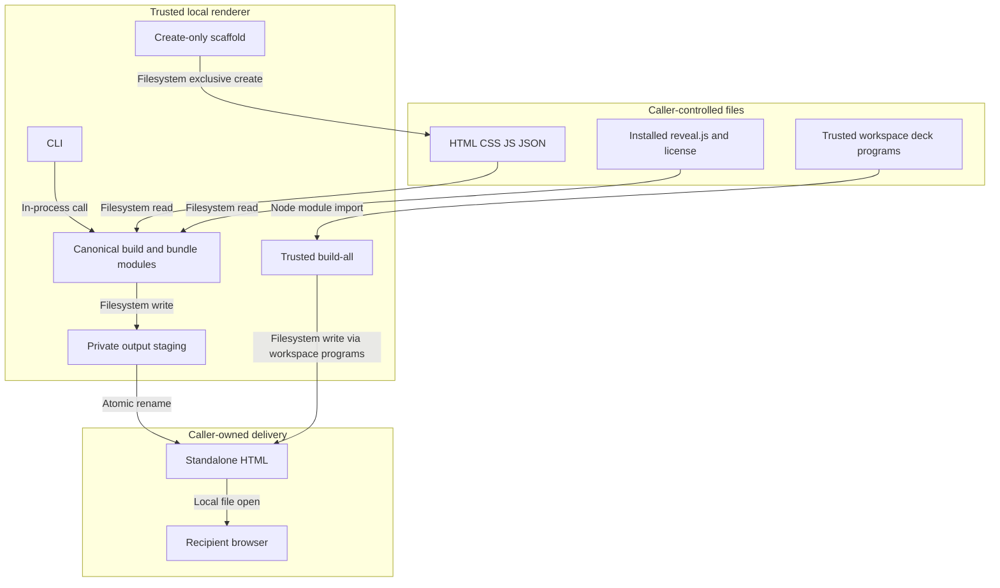

<!-- markdownlint-disable-file -->
# HVE Slides Skill Security Model

`scripts/render-deck.mjs` and `templates/deck/{build,bundle}.mjs` parse caller-owned source and produce standalone HTML. `scripts/create-deck.mjs` scaffolds new decks; `scripts/build-decks.mjs` executes trusted workspace bundlers. B1 covers source/dependency parsing, B2 covers rendering output and recipient execution, and B3 covers authoring/workspace execution. Each bucket enumerates all six STRIDE categories. Browser code is not executed during render-only Node bundling.

> See also: [repo-wide STRIDE model](https://github.com/microsoft/hve-core/blob/main/docs/security/security-model.md).

## Executive Summary

Rendering requires explicit source and output paths and imports only installed canonical build modules. Fixed source filenames, regular-file reads, ancestor link refusal, reveal.js pin/patch checks and staged final replacement limit the local write surface. This is not a sanitizer for authored JavaScript. Operator-controlled directories and review before opening remain required.

Authoring uses the caller's working directory or explicit workspace root, never installation ancestry. Scaffolding refuses existing destinations. Build-all imports workspace deck programs with the operator's privileges and is restricted to trusted workspaces; imported content uses render-only mode instead.

### Security Posture Overview

| Surface      | Control                                                 | Residual                                           |
|--------------|---------------------------------------------------------|----------------------------------------------------|
| Source reads | Fixed files, no-follow handles and identity checks      | Concurrent ancestor replacement by a local writer  |
| Dependencies | Pinned reveal.js and exact patch anchors                | Compromised local installation                     |
| Output       | Explicit destination, private staging and rename        | Operator approval of destination and content       |
| Browser      | Resource markup rejection                               | Authored JavaScript can create requests at runtime |
| Authoring    | Explicit/caller workspace, create-only scaffold         | Operator selects and trusts workspace              |
| Build-all    | Regular deck-module check, declared output verification | Workspace programs execute with Node privileges    |

## Contents

* [System Description](#system-description)
* [Trust Boundaries](#trust-boundaries)
* [Assets](#assets)
* [Adversaries](#adversaries)
* [Bucket B1 Source and Dependency Parsing](#bucket-b1-source-and-dependency-parsing)
* [Bucket B2 Output and Recipient Execution](#bucket-b2-output-and-recipient-execution)
* [Bucket B3 Authoring and Trusted Workspace Builds](#bucket-b3-authoring-and-trusted-workspace-builds)
* [Enterprise Readiness Gaps](#enterprise-readiness-gaps)
* [References](#references)

## System Description

### Components

* CLI: explicit `--deck-dir`, `--output`, optional `--check`; no caller program import
* Build module: fixed source files, generated configuration and locally installed vendor assets
* Bundler: ordered embedding, resource/raw-text checks, pinned reveal.js patches and notices
* Standalone output: caller-owned HTML with inert provenance; executable browser code when opened
* Scaffold: fixed template inventory, slug/title validation and exclusive creation in caller `slides/`
* Build-all: sorted workspace deck discovery and dynamic import of trusted `bundle.mjs` exports

### Data Flow



## Trust Boundaries

### Boundary Diagram

```text
+----------------------+    +----------------------+    +----------------------+
| Caller source/vendor | -> | Installed Node code  | -> | Caller output        |
| HTML/CSS/JS/JSON     |    | Parse, embed, stage  |    | Recipient browser    |
+----------------------+    +----------------------+    +----------------------+
```

### Boundary Descriptions

| Boundary                       | Protected asset         | Control                                                            |
|--------------------------------|-------------------------|--------------------------------------------------------------------|
| Source to renderer             | Host process            | No dynamic caller imports; input consumed as strings               |
| Renderer to filesystem         | Source and installation | Explicit output outside source/install; link checks and rename     |
| HTML to browser                | Recipient context       | Review and isolated validation owned by caller; no sanitizer claim |
| Workspace program to build-all | Host process            | Operator trust required; regular-file checks are not sandboxing    |

## Assets

| ID | Asset                                         |
|----|-----------------------------------------------|
| A1 | Caller source, notes and embedded information |
| A2 | Host filesystem and installed renderer        |
| A3 | Final HTML integrity and dependency notices   |
| A4 | Recipient browser context                     |

## Adversaries

| ID    | Capability                                                    |
|-------|---------------------------------------------------------------|
| ADV-a | Supplies crafted source or substitutes local dependency files |
| ADV-b | Concurrent local writer with access to caller directories     |
| ADV-c | Recipient or publisher redistributes private embedded notes   |

## Bucket B1 Source and Dependency Parsing

### Spoofing

Installed reveal.js must equal the source manifest pin and supported `6.0.2`. Exact patch-anchor counts reject incompatible copies; these checks do not attest the entire local npm installation.

### Tampering

Fixed source files are read through regular-file handles with no-follow flags and identity checks. Assets use constrained relative CSS/JS paths. Resource markup, CSS imports/nonembedded URLs and raw-text delimiters are rejected. Local directory replacement races remain outside the single-user trust assumption.

### Repudiation

Inert deterministic provenance records generator identity, reveal.js version, applied patches and passed checks. It is not a signature or authorship attestation.

### Information Disclosure

The bundler does not fetch remote resources, read credentials or execute source scripts. All supplied notes and strings enter the shareable HTML; no automated classification gate detects private content.

### Denial of Service

Source files are loaded into memory. There is no aggregate size or process-memory limit; the caller must bound imported content before rendering.

### Elevation of Privilege

The CLI statically imports its own modules rather than caller `build.mjs`. Authored JavaScript remains inert during Node bundling. A compromised installed module or interpreter already has the operator's authority.

### Risk Rating

| Threat                         | Likelihood | Impact | Residual Risk | Status                   |
|--------------------------------|------------|--------|---------------|--------------------------|
| Source/dependency substitution | Low        | High   | Medium        | Partially mitigated      |
| Embedded private notes         | Medium     | Medium | Medium        | Operator review required |
| Oversized input                | Low        | Medium | Medium        | Open                     |

## Bucket B2 Output and Recipient Execution

### Spoofing

The CLI refuses source/output within the skill installation and final output within the source directory. Provenance describes transformation, not a trusted author or safe browser program.

### Tampering

Existing output must be a regular file. Source checks complete before staged final replacement. Exclusive staging avoids truncating the previous delivery on failure; cleanup removes only files in invocation-owned staging without recursive deletion.

### Repudiation

The CLI prints a built/checked path or reports failure. It does not provide a durable signed audit trail. The owning workflow records revision hashes and approval evidence when required.

### Information Disclosure

Resource rejection does not prevent authored JavaScript from constructing network requests at browser runtime. Review and offline browser validation are separate, mandatory consumer responsibilities before sharing sensitive material.

### Denial of Service

A failed operation can leave private staging for inspection if another writer changes its structure. Recipient JavaScript can consume browser resources; bundling is not runtime execution or a timeout boundary.

### Elevation of Privilege

No shell, network, package script or browser is invoked by the CLI. Browser execution uses the recipient's privileges when the file is opened. Do not open unreviewed output in a credential-bearing browser profile.

### Risk Rating

| Threat                      | Likelihood | Impact | Residual Risk | Status                                   |
|-----------------------------|------------|--------|---------------|------------------------------------------|
| Filesystem redirection race | Low        | High   | Medium        | Operator-controlled directories required |
| Runtime script behavior     | Medium     | High   | Medium        | Caller review/isolation required         |
| Misattributed delivery      | Low        | Medium | Low           | Provenance, not attestation              |

## Bucket B3 Authoring and Trusted Workspace Builds

### Spoofing

The explicit workspace or current working directory selects the authoring root. Roots inside the skill installation are rejected. Workspace selection is an operator decision, not an authenticity check on its contents.

### Tampering

Scaffolding reads the fixed canonical template through validated regular-file handles, rejects unsafe slugs and linked slide destinations, and creates files exclusively without overwriting a deck. Build-all rejects linked deck directories and nonregular bundlers, but trusts their executable contents. A local writer can still race directory checks.

### Repudiation

Commands report created, built or checked paths and failures. A partial scaffold is left for inspection rather than recursively removed. Revision and approval records are owned by the caller; command output is not signed evidence.

### Information Disclosure

Scaffolding copies only the declared template files, not dependencies or private workspace files. Build-all imports trusted workspace modules that can read any data accessible to Node. Reviewing that code before invocation is required; render-only source rules do not constrain these modules.

### Denial of Service

Build-all stops on the first failed deck and preserves earlier outputs. Imported programs have no timeout or memory bound. Large or nonterminating workspace programs remain an operator-trust risk.

### Elevation of Privilege

Workspace bundlers execute with the user's Node privileges. Regular-file checks and returned-output validation do not sandbox them or prevent additional writes. Never use build-all for untrusted content; the render-only CLI avoids these imports.

### Risk Rating

| Threat                                 | Likelihood | Impact | Residual Risk | Status                                   |
|----------------------------------------|------------|--------|---------------|------------------------------------------|
| Untrusted workspace module execution   | Medium     | High   | High          | Trusted workspaces only                  |
| Incorrect workspace selection          | Low        | Medium | Low           | Explicit root and overwrite refusal      |
| Concurrent local directory replacement | Low        | High   | Medium        | Operator-controlled directories required |

## Enterprise Readiness Gaps

| ID      | Severity        | Gap                                                                             | Status                                                    |
|---------|-----------------|---------------------------------------------------------------------------------|-----------------------------------------------------------|
| G-TAM-1 | Tampering-Med   | Ancestor checks are not a filesystem sandbox against a concurrent local writer. | Open; use private caller directories                      |
| G-INF-1 | InfoDisc-Med    | No classification gate for embedded notes or strings.                           | Operator review                                           |
| G-DOS-1 | DoS-Med         | No aggregate input-size limit or runtime browser resource cap.                  | Caller containment                                        |
| G-EOP-1 | EoP-Med         | Bundling does not sanitize authored browser JavaScript.                         | Review and offline isolated validation                    |
| G-EOP-2 | EoP-High        | Build-all executes workspace-authored Node modules without sandboxing.          | Trusted workspaces only; render-only for imported content |
| G-SUP-1 | SupplyChain-Med | Pin/anchors do not attest the complete local dependency installation.           | Locked restore and host trust                             |

## References

* [Node.js filesystem API](https://nodejs.org/api/fs.html)
* [reveal.js](https://revealjs.com/)
* [HVE Slides source](https://github.com/microsoft/hve-core/tree/main/.github/skills/experimental/hve-slides)

---

🤖 *Crafted with precision by ✨Copilot following brilliant human instruction, then carefully refined by our team of discerning human reviewers.*
