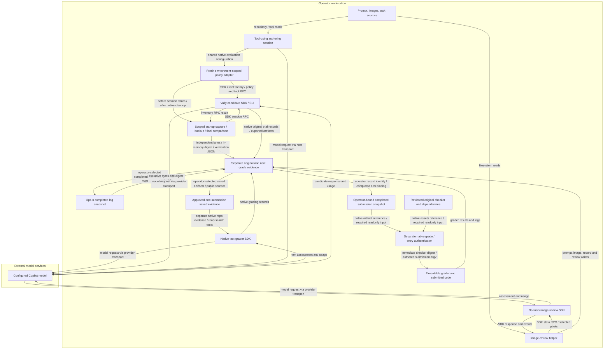

<!-- markdownlint-disable-file -->
# Skill Effectiveness Skill Security Model

The shipped `scripts/native-inventory.mjs` and `scripts/review-images.mjs` helpers
and `scripts/restricted-copilot-executor.mjs` plugin with its optional
`scripts/native-windows-sandbox.mjs` helper are copied into
operator-authored evaluation packages. B1 covers imported local
inputs, native executable grading, inventory capture, and evidence persistence.
B2 covers tool-using intake, candidate sessions, and external model review.
Each bucket enumerates all six STRIDE categories.
Tests use mocks by default; native startup smoke coverage is separately opt-in.

> See also: [repo-wide STRIDE model](https://github.com/microsoft/hve-core/blob/main/docs/security/security-model.md#skill-security-models).

## Executive Summary

This skill helps an operator author and interpret a matched A/B comparison.
It is not an isolation boundary, spending controller, or automatic adoption gate.
Image review can disclose the supplied prompt and images to an external model.
Inventory capture records available skills before the first prompt but cannot
establish that later context is uncontaminated.
Normal candidate execution independently backs up startup bytes and compares
both copies against an in-memory digest after native execution. This is a
supervised consistency check, not candidate-resistant host attestation.
The candidate adapter stores inventory/backup/verification files in an explicit
durable operator audit directory, outside candidate workspace listings. It requires
absolute disjoint audit/workspace roots and checks canonical-path overlap.
This avoids diagnostic-name exposure and accidental candidate interference;
path separation is not an OS access-control boundary.

The templates do not establish verified candidate/grader containment. The
[restricted execution profile](references/experiment-method.md#restricted-execution-profile)
targets released Vally 0.19.0, SDK 1.0.15 and CLI baseline 1.0.89 through a thin
public-factory adapter. Its source validates policy, injects explicit tools and
managed permissions, denies host approval requests and checks tool metadata
before returning a session. Only fresh environment-scoped sessions are supported;
the supported stdio connection explicitly selects the installed platform binary.
Inherited host-agent controls are removed from a child-only environment copy;
configured provider/authentication variables remain in the generic profile.
The optional `windows-native` profile removes inherited Copilot/GitHub tokens
and Copilot provider variables, uses normal local sign-in, disables shell
credential injection and applies the native command sandbox before returning a
session. It denies audit/authentication paths, bypass and command networking.
This is not removal of arbitrary secrets or protection of offline graders.
Custom instructions, on-demand instruction discovery, extensions,
file hooks, host Git context and cross-session storage are disabled separately.
Actual custom-instruction sources must be empty and enabled skill paths must
match the explicitly supplied directories before a prompt is permitted.
An explicit `clientMode: empty` opts into the public SDK's empty client with
private runtime state beneath the external audit root. This suppresses the
observed nested-repository instruction index; it does not filter the inventory
or relax the empty-source guard. Default/provider behavior is unchanged when
the option is omitted. Full-checkout startup and intercepted-request regressions
cover the selected mode; private runtime state is not a credential sandbox.
The adapter supplies only the actual workspace/OS as controlled environment
context in empty mode, without restoring automatic instruction discovery.
Conflicting caller environment-section/full-system overrides reject.
default-mode and resume requests reject. Registration rejects older installed
package versions. Completed model-free checks cover Ubuntu package mechanics,
actual decoding, SDK policy, synthetic role containment and no-prompt startup
retention on tested profiles. A separate Windows-native model-free regression
checks normal-login startup, Node execution and protected-file/write/network
controls. Neither route qualifies arbitrary tasks, successful model-driven
execution or every subsequent source revision.
The [execution evidence and limits](references/experiment-method.md#completed-model-free-evidence-and-limits)
retain exact run results and profile qualifications.
Tool-using intake, candidate tools, executable graders and no-tools review have
different authority; a reviewer restriction does not protect the other roles.
An optional Linux rendering regression exercises Chromium user namespaces and
actual Mermaid output in an operator-supplied pinned image/profile. The reviewed
profile permits namespace creation and `chroot` without granting host
capabilities; it retains no-new-privileges, nonroot execution and denied egress.
This observation does not qualify arbitrary images, native CLI export,
readonly submission binding or online reviewer behavior. The skill does not
redistribute a downloaded profile or browser binary.
Untrusted execution remains blocked until required boundaries are implemented
and observed. Financial approval cannot waive those prerequisites.

### Security Posture Overview

| Dimension          | Value                                                                                                                    |
|--------------------|--------------------------------------------------------------------------------------------------------------------------|
| Runtime surface    | Tool-using intake, native candidates/graders, scoped startup capture/backup, optional log snapshots and SDK image review |
| Trust buckets      | B1 local content and evidence; B2 runtime and model                                                                      |
| Credentials        | SDK/CLI-managed account authentication; no custom token store                                                            |
| Network egress     | Copilot runtime/model services selected by the SDK and account                                                           |
| Open residual gaps | 8; highest severity High; planned controls do not close current gaps                                                     |

## Contents

* [System Description](#system-description)
* [Trust Boundaries](#trust-boundaries)
* [Assets](#assets)
* [Adversaries](#adversaries)
* [Bucket B1: Local Content and Evidence](#bucket-b1-local-content-and-evidence)
* [Bucket B2: Copilot Runtime and Model](#bucket-b2-copilot-runtime-and-model)
* [Enterprise Readiness Gaps](#enterprise-readiness-gaps)
* [References](#references)

## System Description

### Components

1. `SKILL.md` and references guide task selection, candidate extraction,
   fair comparison, evidence selection, authorization, and interpretation.
2. `scripts/native-inventory.mjs` bounds tool initialization and skill listing,
   then publishes the actual startup inventory and an independent backup.
   The session-policy factory retains its digest in per-execution memory and
   verifies both files after native execution/cleanup, publishing a separate
   verification outcome. Its configured durable audit root must be outside and
   disjoint from the candidate workspace, including after canonical resolution.
   The native temporary session-log root is not used for these files because
   CLI export deletes it after copying supported logs. A native CLI cleanup
   regression checks the durable originals, backups and reports survive.
   Errors preserve original bytes and initiating failures.
   A separately invoked diagnostic prototype preload remains available but is
   not part of the generated run command. The explicit `backup-log` command
   snapshots one selected completed log, never a home or session tree.
3. `scripts/review-images.mjs` validates approved-root prompt and PNG/JPEG inputs,
   bounds bytes/count/decoded pixels/base64 before SDK contact, then submits one
   no-tools image review with bounded waits and atomic status/failure records.
   Actual codec checks passed on Ubuntu; model vision and Windows compatibility
   remain unverified.
4. The candidate template stages only `fixtures/<task>/public` and collects
   public completion/delivery checks. A separate native `program` grade-only
   template authenticates a reviewed checker from reserved `EVALUATE_ASSETS`,
   consuming one bound snapshot from `EVALUATE_ARTIFACT_DIR` with distinct
   writable scratch. The optional review spec has only a prompt grader and receives an
   approved saved-evidence workspace, not that private grading view. Templates
   do not enforce role containment, retries or spending.
   Generated paid convenience aliases are omitted; the raw native CLI and
   image helper remain manually invocable. This is not financial enforcement.
5. Repository intake occurs in the tool-using authoring session. The candidate
   adapter does not change that session's authority. Intake requires reading and
   applying the public commit-pinned canonical instruction before target-source
   access, recording its revision, and stopping when activation is unavailable.
6. Executable graders can load candidate-controlled files or code. The current
   package does not isolate these processes from host files, credentials or
   network access. The authored entry-point authenticator rejects missing roots,
   digest/path errors and changed checker bytes; it does not protect mounts,
   authenticate dependencies or prove correct original-record/arm binding.
   Those controls and actual-route verification remain independent requirements.
7. `scripts/restricted-copilot-executor.mjs` delegates native execution/lifecycle
   to Vally through its public environment-aware client factory. Per-run policy
   context and bounded SDK preflight do not supply OS containment or authoritative
   host evidence. Pins match its registration gate and model-free Ubuntu
   package checks passed. Actual SDK policy enforcement passed on the tested
   hardened Linux profile. The optional native Windows helper validates host
   capabilities and applies a no-bypass, workspace-write, network-denied command
   policy, with explicit readonly/private paths and no SDK authentication token
   in the child environment. Unsupported platforms or failed preflight reject.
   The optional native-runtime regression uses fixed SDK request-handler
   responses without forwarding to a model. It checks treatment skill-body
   activation and native file-task completion, not model quality or OS isolation.

### Data Flow



## Trust Boundaries

### Boundary Diagram

```text
+------------------ Operator workstation -------------------+
| Imported sources -> tool-using authoring -> native Vally    |
| Shared session-policy plugin -> environment-scoped SDK     |
| Candidate SDK / CLI -> workspace -> executable grader      |
| Original record -> bound snapshot -> separate native grade |
| Approved saved evidence -> separate native text reviewer   |
| Scoped inventory + backup -> final consistency report     |
| Selected completed log -> explicit local backup           |
| Selected prompt / pixels -> no-tools image-review SDK      |
|------------------------------------------------------------|
| No candidate/grader OS boundary is enforced by the helpers |
| Account authentication is managed by SDK / CLI             |
+-----------------------|-----------------------------------+
                        | provider transport
+-----------------------v-----------------------------------+
|               External model services                     |
+-----------------------------------------------------------+
```

### Boundary Descriptions

| Boundary                      | Assets Protected                                         | Controls Enforced                                                                                                                          |
|-------------------------------|----------------------------------------------------------|--------------------------------------------------------------------------------------------------------------------------------------------|
| Input to helper               | Selected prompt and images                               | Approved root; detected-link rejection; opened-file identity; byte/count/pixel/base64 limits; actual Ubuntu decode passed; Windows pending |
| SDK to inventory              | Session identity and inventory                           | Required identity and enabled-state fields; capture before return; disconnect on failure                                                   |
| Helper to filesystem          | Prior evidence                                           | Exclusive complete writes; independent startup backup; bounded selected-log snapshots; image-review destination must be new                |
| Runtime to model              | Project content and account usage                        | Empty-mode image reviewer, no tools, rejected permissions, response timeout; no hard credit cap                                            |
| Repository to authoring tools | Authoring context and host authority                     | Imported content is untrusted; no helper-enforced intake sandbox                                                                           |
| Candidate to grader           | Checker integrity, host files, credentials and execution | No enforced candidate/grader OS separation; reviewer no-tools settings do not apply here                                                   |
| Candidate to startup evidence | Inventory provenance and comparison integrity            | In-memory startup digest checks both independent copies after execution; supervised detection, not an independent authority                |

The diagrams and controls above describe current mechanics. The planned native
boundary has separate candidate, offline executable-grading and online saved-review
roles. Its adapter applies explicit tool visibility,
native managed permission rules and an explicit deny fallback on supported fresh
environment-scoped sessions. Default-mode and resume requests reject before SDK
startup. Actual policy enforcement passed on the tested hardened Linux profile;
this does not qualify arbitrary task policies or older runtimes, which can
ignore injected managed policy.
Offline grading needs readonly executed inputs, an immediate pre-use checker
hash, a scrubbed credential-free environment and no egress. Online review must
not execute submissions. Stronger host-attested startup records, when required,
need independent write/delete authority; the supervised backup does not supply
that property. No candidate/grader OS boundary is credited to these helpers.

## Assets

| Id | Asset                                   | Lifetime                 | Notes                                                                               |
|----|-----------------------------------------|--------------------------|-------------------------------------------------------------------------------------|
| A1 | Task sources, prompt, images            | Input and saved evidence | May contain confidential information                                                |
| A2 | Account credentials and credits         | SDK/CLI-managed          | Helpers do not implement credential isolation or a credit cap                       |
| A3 | Inventories and assessment records      | Persisted locally        | Include source paths, session identity, hashes, and usage where available           |
| A4 | Baseline/treatment integrity            | One frozen comparison    | Inventory is evidence, not enforcement                                              |
| A5 | Private checkers and grader environment | Grading invocation       | Candidate-controlled code must not alter checks or inherit sensitive host authority |

## Adversaries

| Id    | Adversary                                               | In-scope mitigations                                                               |
|-------|---------------------------------------------------------|------------------------------------------------------------------------------------|
| ADV-a | Instructions embedded in imported sources or images     | Reviewer system message treats artifacts as untrusted; no tool permissions         |
| ADV-b | Another process or operator modifying local evidence    | Exclusive initial writes; input hashes; no tamper-evident audit store              |
| ADV-c | Contaminated runtime context or compromised dependency  | Explicit pins, recorded inventory, and source review; no OS sandbox                |
| ADV-d | Candidate-controlled code or artifacts reaching grading | Current helpers provide no immutable checker or credential-free execution boundary |

## Bucket B1: Local Content and Evidence

### Spoofing

The recorder requires an actual session ID and inventory entries with names and
enabled-state booleans. It does not independently attest the runtime response.
Moving a candidate-owned record to the host does not establish host provenance.

### Tampering

Inventory filenames encode the session ID. Complete records publish through an
exclusive temporary file and same-directory hard link without replacing existing
records; this is failure safety, not candidate-resistant storage. The native
session factory also publishes an independent startup copy before the prompt
and retains the expected digest in execution memory. Completion checks reject
changed/missing copies, shared-inode aliases and redirected paths, recording
verification errors without repairing originals. This detects ordinary changes,
including consistent edits to both copies, but does not protect the process,
its memory or all retained evidence against equivalent authority. The image
reviewer requires a new destination and records prompt/image hashes. Evidence
remains writable by the operator or another process with filesystem access.
Neither template overlays a private checker into a candidate/workspace tree.
The grade-only prelude checks distinct reserved roots and input paths, then
hashes the actual trusted entry immediately before import. It rejects prerequisite
failures as native grader errors; intact snapshots missing task output produce a
task failure without claiming checker execution. Authentication does not prevent
post-check races or protect dependency closures: readonly input protection and
trusted provisioning remain required. Operator-owned record/snapshot binding is
not automatic; a valid opposite-arm snapshot can still pass native grading.

### Repudiation

Inventories record timestamps and session IDs; completion reports retain their
expected digest and outcome. Native workspace preservation and explicit
operator mapping to the original trial are still required. Optional log
snapshots retain source, timestamp, byte count and SHA-256, not completeness
or independent session authentication. Image records retain requested
model, session identity, hashes, usage events, errors, and completion status.
There is no signature or append-only store.
Original records remain separate and byte-preserved; EVALS notes explicitly link
each new grade to native identity, config hashes and its snapshot. Normalized
grade output drops outer arm/trial metadata; that output alone cannot prove the
pairing or protected executed bytes. No tamper-evident binding store is provided.

### Information Disclosure

Saved inventories contain paths and skill descriptions. Image review persists
the full supplied prompt and image bytes. Optional log snapshots copy the entire
selected file and can retain prompts, source or credentials. They are never
collected or uploaded automatically. There is no redaction or custom ACL
enforcement; operators must select publishable content and protect the directory.
The separate diagnostic preload removes its evidence-directory variable before runtime
startup and does not log the directory on success; a closure is not isolation.
Local graders can load submitted code with the host's environment and authority;
reviewing saved text/pixels is not equivalent to safely executing that code.

### Denial of Service

Missing or empty inputs fail explicitly. Media preflight bounds prompt bytes,
image count, individual/aggregate bytes, decoded dimensions/pixels and base64
size before SDK contact. Read-only, nonblocking descriptor opens use no-follow
where supported; descriptor type, size and identity are validated before bytes
are read or buffers allocated. Canonical/link checks and path-to-descriptor
identity comparisons reject substitutions after open and during reading.
Stable opened bytes are decoded, copied and attached.
Windows change time alone is not content identity; device/inode, size and
modification time are checked before/after reads. These checks do not establish
hostile same-user race immunity. Actual Sharp full decode and clean frozen
standalone restore passed on Ubuntu; these checks alone do not qualify other
platforms or model vision.
Session creation has a 30-second maximum for first-use runtime extraction;
inventory initialization, listing and failure-path disconnect each have a
ten-second deadline with cleared timers, bounded by the native task timeout.
A deadline does not cancel the RPC or
prove shutdown. The diagnostic preload retains failure records; the scoped
factory propagates capture/backup and disconnect errors to native execution.
Completion verification retains both execution and evidence errors.
Startup-backup and optional log reads validate the opened descriptor before
reading, require nonempty regular files of at most 16 MiB and compare its
identity, size and modification time with the named path. This does
not establish hostile same-user race immunity or bound SDK response memory.
Log backup never truncates a large file into a success-shaped partial history.
Image decoder, client
creation/startup, model inventory, session creation, response and cleanup waits
are bounded. Image-review runtime startup allows at most thirty seconds;
other lifecycle operations retain a ten-second maximum and responses a
two-minute maximum. Records identify all three deadlines. Startup overruns still
fail before model-session creation; this headroom does not add retries, tools or
permissions. Atomic status writes retain failures, including terminal-persistence
errors. Timeout reports unconfirmed shutdown, not cancellation or a stopped
late-created client; the operator must inspect it before another invocation.

### Elevation of Privilege

Helpers do not execute input text as code. Generated executable graders can run
submitted code as well as operator-authored checkers. A fresh workspace is not
an OS sandbox. Required candidate and grader boundaries must be verified
independently before untrusted execution, including credential/egress denial
and protected checker/submission paths.

### Risk Rating

| Threat                              | Likelihood | Impact | Residual Risk | Status                                                                                                                                             |
|-------------------------------------|------------|--------|---------------|----------------------------------------------------------------------------------------------------------------------------------------------------|
| Sensitive local evidence exposed    | Med        | High   | Med           | Partially mitigated; operator-controlled storage                                                                                                   |
| Evidence or checkers changed        | Med        | High   | High          | Open; entry authentication does not enforce readonly inputs or arm binding                                                                         |
| Oversized inputs exhaust memory     | Med        | Med    | Med           | Partially mitigated; local input bounds do not limit SDK response memory                                                                           |
| Grader code inherits host authority | Med        | High   | High          | Partially mitigated by tested credential-free Linux rendering controls; full native grading route and immutable submission binding remain separate |

## Bucket B2: Copilot Runtime and Model

### Spoofing

Inventory capture checks the Vally and SDK versions. Image review records the
requested model and runtime-reported identity/usage, and checks advertised vision
capability. Capability metadata does not prove actual image understanding.
Tool-using intake can ingest source instructions that impersonate operator
authority. Session identity does not make those instructions trusted.
The [intake activation step](references/repository-intake.md#required-policy-activation)
requires the canonical boundary to be read and applied before source inspection,
including in a standalone copy. This is procedural guidance, not a demonstrated
prompt-injection defense or a restriction on the authoring session's tools.
The candidate connection selects the installed platform executable rather than
relying on an ignored legacy CLI-path option. Package-version checks and that
selection do not independently attest the executable's bytes.

### Tampering

The recorder preserves session configuration and disconnects on capture failure.
Disconnect is attempted once with a bounded wait; late RPC completion cannot
resume capture or erase the failure record. Actual runtime shutdown is unverified
after a timeout, and Vally retains runtime cleanup ownership.
The recorder alone does not reject ambient skills or prevent later context
changes. The candidate adapter rejects enabled skills outside the requested
directories and nonempty custom-instruction sources. Requested skills also
require the native skill tool; registration alone is insufficient evidence of
model exposure. The runtime may omit skill in a no-skill baseline, which is
recorded alongside the actual tool inventory. Later model context and actual
activation still require trace inspection. Neither inventory check restricts
candidate filesystem access by itself.
The adapter source applies restrictions to fresh environment-scoped sessions and
replacement clients, with per-execution policy context. Default-mode and resume
paths reject. Policy/code immutability to the candidate still requires independent
native protection; a writable plugin is not a security boundary.

### Repudiation

Image review preserves its response and runtime errors. Native Vally records
trials and trajectories separately. Missing usage remains unknown, and native
aggregate scores do not establish skill value.
Do not merge incomparable usage units into a monetary total or use missing
usage as evidence of compliance.

### Information Disclosure

The image reviewer sends the selected prompt and image bytes to the configured
model service. Native prompt graders can send workspace text snapshots.
The separate review spec limits intended inputs to approved saved artifacts and
public sources; operators must inspect snapshot coverage and residual condition
clues. It has no executable grader or private overlay. Native 0.19.0's workspace
judge selects read/search and verdict tools, but exact-stack enforcement and
review-role containment remain unverified; candidate policy does not cover it.
Authorization and publication review are operator responsibilities.
Current candidate/grader separation does not establish protection of
model-runtime authentication from candidate-accessible reads or executable code.
Task-specific permission tests must establish useful operations as well as
denials. An exact directory-listing grant can disclose filenames even when
protected root and descendant file reads reject. Keep evaluator originals and
private notes outside the listed workspace; do not substitute a recursive read.
Native audit records and operator policy receipts must also remain outside
candidate directory listings. The adapter fails closed without an absolute,
disjoint durable audit root rather than falling back to candidate-visible or
native temporary storage.
The generic child-environment filter removes host execution controls, not
configured provider credentials. Only the opt-in Windows profile strips the
known Copilot/GitHub authentication variables and applies its command policy.
It does not redact arbitrary environment secrets. Filesystem and shell policies still need independent
credential-access qualification.
The image reviewer's no-tools policy does not apply to repository intake.
Canonical intake activation does not remove credentials or restrict filesystem
or network authority; publication and containment checks remain independent.

### Denial of Service

Paid execution requires operator approval of the run scope, budget and native
retry/reminder behavior. Manual reruns and scope expansion need fresh approval.
Record a supervised target separately from a required enforced maximum. Stop
before the next invocation after approved scope or reported usage reaches its
limit; this does not cancel in-flight requests or native retries. Missing or
incomparable usage needs explicit continuation unless prior approval covers that
specific bounded unknown-usage scope.
Image review has a two-minute response timeout, aborts failed sessions, and stops
the client without scripted retries. These are supervised operational controls,
not financial enforcement. Neither this timeout nor Vally limits enforce a hard
credit cap. A required enforced ceiling must come from the provider or runtime.
The policy adapter bounds each session-creation/tool RPC and failed-session
disconnect to at most ten seconds, further limited by the native timeout.
It preserves startup and cleanup errors; a deadline does not cancel a pending
operation or prove shutdown. Vally still owns client cleanup.

### Elevation of Privilege

Image review uses empty mode, no available tools, rejected permission requests,
and disabled infinite sessions. These controls apply to the reviewer, not the
Vally candidate. Dependencies and the local runtime execute with host privileges.
The built-in candidate executor's approving permission path is not deny-by-default.
The distinct adapter source replaces that handler with explicit tools, native
managed rules and the canonical `{ kind: "reject" }` denial callback. Malformed
permission responses are operational failures, not verified policy denials.
Actual SDK policy and synthetic native-role containment passed on the tested
public-stack Linux profile. These results do not qualify arbitrary task
policies or authenticated model-task boundaries. The Windows-native regression
checks a separate explicit command policy, not enterprise enforcement or the
offline grader. No gap is
closed by mocked wiring. Broad shell/interpreter access is not safe merely
because a session is fresh.

### Risk Rating

| Threat                                                | Likelihood | Impact | Residual Risk | Status                                                                                                                                          |
|-------------------------------------------------------|------------|--------|---------------|-------------------------------------------------------------------------------------------------------------------------------------------------|
| Unauthorized content sent to model                    | Med        | High   | Med           | Partially mitigated; supervised input selection                                                                                                 |
| Ambient context invalidates comparison                | Med        | High   | High          | Detection only; no enforced isolation                                                                                                           |
| Imported instructions reach authoring/candidate tools | Med        | High   | High          | Open; actual SDK policy tested on the hardened profile, not arbitrary useful task policies or intake                                            |
| Runtime credentials exposed to untrusted execution    | Med        | High   | High          | Partially mitigated for optional Windows command policy; generic provider environment and authenticated full-task boundaries need qualification |
| Calls exceed approved budget                          | Med        | High   | High          | Operator-approved scope; no financial enforcement; block if a required hard cap is unavailable                                                  |
| Dependency integrity inadequate                       | Low        | High   | Med           | Mitigated; canonical URLs and SHA-512 integrity                                                                                                 |

## Enterprise Readiness Gaps

Ratings are qualitative project assessments, not CVSS scores.

| Id      | Gap                                                                                                   | Severity         | Status                                                                                                                                                            |
|---------|-------------------------------------------------------------------------------------------------------|------------------|-------------------------------------------------------------------------------------------------------------------------------------------------------------------|
| G-INF-1 | Prompt, image, and inventory evidence has no redaction or custom access control                       | InfoDisc-Med     | Operator must protect inputs and outputs and review before sharing                                                                                                |
| G-TAM-1 | Startup capture does not enforce candidate isolation or cover later context                           | Tampering-High   | Explicit empty client mode and full-checkout tests address nested instruction discovery; unchanged empty-source guard and later trace inspection remain required  |
| G-DOS-1 | Pinned native execution and review paths lack an enforced credit cap                                  | DoS-High         | Supervise approved targets; stop before the next invocation; block if a required enforced maximum is unavailable                                                  |
| G-DOS-2 | Actual model-driven image review and platform lifecycle still need verification                       | DoS-Med          | Partially mitigated; tested decoding and bounded lifecycle; separate startup deadline; qualify each task/platform and inspect unconfirmed shutdowns               |
| G-EOP-1 | Tool-using intake and useful task-specific candidate authority need separate qualification            | EoP-High         | Open; tested Windows commands and Linux namespace rendering do not qualify arbitrary tasks, native export or readonly submission binding; intake remains separate |
| G-TAM-2 | Writable checker/dependencies or incorrect original-record/snapshot binding can invalidate grading    | Tampering-High   | Open; separate authored entry authentication exists, but readonly inputs, dependency provenance and manual arm binding still require verification                 |
| G-INF-2 | Real model-task authentication and credential/egress boundaries require profile-specific verification | InfoDisc-High    | Partially mitigated by optional native Windows normal-login command policy; generic provider environment and full-task/grader boundaries remain open              |
| G-TAM-3 | Supervised startup backups are not independent host attestation                                       | Tampering-High   | Open for stronger assurance; independent bytes and in-memory-digest comparison detect changes but cannot protect runtime memory or every retained copy            |
| G-SUP-1 | Dependency provenance requires canonical registry URLs and strong integrity                           | SupplyChain-High | Mitigated by the frozen public npm lockfile with canonical URLs and SHA-512 integrity                                                                             |

## References

* [Native execution and evidence](references/experiment-method.md)
* [Visual review](references/visual-review.md)
* [Source-grounded review](references/holistic-review.md)
* [Responsible use of GitHub Copilot](https://docs.github.com/en/copilot/responsible-use)
* [npm registry](https://registry.npmjs.org/)

🤖 Crafted with precision by ✨Copilot following brilliant human instruction, then carefully refined by our team of discerning human reviewers.
