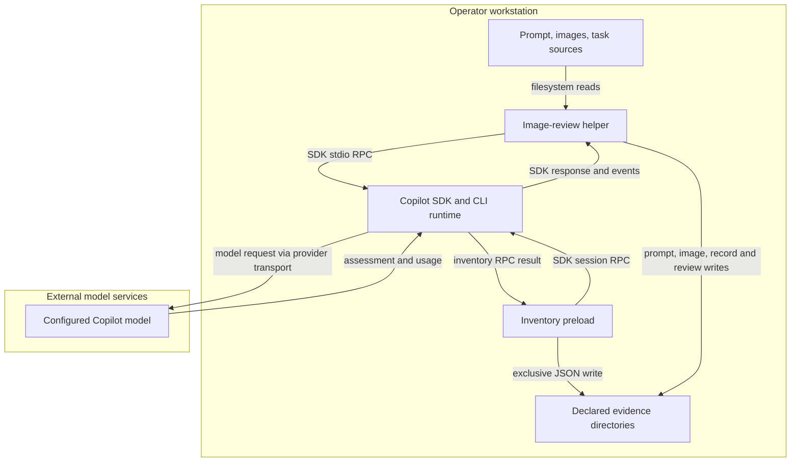

<!-- markdownlint-disable-file -->
# Skill Effectiveness Skill Security Model

The shipped `assets/native-inventory.mjs` and `assets/review-images.mjs` helpers
are copied into operator-authored evaluation packages. B1 covers local inputs,
inventory capture, and evidence persistence. B2 covers the Copilot runtime and
external model review. Each bucket enumerates all six STRIDE categories.
Tests use mocks by default; native startup smoke coverage is separately opt-in.

> See also: [repo-wide STRIDE model](https://github.com/microsoft/hve-core/blob/main/docs/security/security-model.md#skill-security-models).

## Executive Summary

This skill helps an operator author and interpret a matched A/B comparison.
It is not an isolation boundary, spending controller, or automatic adoption gate.
Image review can disclose the supplied prompt and images to an external model.
Inventory capture records available skills before the first prompt but cannot
establish that later context is uncontaminated.

### Security Posture Overview

| Dimension          | Value                                                                           |
|--------------------|---------------------------------------------------------------------------------|
| Runtime surface    | Node preload, SDK runtime subprocess, local evidence writes, and model requests |
| Trust buckets      | B1 local content and evidence; B2 runtime and model                             |
| Credentials        | SDK/CLI-managed account authentication; no custom token store                   |
| Network egress     | Copilot runtime/model services selected by the SDK and account                  |
| Open residual gaps | 3; highest severity High                                                        |

## Contents

* [System Description](#system-description)
* [Trust Boundaries](#trust-boundaries)
* [Assets](#assets)
* [Adversaries](#adversaries)
* [Bucket B1: Local Content and Evidence](#bucket-b1-local-content-and-evidence)
* [Bucket B2: Copilot Runtime and Model](#bucket-b2-copilot-runtime-and-model)
* [Enterprise Readiness Gaps](#enterprise-readiness-gaps)
* [References](#references)

## System Description

### Components

1. `SKILL.md` and references guide task selection, candidate extraction,
   fair comparison, evidence selection, authorization, and interpretation.
2. `assets/native-inventory.mjs` wraps the pinned SDK's session creation,
   initializes tools, reads the skill inventory, and persists it before return.
3. `assets/review-images.mjs` reads an operator-selected prompt and PNG/JPEG
   files, starts an empty-mode SDK runtime, and submits one image review request.
4. Native Vally templates select candidate execution and graders. The helper
   does not control Vally's candidate permissions, retries, or spending.

### Data Flow



## Trust Boundaries

### Boundary Diagram

```text
+---------------- Operator workstation ----------------+
| Files -> helper -> SDK / local CLI -> evidence files |
|------------------------------------------------------|
| account authentication managed by SDK / CLI          |
+------------------|----------------------------------+
                   | provider transport
+------------------v----------------------------------+
|           External Copilot/model services            |
+-----------------------------------------------------+
```

### Boundary Descriptions

| Boundary             | Assets Protected                  | Controls Enforced                                                                               |
|----------------------|-----------------------------------|-------------------------------------------------------------------------------------------------|
| Input to helper      | Selected prompt and images        | Nonempty prompt/media; supported extensions; missing-file errors                                |
| SDK to inventory     | Session identity and inventory    | Required identity and enabled-state fields; capture before return; disconnect on failure        |
| Helper to filesystem | Prior evidence                    | Exclusive inventory writes; image-review destination must be new                                |
| Runtime to model     | Project content and account usage | Empty-mode image reviewer, no tools, rejected permissions, response timeout; no hard credit cap |

## Assets

| Id | Asset                              | Lifetime                 | Notes                                                                     |
|----|------------------------------------|--------------------------|---------------------------------------------------------------------------|
| A1 | Task sources, prompt, images       | Input and saved evidence | May contain confidential information                                      |
| A2 | Account credentials and credits    | SDK/CLI-managed          | Helpers do not implement credential isolation or a credit cap             |
| A3 | Inventories and assessment records | Persisted locally        | Include source paths, session identity, hashes, and usage where available |
| A4 | Baseline/treatment integrity       | One frozen comparison    | Inventory is evidence, not enforcement                                    |

## Adversaries

| Id    | Adversary                                              | In-scope mitigations                                                       |
|-------|--------------------------------------------------------|----------------------------------------------------------------------------|
| ADV-a | Instructions embedded in imported sources or images    | Reviewer system message treats artifacts as untrusted; no tool permissions |
| ADV-b | Another process or operator modifying local evidence   | Exclusive initial writes; input hashes; no tamper-evident audit store      |
| ADV-c | Contaminated runtime context or compromised dependency | Explicit pins, recorded inventory, and source review; no OS sandbox        |

## Bucket B1: Local Content and Evidence

### Spoofing

The recorder requires an actual session ID and inventory entries with names and
enabled-state booleans. It does not independently attest the runtime response.

### Tampering

Inventory filenames encode the session ID and use exclusive creation. The image
reviewer requires a new destination and records prompt/image hashes. Evidence
remains writable by the operator or another process with filesystem access.

### Repudiation

Inventories record timestamps and session IDs. Image records retain requested
model, session identity, hashes, usage events, errors, and completion status.
There is no signature or append-only store.

### Information Disclosure

Saved inventories contain paths and skill descriptions. Image review persists
the full supplied prompt and image bytes. There is no redaction or custom ACL
enforcement; operators must select publishable content and protect the directory.

### Denial of Service

Missing or empty inputs fail explicitly. Image extensions are checked, but there
is no byte-size cap or image decoding preflight before files are read into memory.

### Elevation of Privilege

Helpers do not execute input text as code. Generated evaluations can invoke
operator-authored checker programs under Vally. Review those programs before
execution; generated workspaces are not an OS sandbox.

### Risk Rating

| Threat                           | Likelihood | Impact | Residual Risk | Status                                           |
|----------------------------------|------------|--------|---------------|--------------------------------------------------|
| Sensitive local evidence exposed | Med        | High   | Med           | Partially mitigated; operator-controlled storage |
| Evidence changed after capture   | Med        | Med    | Med           | Partially mitigated; hashes, no signed record    |
| Oversized inputs exhaust memory  | Med        | Med    | Med           | Open; no input-size limit                        |

## Bucket B2: Copilot Runtime and Model

### Spoofing

Inventory capture checks the Vally and SDK versions. Image review records the
requested model and runtime-reported identity/usage, and checks advertised vision
capability. Capability metadata does not prove actual image understanding.

### Tampering

The recorder preserves session configuration and disconnects on capture failure.
It does not reject ambient skills, prevent later context changes, or restrict
candidate filesystem access. Treat unexpected inventory as evidence to inspect.

### Repudiation

Image review preserves its response and runtime errors. Native Vally records
trials and trajectories separately. Missing usage remains unknown, and native
aggregate scores do not establish skill value.

### Information Disclosure

The image reviewer sends the selected prompt and image bytes to the configured
model service. Native prompt graders can send workspace text snapshots.
Authorization and publication review are operator responsibilities.

### Denial of Service

Image review has a two-minute response timeout, aborts failed sessions, and stops
the client without scripted retries. Neither this timeout nor Vally limits
enforce a hard credit cap.

### Elevation of Privilege

Image review uses empty mode, no available tools, rejected permission requests,
and disabled infinite sessions. These controls apply to the reviewer, not the
Vally candidate. Dependencies and the local runtime execute with host privileges.

### Risk Rating

| Threat                                 | Likelihood | Impact | Residual Risk | Status                                          |
|----------------------------------------|------------|--------|---------------|-------------------------------------------------|
| Unauthorized content sent to model     | Med        | High   | Med           | Partially mitigated; supervised input selection |
| Ambient context invalidates comparison | Med        | High   | High          | Detection only; no enforced isolation           |
| Calls exceed required spending cap     | Med        | High   | High          | Paid path blocked when a hard cap is required   |
| Dependency integrity inadequate        | Low        | High   | Med           | Mitigated; canonical URLs and SHA-512 integrity |

## Enterprise Readiness Gaps

Ratings are qualitative project assessments, not CVSS scores.

| Id      | Gap                                                                                                    | Severity         | Status                                                                          |
|---------|--------------------------------------------------------------------------------------------------------|------------------|---------------------------------------------------------------------------------|
| G-INF-1 | Prompt, image, and inventory evidence has no redaction or custom access control                        | InfoDisc-Med     | Operator must protect inputs and outputs and review before sharing              |
| G-TAM-1 | Startup capture does not enforce candidate isolation or cover later context                            | Tampering-High   | Supervised inspection and symmetric exclusions required                         |
| G-DOS-1 | Pinned native execution and review paths lack an enforced credit cap; media also lacks a byte-size cap | DoS-High         | Do not authorize paid execution requiring an unavailable hard cap               |
| G-SUP-1 | Imported lockfile previously contained SHA-1 entries                                                   | SupplyChain-High | Resolved; regenerated from public npm with canonical URLs and SHA-512 integrity |

## References

* [Native execution and evidence](references/experiment-method.md)
* [Visual review](references/visual-review.md)
* [Source-grounded review](references/holistic-review.md)
* [Responsible use of GitHub Copilot](https://docs.github.com/en/copilot/responsible-use)
* [npm registry](https://registry.npmjs.org/)

🤖 Crafted with precision by ✨Copilot following brilliant human instruction, then carefully refined by our team of discerning human reviewers.
