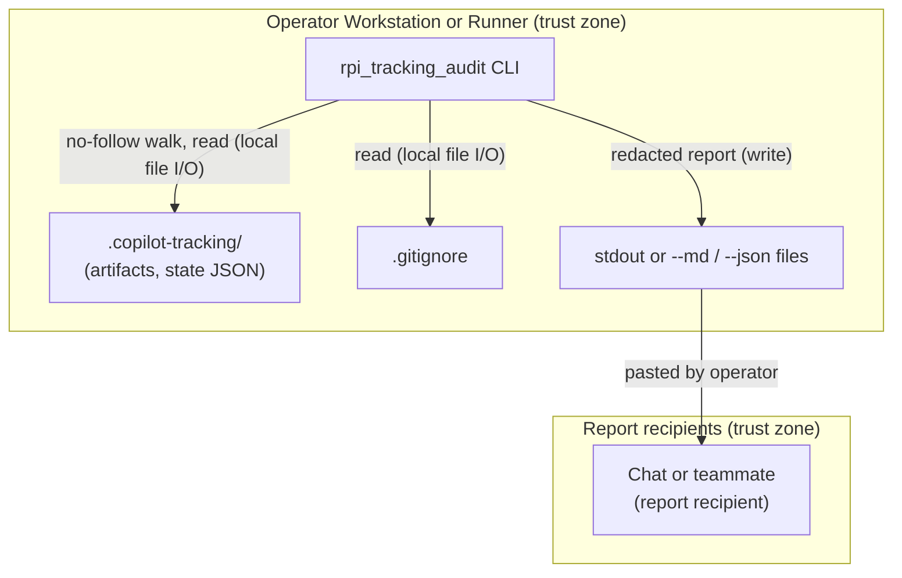

<!-- markdownlint-disable-file -->
# RPI Tracking Audit Skill Security Model

This model covers the runtime of the `rpi-tracking-audit` skill: the standard-library Python package `scripts/rpi_tracking_audit/` (`__main__.py`, `_cli.py`, `_discovery.py`, `_markdown.py`, `_models.py`, `_audit.py`, `_render.py`, `_rules.py`). It decomposes the runtime into three trust buckets: B1 tracking-file parsing, B2 credential-shaped content and report disclosure, and B3 filesystem traversal and report writes. Each bucket enumerates all six STRIDE categories with the in-code mitigations that address them.

> **See also: repo-wide STRIDE model.** This skill participates in the repository-wide threat model recorded in [docs/security/security-model.md](../../../../docs/security/security-model.md) and is registered in its Skill Security Models section.

## Executive Summary

The skill reads the RPI tracking artifacts and RPI session state files under a workspace's `.copilot-tracking/` folder and writes a Markdown or JSON report to stdout or to operator-named files. Tracking files can carry text copied from external research and, by accident, credentials, and reports are meant to be pasted into chats and handed to teammates. The highest-risk behavior is therefore disclosure of a credential through a report; the runtime redacts credential-shaped values before parsing any field, but detection is pattern-based. There is no network egress, no subprocess, and no credential use.

### Security Posture Overview

| Dimension          | Value                                                                                                                                          |
|--------------------|------------------------------------------------------------------------------------------------------------------------------------------------|
| Runtime surface    | Local Python CLI; regex parse of tracking Markdown; `json.loads` of state files; no-follow directory walk; stdout or report files              |
| Trust buckets      | B1 tracking-file parsing, B2 credential-shaped content and report disclosure, B3 filesystem traversal and report writes                        |
| Credentials        | None used; credential-shaped values found in tracking files are redacted from every output; pattern matches are reported by file and line      |
| Network egress     | None                                                                                                                                           |
| Open residual gaps | 4 (InfoDisc-Med pattern-based secret detection; Tampering-Low quoted artifact text; DoS-Low unbounded Markdown reads; Tampering-Low overwrite) |

## Contents

* [System Description](#system-description)
* [Trust Boundaries](#trust-boundaries)
* [Assets](#assets)
* [Adversaries](#adversaries)
* [Bucket B1: Tracking-file parsing](#bucket-b1-tracking-file-parsing)
* [Bucket B2: Credential-shaped content and report disclosure](#bucket-b2-credential-shaped-content-and-report-disclosure)
* [Bucket B3: Filesystem traversal and report writes](#bucket-b3-filesystem-traversal-and-report-writes)
* [Enterprise Readiness Gaps](#enterprise-readiness-gaps)
* [References](#references)

## System Description

### Components

1. `__main__.py` and `_cli.py`: parse arguments, validate them, run the audit, and write the report to stdout or to the `--md` and `--json` paths.
2. `_discovery.py`: locate `.copilot-tracking/` at the workspace root, walk it without following symbolic links, classify files by path, and load JSON files shaped like RPI session state.
3. `_markdown.py`: split Markdown into headings, markers, sections, bullets, and tables with anchored regular expressions, and redact credential-shaped values.
4. `_models.py` and `_audit.py`: derive per-artifact models, evaluate the rules, and derive task state and next actions.
5. `_render.py`: render the Markdown report and the JSON object, applying redaction to every string.
6. `_rules.py`: the rule table, vocabularies, and patterns, including the credential patterns.

### Data Flow



## Trust Boundaries

### Boundary Diagram

```text
┌──────────────────────────────────────────────────────────────────┐
│ TRUST BOUNDARY: Operator Workstation / Runner                    │
│  ┌──────────────────┐   ┌────────────────────┐   ┌────────────┐  │
│  │ rpi_tracking_    │──▶│ .copilot-tracking/ │   │ stdout or  │  │
│  │ audit CLI        │   │ (untrusted content)│   │ report     │  │
│  │                  │──────────────────────────▶│ files      │  │
│  └──────────────────┘   └────────────────────┘   └─────┬──────┘  │
└────────────────────────────────────────────────────────┼─────────┘
                                                         │ operator pastes
                              ┌──────────────────────────▼─────────┐
                              │ TRUST BOUNDARY: Report recipients  │
                              │ (chat session, teammate, ticket)   │
                              └────────────────────────────────────┘
```

### Boundary Descriptions

| Boundary                       | Assets Protected                                     | Controls Enforced                                                                                                                                   |
|--------------------------------|------------------------------------------------------|-----------------------------------------------------------------------------------------------------------------------------------------------------|
| Operator workstation or runner | Tracking files, files outside the workspace, process | Read-only access to tracking files; no symbolic links or junctions followed; no report written inside the tracking folder; no subprocess or network |
| Report recipients              | Credentials recorded in tracking files               | Redaction before parsing and of every value written; `--task` drops state files that do not reach the task                                          |

## Assets

| Id | Asset                       | Lifetime                 | Notes                                                                                                                          |
|----|-----------------------------|--------------------------|--------------------------------------------------------------------------------------------------------------------------------|
| A1 | Tracking artifacts          | Read-only during the run | Markdown written by RPI skills; may quote web research, tool output, or pasted text                                            |
| A2 | RPI session state files     | Read-only during the run | JSON with decisions, blockers, and paths; may hold credential-like values by mistake                                           |
| A3 | Credentials in A1 or A2     | Read-only during the run | Never used; matched values are redacted and reported only by file and line                                                     |
| A4 | Report                      | Operator-controlled      | Markdown or JSON on stdout or at `--md` and `--json` paths; designed to be shared                                              |
| A5 | Files outside the workspace | Not accessed             | Paths named in artifacts or state are checked only when they stay inside the workspace without passing through a symbolic link |

## Adversaries

| Id    | Adversary                                                      | In-scope mitigations                                                                                                     |
|-------|----------------------------------------------------------------|--------------------------------------------------------------------------------------------------------------------------|
| ADV-a | Author of untrusted text copied into a tracking artifact       | Text is parsed as data with anchored regular expressions; quoted text is truncated and escaped; no evaluation            |
| ADV-b | Contributor who planted a symbolic link in the tracking folder | `os.walk` skips linked directories and files; a linked tracking root is not read; `--file` refuses a link below the root |
| ADV-c | Report recipient who should not see a credential in the folder | Pattern redaction before parsing and per value; key-aware JSON redaction; `--task` drops state not reaching the task     |

## Bucket B1: Tracking-file parsing

### Spoofing

* Not applicable. The audit authenticates no party and trusts no file's claimed origin; every statement in the report is tied to the file path it was read from.

### Tampering

* Artifact text is never executed or evaluated. Markdown is split with anchored regular expressions and JSON with `json.loads`; values flow only into string comparisons and report cells.
* Quoted artifact and state text in reports passes through `short()` (whitespace collapsed, redacted, truncated) and `md_escape()` or `escape_inline()`: control characters are replaced, the value is redacted again, and only then is it escaped, so a placeholder is escaped like any other text and no pass rewrites the finished report, which could undo the escaping. Backslashes are doubled before pipes are escaped, newlines and control characters become spaces, runs of two or more backticks become an apostrophe so the remaining single backticks pair exactly as a Markdown renderer pairs them, and `<` before a tag name is escaped outside code spans. Markdown images and links in quoted text are escaped as well, and a backtick left without a partner becomes an apostrophe, so every escaped value is balanced and cannot pair with a backtick in the text beside it. Inside a code span, a zero-width space is placed after `<` before an element name and between `](`, so the text stays inert even where a renderer does not treat the span as code; an HTML comment in a code span is left whole so a quoted plan marker can be copied. During review the escaped output was checked once, by hand, against two Markdown renderers (markdown-it and micromark) with generated hostile values; that check is not part of the test suite. Untrusted text is never written at the start of a list item or paragraph, where it could begin a heading, a quote, or a link definition: it sits in a table cell, after a fixed prefix, or in a heading. A crafted value therefore cannot add table rows or columns, start a new Markdown block, add raw HTML, or make a rendered report fetch a remote image. A bare URL in quoted text can still become a clickable link in a renderer that links URLs automatically (G-TAM-1). Control characters other than newline and tab are replaced when a file is read and again when a value is written, and invisible characters such as the Unicode bidirectional marks and overrides and the zero-width space are removed, so terminal escape sequences and reordered text do not reach a console and a credential split by an invisible character is whole again when it is redacted. A control character inside a credential-shaped value is removed, not replaced, for the same reason, and a terminal colour sequence is removed whole, so a token pasted from coloured terminal output is still recognized; error messages on stderr are filtered the same way and printed on one line. A lone surrogate from a JSON escape is replaced before anything is written (G-TAM-1 records the residual).
* A status value is read from its vocabulary only when it is not negated: `Not conformant`, `Not yet ready`, and `did not pass` are reported as outside the vocabulary and never read as their opposite.

### Repudiation

* Not applicable. The audit is read-only and records no actions; each finding names the rule, the artifact path, and the evidence text, and the report header records the reference date and tool version.

### Information Disclosure

* See Bucket B2. Parsing reads only files under the workspace's `.copilot-tracking/` folder, the root `.gitignore`, and, in a single-file run, the one file `--file` names.

### Denial of Service

* Headings, bullets, vocabulary values, and links are parsed with bounded or anchored patterns, lines over 2,000 characters are never parsed as headings or line references (a bullet field is read from the first 2,000 characters of its line), and HTML comments, code fences, and private key blocks are found in one forward pass. Line-anchored patterns do not cross a line, credential patterns start only at the start of a token and bound the value they read, and phase, task, and finding lookups use indexes, so parsing time grows linearly with input size. Heading ranges are computed once per file, findings are deduplicated by key, and named pipes and other special files in the tracking folder are skipped without being opened.
* State files over 5 MB are not parsed. JSON nested deeper than 64 levels, or holding `NaN` or `Infinity`, is treated as not being state, depth is measured without recursion, and redaction stops at the same depth, so no input can exhaust the interpreter's recursion limit. A file under `rpi-sessions/` that is named like state and cannot be loaded is reported as TK14, not dropped. Markdown artifacts are read whole into memory with no size cap; a very large file in the operator's own folder slows the local process (G-DOS-1).

### Elevation of Privilege

* No subprocess, `eval`, `exec`, `pickle`, or dynamic import runs on file content. The process runs with the operator's own rights.

### Risk Rating

| Threat                                                | Likelihood | Impact | Residual Risk | Status                                                     |
|-------------------------------------------------------|------------|--------|---------------|------------------------------------------------------------|
| Crafted artifact text breaks the report structure     | Low        | Low    | Low           | Mitigated (`md_escape`, `escape_inline`, `short`)          |
| Instructions embedded in artifact text reach an agent | Med        | Low    | Low           | Partially Mitigated (SKILL.md guardrail) (G-TAM-1)         |
| Oversized artifact slows the local process            | Low        | Low    | Low           | Accepted (operator's own folder; linear parsing) (G-DOS-1) |

## Bucket B2: Credential-shaped content and report disclosure

### Spoofing

* Not applicable. Redaction does not depend on who wrote a file.

### Tampering

* Redaction preserves line counts, so the file and line HY1 reports stay accurate after private key blocks are replaced. A private key block, PGP blocks included, runs from its BEGIN line to an END line within 20,000 characters with no heading between; without one, the armor headers and base64 runs after the BEGIN line are replaced instead, so a quoted BEGIN line cannot hide the sections below it.
* HY1 names each line that holds a credential-shaped value in a current artifact, legacy artifact, or state file, up to five lines per file, and counts the rest in one finding; every match is redacted whether or not it has a finding of its own.

### Repudiation

* Not applicable. HY1 findings name the file, the pattern label, and the line, without the value.

### Information Disclosure

* `Artifact` keeps the raw text only for the HY1 scan and builds every parsed field from `redact(raw_text)`.
* State files are passed through `redact_obj()` after `json.loads`: keys are redacted like any string, and a string of eight or more characters under a key named like a credential (`accessToken`, `client_secret`, `dbPassword`, `api_key`, `connection_string`) is replaced whole. The JSON report carries only the State contract's fields, so other keys in a state file are not reported.
* Every value written to the Markdown report is redacted again where it is written, after control and invisible characters are settled and before it is escaped, and the JSON object is redacted recursively in `to_json()`. In the JSON report, a label and value field parsed into an artifact's model is treated like a state key, so a value under a credential-like label is replaced whole; a bullet quoted as free text is redacted by pattern only.
* `--task` removes other tasks' state files and their findings, so a handover report carries one task's decisions and blockers. The state file of a session that reaches the task through its `documents` list is kept with its findings and named in the header, because the task's next action is read from it.
* Detection covers AWS, GitHub, and Slack tokens, private key blocks, JSON web tokens, bearer tokens, Azure storage account keys, shared access signatures, password assignments (a connection string, a keyword list, or a `password:` line), URLs with an embedded password or token, and token or password assignments. A free-form password is recognized by a letter and a digit, so documentation placeholders such as `<password>`, `{your_password}`, `$DB_PASSWORD`, `PERSONAL_ACCESS_TOKEN`, `password`, and `********` are not reported, and neither is a function call, a path, a code reference such as `self.config.password`, an identifier such as `FR-001`, or a date after `password=`. A credential in another format passes through to the report: a passphrase without digits, a password with a space, a labeled token, secret, or API key value shorter than 24 characters (20 in quotes) or made only of letters, a quoted value that holds a `;`, a password followed directly by `(`, a signed token whose payload is not a JSON object, a token split across lines or by a Unicode line separator, a token split by control characters on a line that holds more than four of them while one also stands where its separator was, or a key block in a format other than PEM or PGP armor (G-INF-1).

### Denial of Service

* Not applicable. Redaction runs once per file and once per rendered report.

### Elevation of Privilege

* Not applicable. Redacted values are never used.

### Risk Rating

| Threat                                                 | Likelihood | Impact | Residual Risk | Status                                          |
|--------------------------------------------------------|------------|--------|---------------|-------------------------------------------------|
| Known-format credential copied into a shared report    | Low        | High   | Low           | Mitigated (redaction before parsing and output) |
| Unknown-format credential copied into a shared report  | Low        | High   | Med           | Accepted (documented limitation) (G-INF-1)      |
| Other tasks' state disclosed in a single-task handover | Low        | Med    | Low           | Mitigated (`--task` filtering)                  |

## Bucket B3: Filesystem traversal and report writes

### Spoofing

* A symbolic link cannot stand in for a tracking file or folder: the walk skips linked entries and lists them in the report, a linked `.copilot-tracking` root is reported and not read, and `--file` refuses a path with a linked component below the workspace root. A Windows directory junction is recognized by its reparse tag and treated the same way; other reparse points, such as cloud-synced placeholders, are read as ordinary files. A `.gitignore` that is a symbolic link is not read. A folder the walk cannot list is named in the report header, and the rules are marked partly evaluated.

### Tampering

* Tracking files, `.gitignore`, and state files are opened read-only; the audit writes nothing except the report files the operator names.
* A report path inside any `.copilot-tracking/` folder is refused, so a run cannot replace a tracking artifact or a state file: the audited folder, a nested one, or another workspace's, which matters for a `--file` run that does not know its workspace. The check reads the path's components in any letter case after links are resolved, and also recognizes the audited folder by file identity, so a linked parent folder or another name for the workspace does not get around it. A macOS file ID path (`/.vol/...`), which names a folder without its location, is refused as well. A report path that is a symbolic link or junction, that has other hard links, or that is a file the audit reads (the root `.gitignore`, or the file named by `--file`) is refused too.
* Reports are encoded before any is written, written to a temporary file beside the target opened with `O_EXCL` and `O_NOFOLLOW` where the platform has it, and then moved into place, so nothing is written through an existing file and a failed run leaves no partly written file. When two reports are requested and the second cannot be moved into place, the first has already been replaced.
* `--md` and `--json` overwrite an existing regular file at the given path without confirmation (G-TAM-2).

### Repudiation

* Not applicable. The run writes no log; the report header records the workspace, reference date, and tool version.

### Information Disclosure

* Reads are limited to the root `.copilot-tracking/` folder, the root `.gitignore`, and, in a single-file run, the one file `--file` names, which must carry an RPI artifact suffix; nested tracking folders are listed by path and not read. Existence checks on artifact-named paths never leave the workspace.
* The report includes the absolute workspace path and workspace-relative artifact paths, which the operator shares by choice.

### Denial of Service

* The search for nested tracking folders stops at six levels and skips `node_modules`, virtual environments, and build folders; the report says when the depth limit was reached.

### Elevation of Privilege

* No path from file content is opened, written, or executed. A path named in an artifact or a state file is tested only when it resolves inside the workspace without a symbolic link component, and an over-long or malformed path counts as missing.

### Risk Rating

| Threat                                                 | Likelihood | Impact | Residual Risk | Status                                     |
|--------------------------------------------------------|------------|--------|---------------|--------------------------------------------|
| Planted symbolic link exposes files outside the folder | Low        | Med    | Low           | Mitigated (no-follow walk and `--file`)    |
| Report path overwrites an existing operator file       | Low        | Low    | Low           | Accepted (operator-named path) (G-TAM-2)   |
| Deep repository slows the nested-folder search         | Low        | Low    | Low           | Mitigated (six-level cap, skipped folders) |

## Enterprise Readiness Gaps

The following are known limitations recorded so operators can make informed deployment decisions. Severity ratings are the project's own assessment and are not equivalent to a CVSS score.

| Id      | Gap                                                                                                                                  | Severity      | Status                                                                                                                                                                                                          |
|---------|--------------------------------------------------------------------------------------------------------------------------------------|---------------|-----------------------------------------------------------------------------------------------------------------------------------------------------------------------------------------------------------------|
| G-INF-1 | Credential detection is pattern-based; a credential in a format outside the fixed patterns is not redacted from reports.             | InfoDisc-Med  | Accepted: SKILL.md and the rule catalog state that a clean HY1 result is not an assurance.                                                                                                                      |
| G-TAM-1 | Reports quote artifact text (titles, blockers, decisions); instructions embedded in that text reach the agent that reads the report. | Tampering-Low | Partially mitigated: quoted text is truncated and escaped, and SKILL.md tells the agent to treat it as data. A bare URL in quoted text can become a clickable link in a renderer that links URLs automatically. |
| G-DOS-1 | Markdown artifacts are read whole with no size cap.                                                                                  | DoS-Low       | Accepted: the input is the operator's own folder, the process is local, and parsing is linear.                                                                                                                  |
| G-TAM-2 | `--md` and `--json` overwrite an existing regular file at the given path, outside the tracking folder.                               | Tampering-Low | Accepted: the operator names the path.                                                                                                                                                                          |

For an active issue tracker entry covering these gaps, see the [hve-core issues list](https://github.com/microsoft/hve-core/issues).

## References

* [Repository-wide security model](../../../../docs/security/security-model.md)
* Skill security model conventions: `skill-security-model.instructions.md`.
* [STRIDE Threat Model](https://learn.microsoft.com/azure/security/develop/threat-modeling-tool-threats)
* [OWASP Secrets Management Cheat Sheet](https://cheatsheetseries.owasp.org/cheatsheets/Secrets_Management_Cheat_Sheet.html)

🤖 Crafted with precision by ✨Copilot following brilliant human instruction, then carefully refined by our team of discerning human reviewers.
