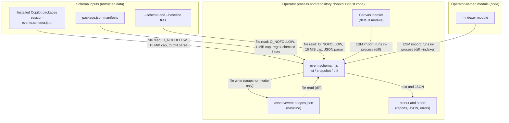

<!-- markdownlint-disable-file -->
# Session Log Canvas Update Skill Security Model

<!-- cspell:ignore NONBLOCK RDONLY -->

This document records the STRIDE threat model for the session-log-canvas-update skill, whose only runtime file is `scripts/event-schema.mjs`, a Node.js command-line tool that uses built-in modules only. The model is organized by trust bucket: schema discovery and parsing (B1), baseline and report outputs (B2), and indexer module import (B3). Each bucket enumerates all six STRIDE categories with the in-code mitigations that address them. Assets and adversaries are enumerated first. Acknowledged enterprise readiness gaps are listed at the end.

The tool has three commands. `list` prints the session event schemas installed under the Copilot home. `snapshot` summarizes one schema as event types, `data` field paths, and type signatures, printing the result or, with `--write`, saving it as the skill's baseline. `diff` compares a schema with the baseline and flags the event types the Session Log canvas handles. The skill lives at `.github/skills/session-log-canvas-update/`, outside every package folder, so it ships in neither the plugin nor the extension. Its `SKILL.md` sets `disable-model-invocation: true`, so the model never starts it on its own; a maintainer runs the tool directly or through `/session-log-canvas-update`. It handles no credentials, makes no network requests, starts no subprocesses, and never opens session logs.

> **See also: repo-wide STRIDE model.** This skill participates in the repository-wide threat model at [`docs/security/security-model.md`](../../../docs/security/security-model.md) and is registered in its [Skill Security Models](../../../docs/security/security-model.md#skill-security-models) section.

## Executive Summary

The session-log-canvas-update skill keeps the Session Log canvas aligned with Copilot's session event schema. Its highest-risk behaviors are parsing schema files that come from downloaded Copilot packages or from paths the operator names, and importing the module named by `diff --indexer`, which runs that module's code in the tool's process. Every file is read through one size-capped, no-follow handle and parsed with `JSON.parse` only; extraction is bounded in nesting depth, total work, and signature length; a file with no session event types is rejected before anything is written; and the only file the tool writes is the skill's own baseline. Residual risk concentrates in the operator-trusted `--indexer` import (EoP-Med) and in low-severity integrity gaps around the baseline write and report text.

### Security Posture Overview

| Dimension          | Value                                                                                                                              |
|--------------------|------------------------------------------------------------------------------------------------------------------------------------|
| Runtime surface    | Repository-only Node.js CLI (`list`, `snapshot`, `diff`); local file reads, one optional ESM import, stdout, one fixed output file |
| Trust buckets      | 3: B1 schema discovery and parsing, B2 baseline and report outputs, B3 indexer module import                                       |
| Credentials        | None read, stored, or sent                                                                                                         |
| Network egress     | None                                                                                                                               |
| Open residual gaps | 6 (EoP-Med: `--indexer` runs the named module in-process)                                                                          |

## Contents

* [System Description](#system-description)
* [Trust Boundaries](#trust-boundaries)
* [Assets](#assets)
* [Adversaries](#adversaries)
* [Bucket B1: Schema discovery and parsing](#bucket-b1-schema-discovery-and-parsing)
* [Bucket B2: Baseline and report outputs](#bucket-b2-baseline-and-report-outputs)
* [Bucket B3: Indexer module import](#bucket-b3-indexer-module-import)
* [Enterprise Readiness Gaps](#enterprise-readiness-gaps)
* [References](#references)

## System Description

### Components

1. `scripts/event-schema.mjs`: the CLI. It finds schemas at `<COPILOT_HOME or ~/.copilot>/pkg/<platform>/<version>/schemas/session-events.schema.json`, or reads the file passed with `--schema <path>.json`, reads the owning `package.json` for the package name and version, extracts event shapes under fixed bounds, and prints a snapshot or a Markdown or JSON diff.
2. `assets/event-shapes.json`: the committed baseline of event types, field paths, type signatures, and source metadata. `snapshot --write` replaces it, and `diff` reads it unless `--baseline <path>` names another file.
3. Canvas indexer, `.github/extensions/hve-core/session-log/lib/indexer.mjs`: the repository module that `diff` imports by default to read `HANDLED_EVENT_TYPES` and `HANDLED_EVENT_PREFIXES`. `diff --indexer <path>` imports a different module instead.
4. `tests/event-schema.test.mjs`: `node:test` coverage for extraction, rejection of files without event types, and the extraction bounds. The crafted deep and wide schemas run in a worker thread so the test timeout can stop a runaway extraction.

### Data Flow



## Trust Boundaries

### Boundary Diagram

```text
┌───────────────────────────────────────────────────────────────────────┐
│ TRUST BOUNDARY: Operator process and repository checkout              │
│  ┌───────────────────┐  ┌───────────────────┐  ┌───────────────────┐  │
│  │ event-schema.mjs  │  │ Baseline          │  │ Canvas indexer    │  │
│  │ Node built-ins    │  │ event-shapes.json │  │ default module    │  │
│  └───────────────────┘  └───────────────────┘  └───────────────────┘  │
└────────────────┬────────────────────────────────────┬─────────────────┘
                 │ file reads: O_NOFOLLOW, size caps  │ ESM import():
                 │ JSON.parse, extraction bounds      │ module code runs
                 │                                    │ in-process
┌────────────────▼─────────────────┐ ┌────────────────▼─────────────────┐
│ TRUST BOUNDARY: Schema inputs    │ │ TRUST BOUNDARY: Operator-named   │
│ (untrusted data)                 │ │ --indexer module (code)          │
│  ┌────────────────────────────┐  │ │  ┌────────────────────────────┐  │
│  │ Installed Copilot packages │  │ │  │ Module that exports        │  │
│  │ (schemas, package.json)    │  │ │  │ HANDLED_EVENT_TYPES        │  │
│  │ --schema and --baseline    │  │ │  │ (runs with the operator's  │  │
│  │ files named by the operator│  │ │  │ privileges)                │  │
│  └────────────────────────────┘  │ │  └────────────────────────────┘  │
└──────────────────────────────────┘ └──────────────────────────────────┘
```

### Boundary Descriptions

| Boundary                                 | Assets Protected                                    | Controls Enforced                                                                                                                                                                                                           |
|------------------------------------------|-----------------------------------------------------|-----------------------------------------------------------------------------------------------------------------------------------------------------------------------------------------------------------------------------|
| Operator process and repository checkout | Baseline integrity, operator workstation            | Fixed write target, schemas without event types rejected before writing, no network, credentials, or subprocesses, session logs never opened                                                                                |
| Schema inputs                            | Availability of the CLI, accuracy of reports        | One open handle per file with `O_NOFOLLOW` and `O_NONBLOCK` where defined, regular-file and size checks on that handle, change-while-reading guard, `JSON.parse` only, regex-checked names, field-walk and signature bounds |
| Operator-named `--indexer` module        | Operator workstation (code runs in the CLI process) | Default is the repository's canvas indexer, replaced only by an explicit flag; usage text and `SKILL.md` require a trusted path; export shape checked after import                                                          |

## Assets

| Id | Asset                                                      | Lifetime                         | Notes                                                                                                             |
|----|------------------------------------------------------------|----------------------------------|-------------------------------------------------------------------------------------------------------------------|
| A1 | Baseline `assets/event-shapes.json`                        | Persisted, tracked in git        | Records the schema the canvas was verified against; written only by `snapshot --write`; reviewed in pull requests |
| A2 | Snapshot and diff reports                                  | Command lifetime (stdout)        | Drive the maintainer's classification of canvas changes; accuracy matters more than secrecy                       |
| A3 | Operator workstation and the CLI process                   | Command lifetime                 | Runs with the operator's privileges; exposed to code execution only through the imported indexer module           |
| A4 | Copilot session logs and session state                     | Persisted under the Copilot home | Never opened by the CLI; listed so the boundary is explicit                                                       |
| A5 | Installed Copilot packages and operator-named schema files | External, read-only              | Downloaded or third-party content, parsed as data only                                                            |

## Adversaries

| Id    | Adversary                                                                                                                               | In-scope mitigations                                                                                                                                                                           |
|-------|-----------------------------------------------------------------------------------------------------------------------------------------|------------------------------------------------------------------------------------------------------------------------------------------------------------------------------------------------|
| ADV-a | Author of a crafted schema, manifest, or baseline file (a tampered installed package, a downloaded schema, a hostile `--baseline` file) | Size caps, single-handle regular-file reads, `JSON.parse` only, regex validation, extraction bounds that mark cut signatures with `…`, rejection of files without event types before any write |
| ADV-b | Local process that races the read paths by swapping a schema for a symbolic link, FIFO, device, or growing file                         | `O_NOFOLLOW` and `O_NONBLOCK` opens, type and size checks on the open handle, `lstat` during discovery, change-while-reading guard                                                             |
| ADV-c | Source of a hostile `--indexer` path, including text that steers an agent running the skill                                             | Default repository indexer, explicit opt-in flag, documented trust requirement in the usage text and `SKILL.md`; residual G-EOP-1                                                              |
| ADV-d | Contributor who alters the committed baseline or replaces it with a symbolic link                                                       | Pull request review of the tracked file; residual G-TAM-1                                                                                                                                      |

## Bucket B1: Schema discovery and parsing

### Spoofing

* Package identity is self-asserted. The `package.json` beside a schema supplies the package name and version that a snapshot records; the name must match `^[@a-z0-9/._-]{1,128}$` and the version `^[A-Za-z0-9_$.-]{1,96}$`, or the value is recorded as null and the version folder name stands in. Nothing authenticates that a schema came from the package it names (G-SPF-1).
* Discovery reads `<COPILOT_HOME>/pkg/<platform>/<version>/` and skips platform and version entries that are not directories, including symbolic links, and schema files that `lstat` does not report as regular files. `COPILOT_HOME` comes from the operator's environment and defaults to `~/.copilot`.

### Tampering

* Schemas, manifests, and baselines are parsed with `JSON.parse` only; nothing read from them is evaluated or imported.
* `readJson` opens each file once with `O_RDONLY`, `O_NOFOLLOW`, and `O_NONBLOCK` where the platform defines those flags, checks that the open handle is a regular file within the size cap, reads at most one byte past the checked size, and fails with "File changed while reading" when the file grew. The file that passed the checks is the file that is parsed.
* `O_NOFOLLOW` covers only the final path component. Windows defines neither flag, so a symbolic link is followed there, though the handle's regular-file and size checks still apply.
* `snapshot` and `diff` reject a file that has no session event root or yields no event types, naming the file and exiting non-zero before anything is written.

### Repudiation

* Not applicable. The CLI reads local files and produces local output; there is no actor or remote state change to attribute. Baseline provenance is covered in B2.

### Information Disclosure

* The CLI never opens session logs or session state. It reads the installed schemas under `pkg/`, the files the operator names with `--schema` and `--baseline`, and the `package.json` two folders above each schema.
* A JSON syntax error message can quote about ten characters of the file it came from on stderr; this applies only to installed package files and files the operator names.
* Extraction keeps identifiers, type signatures, and `const` and `enum` values; schema `description` text is not copied.

### Denial of Service

* Schema and baseline files are capped at 16 MiB and manifests at 1 MiB.
* `$ref` chains stop after 16 hops, `$ref` strings longer than 256 characters are not followed, and enum signatures keep at most 12 values.
* The field walk stops three levels below `data`.
* Signature recursion stops at depth 16. One `extractShapes` call shares a budget of 200,000 work units, charged for each schema node visited, each union alternative, property name, required name, and type entry examined, and each 64 characters of signature text built or recorded. Signatures longer than 4,096 characters are truncated, and `const` and `enum` signatures are built once per schema node. When a limit is reached, the affected signatures end in `…` and the walk stops, so recorded paths and signatures stay under about 12.8 million characters and a crafted schema cannot force exponential work. Regression tests run a 48-level union chain and a three-level, 200-property fan-out under a 5-second timeout.
* The published 1.0.24 schema needs 14,675 work units, a signature depth of 2, and at most 371 characters per signature, so these limits leave its output unchanged. Limits truncate rather than fail, and the parsed document's memory is bounded only by the 16 MiB file cap (G-DOS-1).

### Elevation of Privilege

* Parsing never executes schema content; the CLI runs with the operator's privileges and starts no subprocess.

### Risk Rating

| Threat                                                     | Likelihood | Impact | Residual Risk | Status                                                 |
|------------------------------------------------------------|------------|--------|---------------|--------------------------------------------------------|
| Exponential or super-linear extraction on a crafted schema | Med        | Med    | Low           | Mitigated (depth, work, and length bounds)             |
| Symbolic link, FIFO, or file swap on a read path           | Low        | Med    | Low           | Mitigated (single-handle reads; Windows follows links) |
| Unrecognized file replaces the baseline                    | Low        | Med    | Low           | Mitigated (rejected before writing)                    |
| Forged package provenance in a snapshot                    | Low        | Low    | Low           | Accepted (G-SPF-1)                                     |

## Bucket B2: Baseline and report outputs

### Spoofing

* The baseline's `source` block (package, version, platform, and capture date) comes from the schema's manifest and the local clock. It documents provenance but is not signed (G-SPF-1); reports label the baseline and current sources with these values.

### Tampering

* `snapshot --write` writes only `assets/event-shapes.json` in the skill folder; no option redirects the write, and `--baseline` changes only what `diff` reads.
* The write happens only after the schema yields at least one event type. A rejected schema leaves the existing baseline byte-for-byte unchanged, which a regression test asserts.
* The write uses `fs.writeFile`, which follows a symbolic link at the target and replaces the file in place rather than atomically (G-TAM-1). The baseline is a tracked file, so a change to it, including a symbolic link, appears in pull request review.
* `diff` accepts a baseline only when it has `format: 1` and a `types` object.
* Type names and field keys from a schema must match `^[A-Za-z0-9_$.-]{1,96}$`, and `const` and `enum` values pass through `JSON.stringify`, which escapes C0 control characters. Version and platform folder names and the `source` and `types` entries of a `--baseline` file are printed without filtering, so crafted names can put terminal control or Unicode display characters into a report (G-TAM-2).
* Signatures truncated by the extraction limits are written like any other signature; they stay visible as `…` in the report and in the pull request diff (G-DOS-1).

### Repudiation

* The baseline records its source package, version, and capture date, and git history attributes each baseline change to a commit and its review. The CLI keeps no log of its own.

### Information Disclosure

* Output goes to stdout and stderr only. The baseline holds event and field identifiers, type signatures, and source metadata, never schema descriptions, local paths, or session content; a test asserts the committed baseline has no `description` keys or user-profile paths. Error messages and the `--write` confirmation name local file paths on the operator's terminal only.

### Denial of Service

* Snapshot and report size is bounded by the extraction budget, and `diff` refuses a baseline larger than 16 MiB.
* An interrupted write can leave a partial baseline, which `diff` then rejects as invalid; git restores the tracked file (G-TAM-1).

### Elevation of Privilege

* Writing the baseline needs only the operator's write access to the checkout; there is no privilege transition.

### Risk Rating

| Threat                                         | Likelihood | Impact | Residual Risk | Status             |
|------------------------------------------------|------------|--------|---------------|--------------------|
| Baseline overwritten by an unrecognized schema | Low        | Med    | Low           | Mitigated          |
| Baseline write follows a planted symbolic link | Low        | Med    | Low           | Open (G-TAM-1)     |
| Display-control characters in reports          | Low        | Low    | Low           | Accepted (G-TAM-2) |
| Truncated signatures committed to the baseline | Low        | Low    | Low           | Accepted (G-DOS-1) |

## Bucket B3: Indexer module import

### Spoofing

* The default module path is fixed relative to the script: `.github/extensions/hve-core/session-log/lib/indexer.mjs` in the same checkout. `diff --indexer <path>` replaces it with any path the operator gives, and the CLI cannot verify who wrote that module.

### Tampering

* `loadHandled` imports the module with a dynamic `import()` of its file URL, so the module's top-level code runs in the CLI's process and can change anything the operator can. The CLI then requires an array `HANDLED_EVENT_TYPES` export and reads `HANDLED_EVENT_PREFIXES` when it is an array; those values only label report rows.

### Repudiation

* Not applicable. The import is a local, operator-initiated action with no remote state to attribute.

### Information Disclosure

* An imported module has the operator's file and network access, so a hostile module could read and send local data. The default indexer is repository code reviewed in pull requests and shipped as part of the Session Log canvas.

### Denial of Service

* A module that blocks or throws during import stops the `diff` command. `diff` writes nothing, and the import happens after the baseline and schema are read, so a failed import leaves no partial output.

### Elevation of Privilege

* The import runs code with the operator's privileges, and the operator's choice of path is the only control. The usage text, the `loadHandled` documentation, and the skill's constraints say to pass only a trusted module; the skill's workflow never passes `--indexer`; and `list` and `snapshot` never import a module (G-EOP-1).

### Risk Rating

| Threat                                     | Likelihood | Impact | Residual Risk | Status                                      |
|--------------------------------------------|------------|--------|---------------|---------------------------------------------|
| Hostile module passed with `--indexer`     | Low        | High   | Med           | Accepted (operator responsibility, G-EOP-1) |
| Default indexer modified in a pull request | Low        | High   | Low           | Mitigated (repository review)               |

## Enterprise Readiness Gaps

The following are known limitations recorded so operators can make informed deployment decisions. Severity ratings are the project's own assessment and are not equivalent to a CVSS score.

| Id      | Gap                                                                                                                                                                                                                                                                                                      | Severity        | Status                                                                                                                                    |
|---------|----------------------------------------------------------------------------------------------------------------------------------------------------------------------------------------------------------------------------------------------------------------------------------------------------------|-----------------|-------------------------------------------------------------------------------------------------------------------------------------------|
| G-EOP-1 | `diff --indexer <path>` imports and runs the named module in the CLI's process with no allow-list, signature check, or isolation; only the operator's choice of path protects the workstation.                                                                                                           | EoP-Med         | Accepted (operator responsibility; the default is the repository's canvas indexer and the skill's workflow never passes `--indexer`)      |
| G-TAM-1 | `snapshot --write` replaces `assets/event-shapes.json` with `fs.writeFile`, which follows a symbolic link at that path and is not atomic, so a link planted in the checkout redirects the write and an interrupted write leaves a partial file.                                                          | Tampering-Low   | Open (candidate hardening: open the target with `O_NOFOLLOW`, or write a temporary file and rename it into place)                         |
| G-TAM-2 | Reports print version and platform folder names and the `source` and `types` entries of a `--baseline` file without filtering, and `JSON.stringify` keeps Unicode display controls such as bidirectional overrides in signatures, so crafted inputs can change what a terminal or Markdown viewer shows. | Tampering-Low   | Accepted (the inputs are the operator's own Copilot home and files the operator names)                                                    |
| G-DOS-1 | Extraction limits truncate rather than fail: a schema that exhausts them still produces a snapshot with `…` signatures, which `snapshot --write` saves without a warning. Parsed-document memory is bounded only by the 16 MiB file cap.                                                                 | DoS-Low         | Accepted (the published schema uses a small fraction of each limit, and truncation stays visible in the report and the pull request diff) |
| G-SPF-1 | Snapshot provenance (`source.package` and `source.version`) comes from the unauthenticated `package.json` beside the schema, or from the version folder name when that manifest is missing or invalid.                                                                                                   | Spoofing-Low    | Accepted (provenance is advisory; the skill prefers the schema bundled with VS Code)                                                      |
| G-SUP-1 | The CLI runs on whatever Node.js runtime the operator provides. It uses built-in modules only, so there is no package dependency to pin, but the runtime itself is not verified.                                                                                                                         | SupplyChain-Low | Accepted (the repository's `.node-version` names the supported runtime)                                                                   |

For an active issue tracker entry covering these gaps, see the [hve-core issues list](https://github.com/microsoft/hve-core/issues).

## References

* [STRIDE Threat Model](https://learn.microsoft.com/azure/security/develop/threat-modeling-tool-threats)
* [CWE-400: Uncontrolled Resource Consumption](https://cwe.mitre.org/data/definitions/400.html)
* [CWE-59: Improper Link Resolution Before File Access](https://cwe.mitre.org/data/definitions/59.html)
* [CWE-367: Time-of-check Time-of-use (TOCTOU) Race Condition](https://cwe.mitre.org/data/definitions/367.html)
* [CWE-829: Inclusion of Functionality from Untrusted Control Sphere](https://cwe.mitre.org/data/definitions/829.html)
* [Node.js file open constants](https://nodejs.org/api/fs.html#file-open-constants)
* [Node.js `import()` expressions](https://nodejs.org/api/esm.html#import-expressions)
* [Understanding JSON Schema: schema composition](https://json-schema.org/understanding-json-schema/reference/combining)
* [Repository security model](../../../docs/security/security-model.md)

🤖 Crafted with precision by ✨Copilot following brilliant human instruction, then carefully refined by our team of discerning human reviewers.
