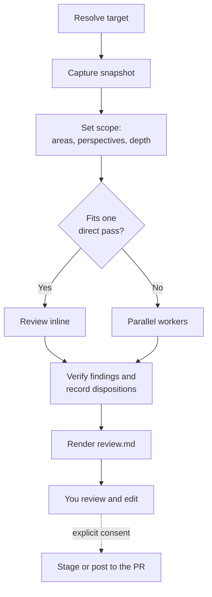

Code Review finds consequential defects in a change and records what it reviewed and what still needs evidence. The workflow lives in the `code-review` skill. You can run it with the `/code-review` command or select the **Code Review** agent, and both follow the same skill.

Each review captures the change once as an immutable snapshot, and every perspective works from that snapshot. Code Review verifies each finding against the captured lines and records a disposition for it. The report is a Markdown file you can edit, and in an interactive review nothing reaches a pull request until you confirm it.

## Why use Code Review

Code Review ties each finding to the reviewed code and shows what each perspective covered:

| Need                         | How Code Review handles it                                                                                                                          |
|------------------------------|-----------------------------------------------------------------------------------------------------------------------------------------------------|
| Review the change you mean   | Reviews a PR or MR, a named branch comparison, a commit, staged or unstaged local changes, or selected code, and asks when the target is ambiguous  |
| Findings that match the code | Every perspective reviews the same captured snapshot, and each finding is anchored to captured changed lines                                        |
| Focused review               | Functional, standards, accessibility, security, and readiness perspectives each have their own skill and criteria                                   |
| Visible coverage             | The report shows what each perspective covered; blocked, unavailable, skipped, or stale required work leaves the review incomplete, with no outcome |
| Human control                | You edit the report, and staging or posting to a pull request from an interactive review needs your explicit consent                                |

> [!TIP]
> To try it, stage a small change and run `/code-review staged changes`. Read the generated `review.md` before you act on any finding.

## Start a review

| Entry point       | How to start                                                                                                                  |
|-------------------|-------------------------------------------------------------------------------------------------------------------------------|
| `/code-review`    | Type the command in Copilot Chat, optionally followed by a target and options                                                 |
| Code Review agent | Select **Code Review** in the agent picker and describe the target. The agent preloads the `code-review` skill and follows it |

Options follow the target, and each one is optional:

```text
/code-review [target] [profile=standard|full|custom] [depth=basic|standard|comprehensive] [mode=sweep|guided]
```

For example:

```text
/code-review PR #482
/code-review feature/search compared with main profile=full
/code-review staged changes depth=comprehensive
/code-review src/parser.ts lines 40-120 mode=guided
```

Code Review supports these targets:

| Target                        | What Code Review captures                                                                                                                      |
|-------------------------------|------------------------------------------------------------------------------------------------------------------------------------------------|
| Pull request or merge request | Provider identity, base and head revisions, description, required checks, template checkboxes, linked issues, and inline and timeline comments |
| Branch comparison             | The named base and head, compared from their merge base unless you ask for a direct comparison                                                 |
| Commit                        | The commit against its parent, or against a base you name. A merge commit needs an explicit base                                               |
| Local changes                 | Staged, unstaged, or combined working-tree changes                                                                                             |
| Selected code                 | The paths and line ranges you name                                                                                                             |

Code Review doesn't guess a base branch, fetch, or check out a branch; it asks you instead. A PR review never mixes in uncommitted local edits. If you ask for a local overlay, Code Review treats it as a separate review, and that review can't produce PR inline comments. When provider reads are partial or unavailable, the review records the gap and doesn't treat the discussion as empty.

## Choose the scope

Three independent options shape a review. The mode decides when Code Review stops for your input, the profile picks the perspectives, and the depth sets how far each perspective traces the change.

### Sweep and guided modes

| Mode              | Behavior                                                                                  |
|-------------------|-------------------------------------------------------------------------------------------|
| `sweep` (default) | After the target is clear, Code Review shows a compact scope summary and continues        |
| `guided`          | Code Review waits for your choice of areas, perspectives, or depth at each decision point |

In both modes the chosen scope stays visible and you can override it. Material ambiguity, such as an unclear target, still stops for your input.

### Profiles

| Profile              | Perspectives                                                                                                                                                                                                                                                                                |
|----------------------|---------------------------------------------------------------------------------------------------------------------------------------------------------------------------------------------------------------------------------------------------------------------------------------------|
| `standard` (default) | Functional, standards, and readiness. Accessibility joins for interactive UI, markup, user-facing content, or accessibility documentation. Security joins for changed trust boundaries, authentication, secrets, parsing, networking, persistence, or confirmed Security Plan Drift context |
| `full`               | All five perspectives. A perspective with nothing relevant to review returns a reasoned not-applicable result                                                                                                                                                                               |
| `custom`             | The perspectives you choose. Code Review asks when the choice is ambiguous                                                                                                                                                                                                                  |

### Depth

Depth sets how far each selected perspective follows the change, independently of the profile:

| Depth                | What each perspective checks                                                  |
|----------------------|-------------------------------------------------------------------------------|
| `basic`              | The changed path and its immediate contract                                   |
| `standard` (default) | Also relevant consumers, error paths, and validation evidence                 |
| `comprehensive`      | Also follows demonstrated high-risk interactions and missing evidence further |

Code Review uses `standard` unless you pick another depth or concrete risk in the change supports a different recommendation. A recommendation names the evidence and missing checks behind it; there's no fixed risk questionnaire. No depth authorizes source edits or a repository-wide audit.

## Perspectives and workers

Each responsibility has its own skill and a matching subagent:

| Responsibility | Skill                       | Subagent                  | Focus                                                                                                       |
|----------------|-----------------------------|---------------------------|-------------------------------------------------------------------------------------------------------------|
| Functional     | `code-review-functional`    | Code Review Functional    | Behavioral defects and regressions, plus acceptance-criteria coverage for behavior                          |
| Standards      | `code-review-standards`     | Code Review Standards     | Departures from applicable repository instructions and domain skills, citing each criterion's source        |
| Accessibility  | `code-review-accessibility` | Code Review Accessibility | User barriers in changed interaction, markup, and content, separating static evidence from runtime evidence |
| Security       | `code-review-security`      | Code Review Security      | Changed paths that permit a concrete security failure across a trust boundary                               |
| Readiness      | `code-review-readiness`     | Code Review Readiness     | PR description, linked issues, checklists, required checks, validation evidence, and changed documentation  |
| Orientation    | `code-review-context`       | Code Review Orientation   | Factual overview of changed areas, entry points, and affected consumers                                     |
| Explanation    | `code-review-context`       | Code Review Explainer     | Factual answer to a question about a symbol or area                                                         |
| Investigation  | `code-review-investigation` | Code Review Walkback      | One bounded evidence gap, answered without restarting the review                                            |

Each subagent preloads `code-review-core` and its responsibility skill. A worker writes only its assigned result file. It doesn't edit source, publish, pick the overall outcome, or dispatch other workers.

Orientation, Explainer, and Walkback return factual observations with no graded findings, and their work doesn't count as review coverage. When a Walkback question turns into open-ended research, the worker stops and recommends an `rpi-research` escalation, and Code Review decides whether to start it.

Small reviews run inline. When the evidence fits one direct pass or the trace is tightly coupled, Code Review applies the perspective skills itself and writes the same result records. For larger independent work, it dispatches every selected worker that's ready in one parallel batch, and orientation can run alongside the perspectives without holding them back.

If subagents aren't available, Code Review does the selected work inline when it can. Otherwise it records the work as unavailable, so a selected perspective never disappears without notice.

The standards perspective takes its criteria from the repository instructions and skills that apply to the changed files. See [Language Skills](language-skills.md) to add your own.

## How a review runs



1. Code Review resolves the target and its revisions, and asks when anything is ambiguous.
2. The core helper captures the change once. Code Review groups the files into areas and records each area's intent, before and after behavior, and entry points. Scope accounting covers lockfiles, configuration, renames, deletions, and omitted files, and explains anything left out as irrelevant.
3. Code Review records the scope and assigns the work. Each acceptance criterion gets one owner: functional for behavior, readiness for deliverable-only criteria. Without a story definition, criteria stay unassessed.
4. The selected perspectives run inline or as parallel workers.
5. Code Review verifies each returned claim against its captured anchors and counter-evidence, merges duplicates once, and records each finding as accepted, disputed, deferred, or rejected with a reason.
6. Optional integrations run when their context exists.
7. The core helper renders `review.md`, keeping your edits and the canonical disclaimer.

| Integration         | Runs when                                                                        | Result                                                                                                         |
|---------------------|----------------------------------------------------------------------------------|----------------------------------------------------------------------------------------------------------------|
| Business alignment  | You supply BRD, PRD, or ADR sources, or confirm sources Code Review discovers    | Drift findings rated with the shared business-alignment rubric, compared with each source at the base revision |
| Security Plan Drift | A confirmed security plan baseline exists and the security findings are accepted | Accepted security findings correlated with the plan                                                            |
| Specialist referral | Changed-surface signals and an available capability support it                   | A named follow-up recommendation; no extra review runs                                                         |

## Review records and the report

Every review gets its own folder:

```text
.copilot-tracking/reviews/code-reviews/<date>/<review-id>/
├── snapshots/<snapshot-id>/
│   ├── snapshot.json
│   └── files/
├── review-state.json
├── results/<snapshot-id>/<work-id>.json
├── feedback.json
└── review.md
```

The `code-review-core` skill's [review contract](https://github.com/microsoft/hve-core/blob/main/.github/skills/coding-standards/code-review-core/references/review-contract.md) defines each record:

| Record                                 | Owner              | Contents                                                                            |
|----------------------------------------|--------------------|-------------------------------------------------------------------------------------|
| `snapshot.json` and `files/`           | Core helper        | Immutable capture of the target, changed files and hunks, discussion, and omissions |
| `review-state.json`                    | Code Review        | Scope, areas, work items, verified findings, limitations, and outcome               |
| `results/<snapshot-id>/<work-id>.json` | Assigned worker    | One work item's coverage, findings, observations, and limitations                   |
| `feedback.json`                        | Code Review canvas | Feedback you send from the canvas                                                   |
| `review.md`                            | You                | The human-editable report                                                           |

Review IDs include a random identifier, so a second review of the same branch gets its own folder. Resuming a review reuses its snapshot when the repository and target still match. When the evidence changes, a new capture archives the previous state and resets coverage, while earlier snapshots, feedback, and reports stay in place.

### Findings and outcome

Each finding states a claim and its consequence, anchors it to captured lines, names the criterion it applies when there is one, and suggests a remediation. Severity (`Critical`, `High`, `Medium`, or `Low`) describes the consequence, and findings carry no confidence scores. A new finding stays `proposed` until Code Review verifies it and records a disposition with a reason. Disputed and deferred findings stay visible in the report.

| Completed review                      | Outcome                 |
|---------------------------------------|-------------------------|
| Any retained Critical or High finding | `request_changes`       |
| Only Medium or Low findings           | `approve_with_comments` |
| No retained findings                  | `approve`               |

When required work is blocked, unavailable, skipped, or stale, or a blocking limitation exists, the review is `incomplete` and has no outcome. Complete coverage and an empty findings list are separate facts, and the report shows both.

### The report

`review.md` contains the target and coverage, the findings, context and limitations, and the disclaimer with an unchecked human-review checkbox. Pull request and merge request reports add a comment draft with the proposed event and its own unchecked posting checkbox. Only a human checks either box.

Your edits are authoritative. Code Review regenerates `review.md` only while the file still matches its last render. If you've edited the file, rendering stops and Code Review reconciles the changes with you.

## Code Review canvas

When your host supports canvases and the Code Review canvas (`hve-core-code-review`) is available, Code Review opens it on the current review. The canvas shows the captured changes, review coverage, findings, PR discussion, and your feedback in one read-only panel.

| The canvas can                                               | The canvas can't                                 |
|--------------------------------------------------------------|--------------------------------------------------|
| Show captured changes, coverage, findings, and PR discussion | Change coverage, dispositions, or human sign-off |
| Send your feedback to Code Review                            | Stage, post, approve, or merge anything          |
| Keep unsent drafts private                                   | Create another review or delete an earlier one   |

Code Review collects sent feedback at dispatch and completion boundaries, before a material decision, and before closeout. It applies each item within the review's authority and records what changed. If the canvas is missing or fails, the review continues in chat with the same evidence and decisions, and Code Review names the limitation. See the [Code Review canvas guide](canvas) for the panel itself.

## Publishing to a pull request

Saving the local report, staging a draft review with the provider, and posting are separate actions. Staging a draft doesn't submit it, and neither the canvas nor the core helper can stage or post. Before Code Review stages or posts anything:

1. It shows every retained Critical or High finding and any pending or unopened areas, and asks you to inspect them or explicitly acknowledge proceeding. Acknowledging doesn't complete missing review work.
2. It links the report and the PR comment draft, then asks you to confirm the target, the event, and the comments. Posting the general comment also needs its checkbox, which only you can check.
3. Right before submission, it re-reads the PR's identity, open or closed state, base and head revisions, and inline-comment anchors. A mismatch stops the submission until you agree how to refresh.
4. It records what was staged or posted, including provider IDs, separately from findings and coverage.

Code Review never resolves threads, approves, or merges as a side effect. Evidence from local changes or selected code can't become PR inline comments, and local stakeholder notes are never published. If you decline, the local report is the delivered result.

## Automated PR review

The PR Review workflow runs Code Review on a pull request when a user with write access posts `/review`. It activates the `code-review` skill in host-managed, non-interactive mode with fixed settings:

| Setting      | Value                                                                 |
|--------------|-----------------------------------------------------------------------|
| Perspectives | `full`: functional, standards, accessibility, security, and readiness |
| Depth        | `basic`                                                               |
| Execution    | Inline, without subagents                                             |
| Output       | Owned by the workflow, including any review it submits                |

In host-managed runs, Code Review asks no routine questions and doesn't require a canvas or local tracking files when the host forbids them. It applies the same criteria, verification, and coverage rules in memory.
It uses only business sources the host supplies, never grants owner-acknowledged status, and returns a blocked or incomplete result when the target or required evidence is missing.
See [Agentic Workflows](../../architecture/agentic-workflows.md) for the trigger, labels, and maintainer advisory mode.

## What you need

| Requirement                     | Details                                                                                                                         |
|---------------------------------|---------------------------------------------------------------------------------------------------------------------------------|
| VS Code and GitHub Copilot Chat | Agent mode enabled                                                                                                              |
| HVE Core                        | The `hve-core` extension or plugin, which includes the Code Review skills, agent, and subagents                                 |
| Git                             | The revisions under review must be in your local clone. Code Review doesn't fetch or check out branches                         |
| Node.js                         | Runs the `code-review-core` helper that captures snapshots, updates review state, and renders the report                        |
| Provider read access            | Optional. Needed for PR descriptions, checks, linked issues, and comments; without it, those checks are recorded as unavailable |
| Canvas support                  | Optional. Needed only for the Code Review canvas                                                                                |

Code Review works with any programming language. Standards and accessibility coverage depend on the instructions and skills available for the changed files. When none apply, the perspective reports the gap and doesn't count the change as passing.

<!-- markdownlint-disable MD036 -->
*🤖 Crafted with precision by ✨Copilot following brilliant human instruction,
then carefully refined by our team of discerning human reviewers.*
<!-- markdownlint-enable MD036 -->
