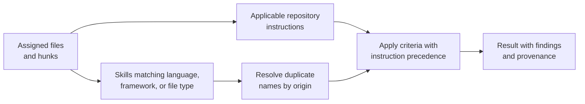
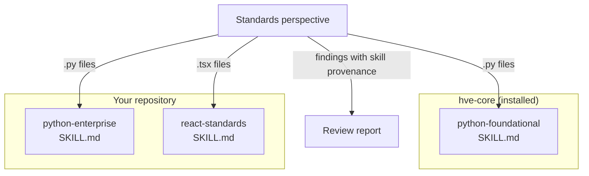

The standards perspective of [Code Review](README.md) checks a change against your project's own conventions. Its criteria come from the repository instructions that apply to the changed files and from the skills that match the changed languages, frameworks, or file types. Each finding cites the instruction or skill behind it, so you can trace a finding back to the rule that produced it. To extend coverage, add an instruction file or a skill; the review workflow stays the same.

## How the standards perspective selects criteria



1. Code Review assigns the standards perspective a set of areas, files, and hunks from the captured snapshot.
2. The perspective reads the repository instructions whose scope covers the changed files.
3. It selects available skills by changed language, framework, or literal file type, using each skill's `name` and `description`.
4. It keeps each source's name, location or origin label, applicable scope, and criterion together. It doesn't infer provenance from prose.
5. It resolves same-named skills by origin, applies instruction precedence, and records any unresolved conflict with both sources.
6. It reviews the assigned changes against the selected criteria and established local patterns, then writes its result. Each finding cites the instruction or exact skill name and the criterion, and the observations list every criteria source used.

There's no fixed cap on the number of skills. The perspective loads each distinct match the changed surface needs, so a change that spans several languages can load a skill for each one.

### Skill origins

The perspective keeps each skill's origin with it through selection:

| Origin    | What it represents                                                            |
|-----------|-------------------------------------------------------------------------------|
| Workspace | Skills authored in the repository or workspace under review                   |
| User      | Skills from the user's profile, when the platform exposes them                |
| Bundled   | Skills packaged with an installed extension, plugin, or the hve-core baseline |
| Unknown   | A skill with no identifiable source label                                     |

Origin comes from each skill's source label or location. The perspective doesn't guess it from the skill's text. Author repository skills so they present as Workspace origin, which takes precedence over User and Bundled copies with the same name.

### Duplicates and conflicts

| Case                 | Behavior                                                                                                                                                                  |
|----------------------|---------------------------------------------------------------------------------------------------------------------------------------------------------------------------|
| Distinct skill names | Every matching skill loads. Findings cite the exact skill name                                                                                                            |
| Same skill name      | Workspace shadows User, which shadows Bundled. When origin is unknown, one copy loads and the result discloses the ambiguity. Same-named bodies are never combined        |
| Conflicting criteria | Instruction precedence decides. An unresolved conflict is recorded with both sources, and a material conflict stops the perspective as blocked for Code Review to resolve |

### Boundaries

| Situation                                 | How the standards perspective handles it                                                   |
|-------------------------------------------|--------------------------------------------------------------------------------------------|
| A functional defect                       | Left to the functional perspective                                                         |
| Acceptance-criteria coverage              | Left to the perspective Code Review assigns as its owner                                   |
| A departure that only reflects preference | Not reported. A finding explains the consequence of the departure                          |
| No applicable instructions or skills      | Recorded as unavailable standards evidence. It doesn't count as a standards pass           |
| Production telemetry emitters             | Reviewed with `telemetry-foundations` and its semantic conventions, without invented names |

## Built-in skills

The `coding-standards` collection ships one language skill. Additional language skills follow the same pattern and can be contributed to the repository or authored independently.

### python-foundational

| Field      | Value                                                                                                         |
|------------|---------------------------------------------------------------------------------------------------------------|
| Origin     | Bundled hve-core baseline; a repository copy named `python-foundational` takes precedence as Workspace origin |
| Applies to | `.py` files in the change                                                                                     |
| Sections   | 9 checklist sections with about 30 checks                                                                     |
| Maturity   | Experimental                                                                                                  |

The python-foundational skill covers:

| Section                 | What it checks                                                                                          |
|-------------------------|---------------------------------------------------------------------------------------------------------|
| Readability & Style     | Naming conventions and import grouping                                                                  |
| Pythonic Idioms         | Comprehensions, context managers, data holders, `pathlib`, keyword-only arguments, and mutable defaults |
| Function & Class Design | Single responsibility, public API docstrings, side-effect documentation, and member ordering            |
| Type Safety Foundations | Type hints on public APIs, generics, and `Any` avoidance                                                |
| Error Handling          | Specific exceptions, no silent failures, and actionable error context                                   |
| Anti-Patterns to Avoid  | `eval`, `exec`, or `pickle` on untrusted data, and hard-coded secrets                                   |
| Maintainability         | Self-documenting code, structured logging, and functions too complex to test                            |
| Architectural Fit       | Alignment with existing patterns, reuse of shared functionality, and module placement                   |
| Design Principles       | Duplication, the simplest sufficient design, change breadth, and checks before flagging unused code     |

Findings from this skill cite `python-foundational` and the checklist criterion they apply.

## Built-in instructions

The coding-standards collection also includes language instruction files. Copilot applies them when it generates or edits matching files, and the standards perspective reads the ones that apply to the changed files as review criteria.

| Language   | Instruction files                                                                              | Applies to                                                                   |
|------------|------------------------------------------------------------------------------------------------|------------------------------------------------------------------------------|
| Bash       | `bash.instructions.md`                                                                         | `**/*.sh`                                                                    |
| Bicep      | `bicep.instructions.md`                                                                        | `**/*.bicep`, `**/*.bicepparam`, `**/bicep/**`                               |
| C#         | `csharp.instructions.md`, `csharp-tests.instructions.md`                                       | `**/*.cs`                                                                    |
| PowerShell | `powershell.instructions.md`, `pester.instructions.md`                                         | `**/*.ps1`, `**/*.psm1`, `**/*.psd1`; Pester rules apply to `**/*.Tests.ps1` |
| Python     | `python-script.instructions.md`, `python-tests.instructions.md`, `uv-projects.instructions.md` | `**/*.py`; uv project rules also apply to `**/*.ipynb`                       |
| Rust       | `rust.instructions.md`, `rust-tests.instructions.md`                                           | `**/*.rs`                                                                    |
| Terraform  | `terraform.instructions.md`                                                                    | `**/*.tf`, `**/*.tfvars`, `**/terraform/**`                                  |
| TypeScript | `typescript-doc-comments.instructions.md`                                                      | `**/*.ts`, `**/*.tsx`, `**/*.mts`, `**/*.cts`                                |

Instructions apply passively to every matching file. Skills load on demand when the standards perspective selects them. When both cover the same language, keep them consistent.

> [!TIP]
> When you author a new language skill, check the matching instruction files for contradictions. A mismatch creates a generate-then-flag loop, where Copilot writes code that the standards perspective then flags.

## Authoring a custom skill

You extend the standards perspective by creating a `SKILL.md` file under `.github/skills/coding-standards/` in your repository. The perspective treats it as a Workspace-origin skill and selects it when its name or description matches the languages, frameworks, or file types in the change.

### Skill stacking

Skills stack. When a Python change is reviewed, the perspective might load both `python-foundational` from hve-core and `python-enterprise` from your repository. Findings from every loaded skill appear in the same report, and each cites the skill and criterion that produced it.



### Directory structure

Place custom skills under `.github/skills/coding-standards/{your-package}/{skill-name}/`:

```text
.github/skills/coding-standards/
└── contoso/
    └── python-enterprise/
        ├── SKILL.md
        └── references/
            └── api-conventions.md
```

### SKILL.md template

```yaml
---
name: python-enterprise
description: >-
  Contoso Python enterprise standards covering internal API conventions,
  approved libraries, and production deployment requirements.
---
```

The `name` and `description` are required. The description drives selection, so include the language names, framework names, or file extensions your skill targets.

### Checklist structure

Organize checks into numbered sections with bullet points. Each bullet should be a concrete, verifiable check.

In the resulting `SKILL.md`, `## Core Checklist` renders as a level-two
heading and each `###` section heading renders as level three. The following
block shows the literal Markdown source; these markers are not headings while
displayed inside this example.

```markdown
## Core Checklist

### 1. API Conventions

* Use `@api_version("v2")` decorator on all public endpoint functions.
* Return `ApiResponse` wrapper for all HTTP handlers.
* Include `correlation_id` in every log statement within request handlers.

### 2. Approved Libraries

* Use `httpx` for HTTP clients (not `requests`).
* Use `pydantic` for data validation (not manual dict parsing).
* Pin all production dependencies with exact versions in `pyproject.toml`.
```

### What makes a good skill

| Quality         | Guidance                                                                                 |
|-----------------|------------------------------------------------------------------------------------------|
| Specificity     | Each check should be verifiable from the changed code without running it                 |
| Traceability    | Group checks into named, numbered sections so each finding can cite a specific criterion |
| Scope alignment | Write the description to match only the languages and frameworks you intend to cover     |
| Consequence     | State why a check matters, because findings must explain the consequence of a departure  |
| Reasonable size | Aim for 5-15 sections with 2-5 checks each; larger skills dilute focus                   |
| No duplication  | Do not repeat checks already covered by the foundational skill your skill stacks with    |

### Testing your skill

1. Place the `SKILL.md` file in your repository.
2. Change a file that matches the skill's target language.
3. Run `/code-review` on that change. The default `standard` profile includes the standards perspective.
4. Open `review.md` and check Context and limitations, where the standards observations list the criteria sources used. Findings from your skill cite it in their `criterion` field in `review-state.json`.
5. If the skill isn't selected, confirm that it's authored under `.github/skills/coding-standards/` (Workspace origin) and that its `description` names the language, framework, or file extension in the change.

## Enterprise scenarios

### Overlay company standards on built-in skills

A financial services team installs the `coding-standards` collection and adds `.github/skills/coding-standards/woodgrove/python-finserv/SKILL.md` with checks for audit logging, PII handling, and approved cryptographic libraries. The standards perspective loads both `python-foundational` and `python-finserv` for every Python change, and each finding cites the skill it came from.

### Add coverage for an unsupported language

A team working in Go creates `.github/skills/coding-standards/tailspin/go-standards/SKILL.md` with checks for error wrapping conventions, context propagation, and struct tag formatting. The standards perspective selects it for any `.go` files in the change because its description names Go.

### Scope a skill to a specific framework

A frontend team authors `.github/skills/coding-standards/northwind/react-standards/SKILL.md` with a description that mentions "React components, hooks, and JSX patterns." The standards perspective selects it only when React files such as `.tsx` or `.jsx` appear in the change, so unrelated reviews aren't affected.

## Reference

| Resource                    | Path                                                                                     |
|-----------------------------|------------------------------------------------------------------------------------------|
| python-foundational skill   | `.github/skills/coding-standards/python-foundational/SKILL.md`                           |
| Standards perspective skill | `.github/skills/coding-standards/code-review-standards/SKILL.md`                         |
| Review contract             | `.github/skills/coding-standards/code-review-core/references/review-contract.md`         |
| Standards output guidance   | [Code Review Standards Output Format](../../templates/standards-review-output-format.md) |
| Code Review output guidance | [Code Review Output Format](../../templates/full-review-output-format.md)                |
| Engineering fundamentals    | `docs/templates/engineering-fundamentals.md`                                             |
| Skill authoring guide       | [Authoring Custom Skills](../../customization/skills.md)                                 |
| Contributing skills         | [Contributing: Skills](../../contributing/skills.md)                                     |
| HVE Core plugin manifest    | `plugin.json`                                                                            |

<!-- markdownlint-disable MD036 -->
*🤖 Crafted with precision by ✨Copilot following brilliant human instruction,
then carefully refined by our team of discerning human reviewers.*
<!-- markdownlint-enable MD036 -->
