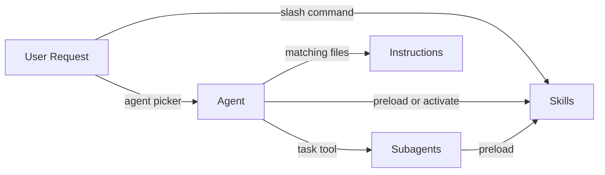

HVE Core customizes GitHub Copilot with three artifact types. Agents orchestrate workflows, skills carry entry points and reusable procedures, and instructions encode standards for matching files. Each type reaches a Copilot session in its own way, and together they take a request from user intent to technology-specific standards and executable utilities.

> [!NOTE]
> HVE Core targets the Copilot harness, the Copilot SDK runtime that is VS Code's default agent harness and also runs Copilot CLI. The Copilot harness does not load prompt files (`.prompt.md`) or `#file:` directives, and it has no handoff buttons. Prompt files were the entry points under VS Code's older Local harness. Skills fill that role now, and HVE Core ships no prompt files.

## Artifact Type Hierarchy

The artifact system organizes customizations by scope and responsibility. Agents orchestrate workflows, skills hold entry points and the procedures that several agents share, and instructions encode standards.

### Agents

Agents (`.agent.md`) define task-specific behaviors with access to Copilot tools. They orchestrate multi-step workflows and make decisions based on context. A user selects an agent in the agent picker, or a parent agent starts one as a subagent.

#### Core Characteristics

* Specify available tools through a `tools:` list of aliases such as `read`, `edit`, `search`, `execute`, `agent`, and `skill`
* Preload the skills they need at start through `skills:`, and activate other skills by name
* Dispatch subagents by `name` through the `task` tool
* Maintain conversation context across multiple interactions
* Apply domain expertise through detailed behavioral instructions

#### Frontmatter Structure

```yaml
---
name: RAI Planner
description: 'Responsible AI assessment planner evaluating against NIST AI RMF 1.0'
tools:
  - read
  - edit
  - execute
  - search
  - web
  - agent
  - skill
  - ask_user
skills:
  - disclaimer-language
  - untrusted-content-boundary
---
```

The Copilot harness does not support `handoffs`, `agents`, or `argument-hint` on agents. An agent's body names the subagents it uses and the skill or agent the user should turn to next.

Agents answer the question "how should this task be executed?" and coordinate the necessary tools and resources.

### Instructions

Instructions (`.instructions.md`) encode technology-specific standards and conventions. They apply automatically based on file patterns and provide consistent guidance across the codebase.

#### Core Characteristics

* Match files through `applyTo:` glob patterns and apply once a session reads or edits a matching file
* Load into every session when they have no `applyTo`, so reserve that form for the rare rule every session needs
* Define coding standards, naming conventions, and quality requirements
* Apply to specific languages, frameworks, or file types
* Stack with other instructions when multiple patterns match
* Never reach subagents, which get their rules from their own body, a preloaded skill, or the dispatch prompt

#### Frontmatter Structure

```yaml
---
description: 'Python scripting standards with type hints'
applyTo: '**/*.py, **/*.ipynb'
---
```

Instructions answer the question "what standards apply to this context?" and ensure consistent code quality.

#### Repo-Specific Instructions

Instructions placed at the root of `.github/instructions/` (without a subdirectory) are scoped to the hve-core repository itself and MUST NOT be included in plugin membership. These files govern internal repository concerns (CI/CD workflows, repo-specific conventions) that are not applicable outside the repository. Root-level artifacts are intentionally excluded from artifact selection and plugin composition.

> [!IMPORTANT]
> Root-level files under `.github/instructions/` (no subdirectory) are repo-specific and never distributed. Files in package subdirectories such as `hve-core/`, `ado/`, and `shared/` are eligible for distribution.

### Skills

Skills (`.github/skills/<name>/SKILL.md`) package reusable workflows, domain knowledge, and executable utilities. HVE Core also uses them for two jobs: a user-invocable skill is an entry point that runs as a slash command, such as `/rpi-research`, and a shared protocol, such as `disclaimer-language`, lives in a skill that several agents preload.

#### Core Characteristics

* Run as slash commands that take their inputs from the user's message
* Load by semantic match on `description`, unless `disable-model-invocation: true` limits them to their slash command
* Carry shared protocols that agents preload with `skills:` or activate by name
* Bundle references, templates, and scripts, linked with paths relative to the skill root
* Include parallel implementations for cross-platform support (`.sh` and `.ps1`) when they ship scripts

#### Directory Structure (by Convention)

```text
.github/skills/{package-id}/<skill-name>/
├── SKILL.md           # Required entry point with frontmatter
├── scripts/
│   ├── convert.sh     # Bash implementation
│   └── convert.ps1    # PowerShell implementation
└── examples/
    └── README.md      # Usage examples
```

#### Frontmatter Structure

An entry-point skill that only users start:

```yaml
---
name: git-merge
description: 'Integrate branches with merge or rebase, resolve conflicts, and push when explicitly authorized'
argument-hint: 'operation={merge|rebase|rebase-onto} branch=<ref> [onto=<ref>]'
user-invocable: true
disable-model-invocation: true
---
```

A shared protocol that agents preload:

```yaml
---
name: disclaimer-language
description: 'Verbatim CAUTION disclaimers for HVE planning, coaching, and review agents'
user-invocable: false
---
```

#### Required Frontmatter Fields

| Field         | Description                                             |
|---------------|---------------------------------------------------------|
| `name`        | Lowercase kebab-case identifier matching directory name |
| `description` | Brief capability description                            |

#### Invocation Fields

| Field                      | Effect                                                                    |
|----------------------------|---------------------------------------------------------------------------|
| `argument-hint`            | Shows the arguments a slash command expects                               |
| `user-invocable`           | `false` hides the slash command for a skill that only agents load         |
| `disable-model-invocation` | `true` hides the skill from the model, so only its slash command loads it |

Skill frontmatter does not declare `tools`, `model`, `skills`, or `applyTo`. Distribution is determined by tracked path and license classification, not skill maturity metadata. See [Plugin Identity](#plugin-identity).

Skills answer the question "what reusable procedure or utility does this task need?" and give users and agents the same entry point.

#### Key Distinction from Instructions

| Aspect     | Instructions                    | Skills                                          |
|------------|---------------------------------|-------------------------------------------------|
| Nature     | Passive guidance                | On-demand capability                            |
| Content    | Standards and conventions       | Workflows, protocols, references, and scripts   |
| Activation | `applyTo` match on read or edit | Slash command, semantic match, preload, or name |
| Output     | Guidance for Copilot            | Guided workflows and executed operations        |

## Delegation Flow

A request enters through an agent that the user selects or through a skill's slash command. Agents then load skills, dispatch subagents, and pick up instructions for the files they work on.



### Flow Mechanics

1. The user selects an agent in the agent picker or types a skill's slash command, such as `/rpi-research`.
2. The agent starts with the bodies of the skills in its `skills:` list and activates other skills by name as its workflow reaches them.
3. When the agent reads or edits a file that matches an instruction's `applyTo` glob, Copilot applies that instruction.
4. The agent dispatches subagents through the `task` tool. Subagents receive no repository instructions, so each one gets its rules from its own body, a preloaded skill, or the dispatch prompt.

This delegation model separates concerns. Skills hold reusable procedures, agents manage orchestration, and instructions provide standards. Copilot has no handoff buttons, so a user moves to the next phase of a workflow by invoking its skill, such as `/rpi-plan`, or by working with the RPI Agent, which coordinates the phases.

## Interface Contracts

Each artifact type defines clear interfaces for interoperability.

### Agent-to-Skill References

Agents reach skills by name. A skill listed under `skills:` loads when the agent starts, and the agent activates any other skill by name, which requires `skill` in its `tools` list:

```yaml
---
name: Code Review
description: 'Review changes through the shared Code Review skill, with focused perspectives, snapshot-backed evidence, and an optional canvas.'
tools:
  - agent
  - execute
  - search
  - read
  - edit
  - skill
  - ask_user
skills:
  - disclaimer-language
  - code-review
---
```

Copilot injects each preloaded skill's `SKILL.md` body at session start. Files that the skill links load only when the agent reads them. A skill's name matches its folder name, and Copilot finds the folder at any depth under `.github/skills`.

### Subagent Dispatch

A parent names each subagent in its body by the subagent's `name` value, such as Code Review Functional. The `task` tool dispatches by that name, so nesting depth under `.github/agents` does not matter. A parent with a `tools` list needs `agent` in it. A subagent sets `user-invocable: false` to stay out of the agent picker and leaves `agent` out of its own `tools` list when it must not dispatch further. Subagents never receive `ask_user`.

### Instruction Glob Patterns

Instructions use `applyTo:` patterns for automatic activation:

| Pattern                      | Matches                              |
|------------------------------|--------------------------------------|
| `**/*.py`                    | All Python files recursively         |
| `**/tests/**/*.ts`           | TypeScript files in test directories |
| `**/.copilot-tracking/pr/**` | PR tracking files                    |

Multiple instructions can apply to the same file. When patterns overlap, all matching instructions contribute guidance. Pattern specificity determines precedence for conflicting directives.

An agent that depends on a path-specific instruction before it touches a matching file reads that instruction file by name. HVE Core's ADR Creator, for example, reads `adr-standards.instructions.md` when it enters a phase that needs those rules.

### Skill Entry Points

Skills provide self-contained capabilities through the `SKILL.md` file:

```text
.github/skills/{package-id}/<skill-name>/
├── SKILL.md                    # Entry point documentation
├── convert.sh                  # Bash implementation
├── convert.ps1                 # PowerShell implementation
└── examples/
    └── README.md
```

The `{package-id}` path segment reflects the conventional organization; artifacts can reside in any subfolder.

Copilot loads a skill when the user types its slash command, when its description matches the current task, when an agent preloads it, or when an agent activates it by name. A skill takes its input from the user's message. Its `argument-hint` shows the expected arguments, and its body names each input and its default.
In VS Code, skills installed with the HVE Core plugin carry the plugin name as a prefix, such as `/hve-core:rpi-research`, while skills copied into a project's own `.github/skills` folder appear as `/rpi-research`. The skill's `SKILL.md` documents prerequisites, parameters, and usage patterns. Cross-platform scripts ensure consistent behavior across operating systems.

## Plugin Identity

Root `plugin.json` is the sole component-membership authority for the `hve-core` plugin and VSIX. `.github/plugin/marketplace.json` contains one relative locator to the repository root and does not repeat membership. The plugin details surface resolves root `README.md` and `LICENSE`; the VSIX keeps `extension/README.md` and `extension/LICENSE` as its separate metadata surface.

The one product identity includes every distributable agent, instruction, and skill. Stable and PreRelease use the same manifest membership.

### Deterministic Membership

`npm run plugin:sync` derives manifest membership from tracked canonical paths:

* `agents/<package>/**/*.agent.md`
* `instructions/<package>/**/*.instructions.md`
* `skills/<package>/<skill>/SKILL.md`, unless its top-level license has a noncommercial qualifier

Repository-root artifacts without a package segment are excluded. Paths are unique and ordinal-sorted. The manifest declares a hook only while one ships under the plugin root; the repository ships none today.

`npm run plugin:validate` checks manifest drift, one-entry locator parity and containment, declared component coverage, and hooks without modifying files.

### Direct Outputs

Copilot CLI and VS Code install the plugin directly from the repository root, where `plugin.json` lives. Extension preparation consumes the same manifest and produces one `hve-core` VSIX. The architecture has no package dependencies, package matrix, copied plugin tree, or plugin ZIP.

## Extension Integration

The VS Code extension contributes HVE Core's agents, instructions, and skills to VS Code through contribution points.

### Discovery Mechanism

Copilot discovers these folders in a workspace at any depth, with no settings required:

* `.github/agents/{package-id}/` for specialized behaviors
* `.github/instructions/{package-id}/` for technology standards
* `.github/skills/{package-id}/` for skills and slash commands

These paths reflect the conventional directory structure. Plugin and extension membership is controlled by root `plugin.json`, whose declarations are repository-relative `.github/...` paths. Artifacts directly under `.github/{type}/` with no package subdirectory are repo-specific, excluded from plugin membership, and never packaged into extension builds.

Extension preparation writes the manifest's agents, instructions, and skills into the extension's contribution points. VS Code forwards the extension's agents and skills to Copilot sessions, but the extension's instructions may not reach those sessions, so install the plugin when you need HVE Core's instructions.

Stable and PreRelease differ in source ownership, cadence, and version, not component membership.

### Extension Identities

HVE Core has one Copilot plugin root at the repository root and one VSIX identity, `ise-hve-essentials.hve-core`. Artifact discovery remains bounded to eligible package-scoped paths under `.github`.

The VS Code extension is prepared with `Prepare-Extension.ps1` and packaged with `Package-Extension.ps1`. Both Stable and PreRelease preparation write the same component set to the single extension manifest and README. No Copilot package assembly step exists.

The plugin ships no hooks. Telemetry is opt-in through the `copilot-otel-metrics` skill, which the user installs and configures deliberately.

For a repository-owned selection, the installer validates chosen component paths against root `plugin.json`. It converts repository-relative manifest declarations to installer form, then copies agents, instructions, and complete distributable skill directories while preserving canonical `.github` target paths; hooks are not copied.

### Activation Context

The three artifact types activate differently:

* Instructions with `applyTo` apply after the session reads or edits a matching file. Instructions without `applyTo` are inlined in every session.
* Agents activate when a user selects them in the agent picker, or when a parent dispatches them as subagents through the `task` tool.
* Skills load when a user types their slash command, when their description matches the task, when an agent preloads them with `skills:`, or when an agent activates them by name.

VS Code keeps its list of path-specific instructions for the life of the window. After you install, update, or edit instruction files, run **Developer: Reload Window** so that new chat sessions pick up the change.

## Deprecated Artifacts

Artifacts that have been superseded or are scheduled for removal live under `.github/deprecated/{type}/`, preserving the same type subdirectories used by active artifacts.

### Location

```text
.github/deprecated/
├── agents/         # Superseded agent files
├── instructions/   # Retired instruction files
└── skills/         # Retired skill packages
```

### Automatic Exclusion

The build system excludes `.github/deprecated/` contents from all downstream surfaces:

| Surface             | Exclusion Mechanism                      |
|---------------------|------------------------------------------|
| Plugin manifest     | Sync scans only active artifact roots    |
| Extension packaging | Consumes only plugin manifest membership |
| VS Code activation  | Deprecated paths are not contributed     |

Run `npm run plugin:sync` after moving an artifact to `.github/deprecated/`. The path-based classification removes it from plugin and extension membership.

### Retention and Removal

Deprecated artifacts remain in the repository for traceability and migration guidance. Each deprecated file SHOULD contain a frontmatter note or heading that identifies its replacement. Permanent removal occurs at a planned retirement window with a corresponding changelog entry.

### When to Deprecate

Move an artifact to `.github/deprecated/{type}/` when:

* A newer artifact fully replaces its functionality
* The artifact is no longer maintained or tested
* The artifact targets a retired platform or workflow

## Removed Artifacts

Remove a retired artifact from its active package-scoped path and run `npm run plugin:sync`. The manifest update removes it from both channels. Preserve migration history in the changelog or durable documentation when users need it; no distribution tombstone or compatibility entry is required.

## Related Documentation

* [Agent Systems Catalog](../agents/) - Overview of all agent systems with workflow documentation
* [AI Artifacts Common Standards](../contributing/ai-artifacts-common.md) - Quality requirements for all artifacts
* [Reusable Slash Commands](../customization/prompts.md) - Building a slash command as a skill
* [Contributing Agents](../contributing/custom-agents.md) - Agent file specifications
* [Contributing Instructions](../contributing/instructions.md) - Instruction file specifications
* [Contributing Skills](../contributing/skills.md) - Skill package specifications

🤖 *Crafted with precision by ✨Copilot following brilliant human instruction, then carefully refined by our team of discerning human reviewers.*
