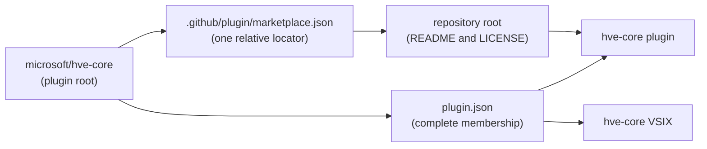

HVE Core is a library of agents, skills, and instructions for GitHub Copilot. It targets the Copilot agent harness, which VS Code uses for chat sessions by default and which also runs Copilot CLI. Pick one install route, check that HVE Core loaded, and add `.copilot-tracking/` to your project's `.gitignore`.

## Use the Copilot Harness

HVE Core supports only the Copilot harness. VS Code's Local harness doesn't load the skills that HVE Core agents preload through their `skills:` frontmatter, so the agents can't run there as written. Earlier releases worked in Local, which makes this a breaking change for anyone still using it.

VS Code shows a session's harness at the start of its chat title. To switch, start a new chat and select **Copilot** in the **Session Target** control before you send the first prompt. [Choose an agent harness](https://code.visualstudio.com/docs/agents/run/agent-harnesses) covers the options.

## Choose an Install Route

| Route                                                  | What you get                                                   | Choose it when                                  |
|--------------------------------------------------------|----------------------------------------------------------------|-------------------------------------------------|
| [Plugin](#install-the-plugin) ⭐                        | Every agent, skill, and instruction, following `main`          | You want the full set in VS Code or Copilot CLI |
| [Repository default](#offer-the-plugin-to-your-team)   | The plugin offered to everyone who opens a repository          | Your team wants one setup without copying files |
| [Repository copy](#copy-hve-core-into-your-repository) | Copies of every component, owned by your repository            | You customize HVE Core in your repository       |
| [VS Code extension](#use-the-vs-code-extension)        | Agents and skills from the VS Code Marketplace                 | You manage editor tools through the Marketplace |
| [A clone](#work-from-a-clone)                          | A pinned or editable copy, loaded as a plugin or from settings | You pin a version, contribute, or test a branch |

⭐ Most people should start with the plugin.

## Install the Plugin

The `hve-core` plugin carries every HVE Core agent, skill, and instruction, plus canvases such as the [RPI Workflow canvas](../rpi/rpi-workflow-canvas). Its registration follows the `main` branch.

To install it in VS Code:

1. Run **Chat: Open Customizations** from the Command Palette to open the Agent Customizations editor.
2. Select **Browse**, open the source menu, and select **Configure Marketplaces**.
3. Select **Add Marketplace** and enter `microsoft/hve-core`.
4. Return to **Browse**, choose the `hve-core` marketplace from the source menu, and install the `hve-core` plugin. The first install from a new marketplace asks you to trust it.

If your editor has no **Browse** page, select **Plugins** and then **Browse Marketplace** instead. In a Copilot chat session, these two commands do the same thing:

```text
/plugin marketplace add microsoft/hve-core
/plugin install hve-core@hve-core
```

In Copilot CLI, run:

```bash
copilot plugin marketplace add microsoft/hve-core
copilot plugin install hve-core@hve-core
```

VS Code also picks up plugins that Copilot CLI installs. [Copilot Plugin](methods/cli-plugins) covers both clients in more detail.

### Update the Plugin

In VS Code, select **Check for and Apply Updates** on the **Plugins** page, or run **Chat: Update Plugins**. In Copilot CLI, refresh the marketplace before you update the plugin:

```bash
copilot plugin marketplace update hve-core
copilot plugin update hve-core@hve-core
```

If you registered a release-channel or tag ref earlier, follow [Replace an Earlier Registration](methods/cli-plugins#replace-an-earlier-registration).

## Offer the Plugin to Your Team

Commit `.github/copilot/settings.json` to a repository to offer HVE Core to everyone who opens it with the Copilot harness:

```json
{
  "extraKnownMarketplaces": {
    "hve-core": {
      "source": {
        "source": "github",
        "repo": "microsoft/hve-core"
      }
    }
  },
  "enabledPlugins": {
    "hve-core@hve-core": true
  }
}
```

The Copilot harness treats this file as the repository's plugin defaults. Each person can still turn the plugin off on the **Plugins** page, and enterprise-managed settings take precedence. The key under `extraKnownMarketplaces` must be `hve-core` because that is the marketplace's name.

## Copy HVE Core Into Your Repository

Copilot finds agents, skills, and instructions in a project's `.github/agents`, `.github/skills`, and `.github/instructions` folders without any settings. If your repository should own its HVE Core files, copy them into those folders with the `hve-core-installer` skill, which ships with the plugin and the extension. Ask an agent to use it, and it walks you through four steps:

1. Clone or pin the HVE Core version to adopt.
2. Confirm that the installer copies every component declared by root `plugin.json`.
3. Review component kinds and collisions before anything is written.
4. Choose automatic source updates or a controlled pinned version.

The installer copies the full set because agents load skills and instructions by name, and a partial set can leave an agent without what it needs to start. An earlier install that recorded a smaller set keeps upgrading that set.

Agents, instructions, and complete skill directories keep their repository-relative paths, and the installer records the result in `.hve-tracking.json` (schema version 2). Once your repository has its copies, uninstall the plugin or extension so Copilot does not load HVE Core twice.

## Use the VS Code Extension

The `ise-hve-essentials.hve-core` extension installs HVE Core from the VS Code Marketplace, with Stable and PreRelease channels. VS Code forwards the extension's agents and skills to Copilot sessions. The extension's instructions may not reach those sessions, and the extension has no canvases, so use the plugin when you need either. [VS Code Extension](methods/extension) has the install and update steps.

## Work From a Clone

A clone holds a pinned or editable copy of HVE Core, and Copilot can load it in two ways.

For any folder that VS Code can read, install the clone's root folder as a plugin from source. In the Agent Customizations editor, select **Plugins**, select the add (`+`) button next to **User** or **Workspace**, and enter the folder path. **Chat: Install Plugin from Source** in the Command Palette does the same. HVE Core keeps `plugin.json` at its repository root, so this route loads the full set.

For a copy inside your project's checkout, such as a submodule or a git-ignored folder, you can instead list its folders in `.github/copilot/settings.json`:

```json
{
  "agentDirectories": ["lib/hve-core/.github/agents"],
  "skillDirectories": ["lib/hve-core/.github/skills"],
  "instructionDirectories": ["lib/hve-core/.github/instructions"]
}
```

Each path must be a literal folder inside the checkout. Copilot rejects absolute paths, `~`, environment variables, globs, and paths that leave the checkout, and it loads the folders only when the workspace folder is trusted. It finds agents and skills nested under each folder and inlines instructions that have no `applyTo`. Whether path-specific instructions load from these folders is not confirmed yet, so use the plugin route when you need them.

| Where the copy lives                      | How Copilot loads it                                   | Guide                                      |
|-------------------------------------------|--------------------------------------------------------|--------------------------------------------|
| A folder next to your project             | Plugin from source                                     | [Peer Directory Clone](methods/peer-clone) |
| A submodule in your project               | Repository settings                                    | [Git Submodule](methods/submodule)         |
| A git-ignored folder in your project      | Plugin from source or repository settings              | [Git-Ignored Folder](methods/git-ignored)  |
| A host folder mounted into a container    | Repository settings, when mounted inside the workspace | [Mounted Directory](methods/mounted)       |
| GitHub Codespaces                         | Repository default, or a clone inside the repository   | [GitHub Codespaces](methods/codespaces)    |
| A second folder in a multi-root workspace | Plugin from source                                     | [Multi-Root Workspace](methods/multi-root) |

[Comparing Setup Methods](methods/comparison) puts every route side by side.

## Use One Route at a Time

Copilot does not remove copies that arrive by different routes. If you install the plugin and the extension, or the plugin and a declared clone, each agent appears more than once in the subagent list. Keep one route and remove the others.

Earlier HVE Core guides set `chat.agentFilesLocations`, `chat.instructionsFilesLocations`, and `chat.agentSkillsLocations` in VS Code settings. Copilot CLI and the GitHub Copilot app ignore those settings, and VS Code still forwards their folders to Copilot sessions, which loads HVE Core a second time next to any route above. Remove them in this order:

1. Switch to the Copilot harness, as [Use the Copilot Harness](#use-the-copilot-harness) describes. If you remove the settings while your sessions still use Local, the agents Local found through them disappear from its picker.
2. Install one route above and confirm that it works in a Copilot session, using [Check That It Works](#check-that-it-works).
3. Remove the entries that point at HVE Core, reload the window, and run the same checks again.

## Check That It Works

1. Open Copilot Chat in VS Code and confirm that Copilot appears at the start of the chat title. New chats use the Copilot harness by default. If the title shows Local, start a new chat and select **Copilot** in the **Session Target** control.
2. Open the agent picker and confirm `RPI Agent` is listed.
3. Type `/` and confirm HVE Core skills appear. Skills from the plugin carry the plugin name as a prefix, such as `/hve-core:rpi-research`. Skills copied into your repository appear without it, such as `/rpi-research`.

In Copilot CLI, run `/help` and look for `hve-core:rpi-agent`.

After you install, update, or edit HVE Core files, run **Developer: Reload Window**. VS Code keeps its list of path-specific instructions for the life of the window, so new chat sessions see instruction changes only after a reload.

If something is missing, see [Troubleshooting](troubleshooting).

## Developer Setup

Contributors who change HVE Core itself work in a fork:

1. Fork and clone the repository:

   ```bash
   git clone https://github.com/<your-fork>/hve-core.git
   ```

2. Install dependencies:

   ```bash
   cd hve-core && npm ci
   ```

3. Open the folder in VS Code. A devcontainer configuration is included for containerized development.

Copilot discovers the repository's own agents, skills, and instructions when you open the clone, so you need no other route while you work in it. Work in Copilot harness sessions here too.
The workspace settings also list the repository's package folders so a Local session still finds its agents while you switch, as [Copilot Discovery](../customization/environment#copilot-discovery) explains. If the plugin or extension is also installed, disable it while you develop so agents do not appear twice. The [Contributing Guide](../contributing/) covers pull request and development conventions.

## Distribution Identity and Channels

HVE Core uses one identity across the plugin and the extension. Root `plugin.json` owns membership, and `.github/plugin/marketplace.json` contains one relative locator to the repository root. Plugin clients read the root README and LICENSE, and the VSIX keeps its extension-owned metadata.



The plugin has one registration, `microsoft/hve-core`, which tracks `main` and has no PreRelease or Stable channels. The VS Code extension is published as PreRelease and Stable from reviewed release branches that advance from `main` to `release/prerelease` to `release/stable`.

A published extension release is the assurance boundary for its immutable tag. The release workflow applies review and release gates, produces one VSIX with its SBOM and provenance sidecars, verifies provenance, and publishes through the configured release path. The plugin registration resolves `main` and does not carry that assurance. [HVE Core Identity and Channels](packages) describes the lifecycle and source contract.

## Post-Installation: Update Your .gitignore

Add this line to your project's `.gitignore`:

```text
.copilot-tracking/
```

> [!IMPORTANT]
> This applies to every install route. Agents create the `.copilot-tracking/` folder in your project directory, not in HVE Core itself.

The folder holds working files such as research documents, implementation plans, PR review notes, and work item planning files. Agents use them to keep context across sessions, but they do not belong in your repository's history.

## MCP Server Configuration (Optional)

Some HVE Core agents can use MCP (Model Context Protocol) servers for services such as Azure DevOps, Microsoft Learn, or Figma. Agents work without them. Copilot reads servers from `.mcp.json` at the workspace root, and [MCP Server Configuration](mcp-configuration) has the templates, server requirements, and troubleshooting steps.

## Next Steps

* [Your First Interaction](first-interaction) to confirm your setup works
* [Your First Workflow](first-workflow) to try HVE Core with a real task
* [RPI Workflow](../rpi/) for the Research, Plan, Implement, Review methodology

---

<!-- markdownlint-disable MD036 -->
*🤖 Crafted with precision by ✨Copilot following brilliant human instruction,
then carefully refined by our team of discerning human reviewers.*
<!-- markdownlint-enable MD036 -->
