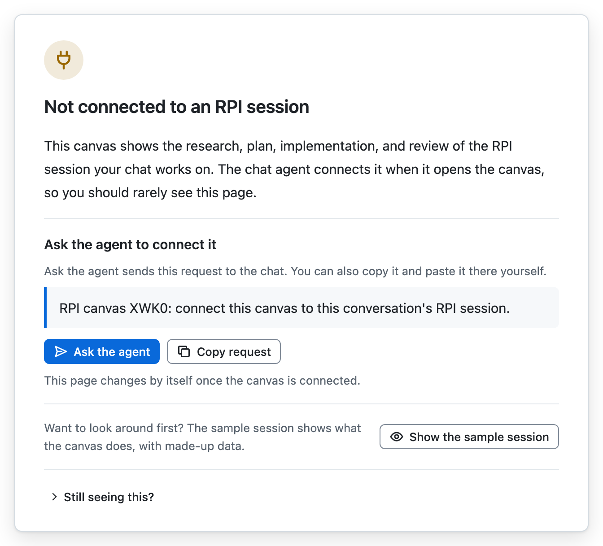
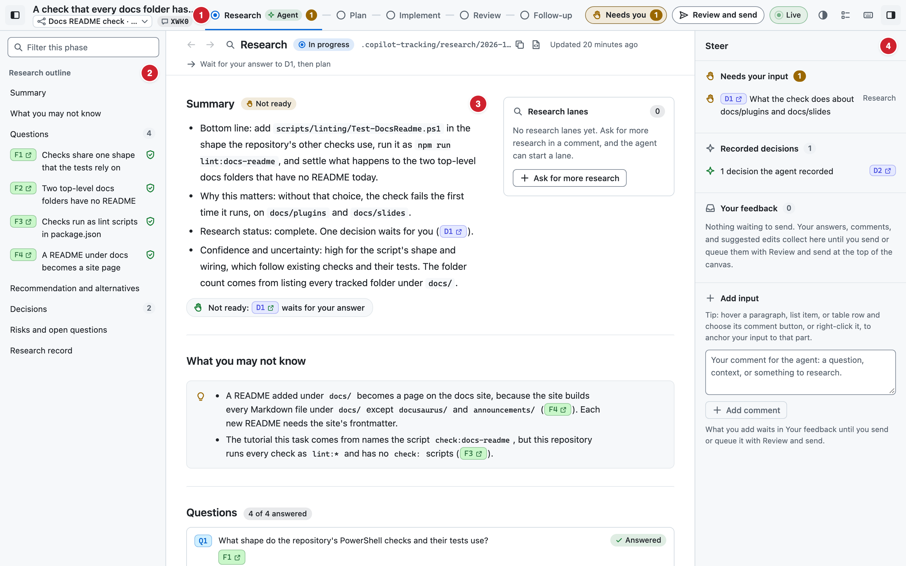
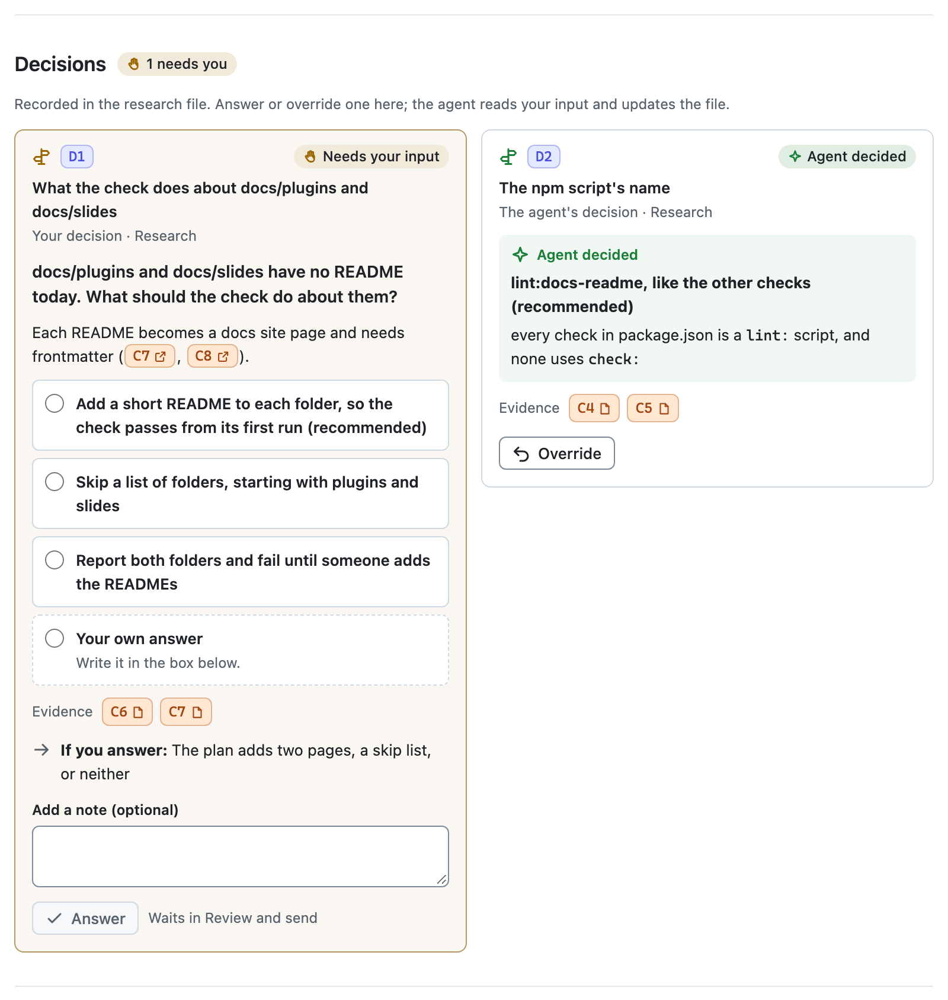
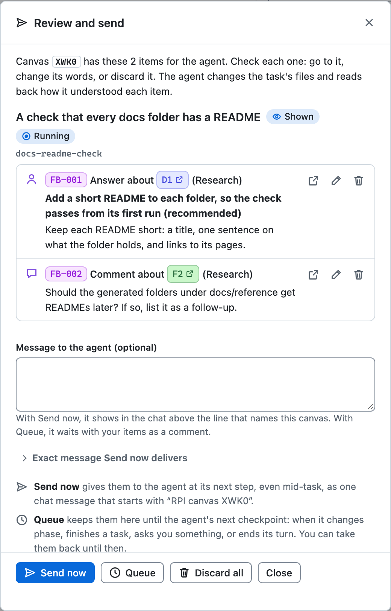
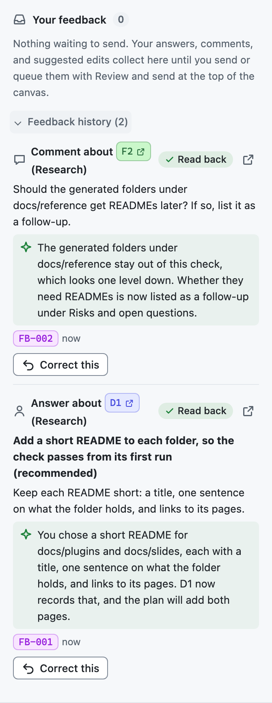
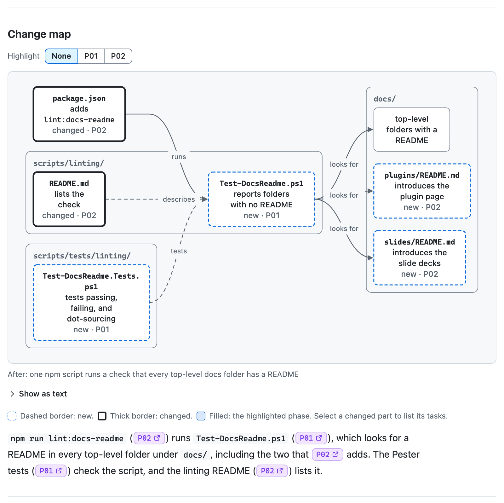
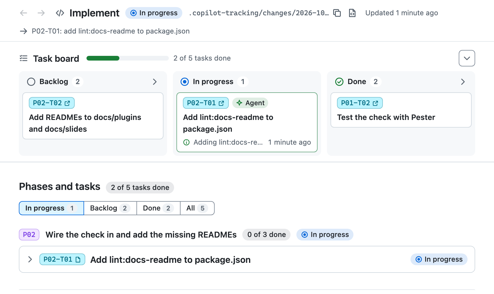
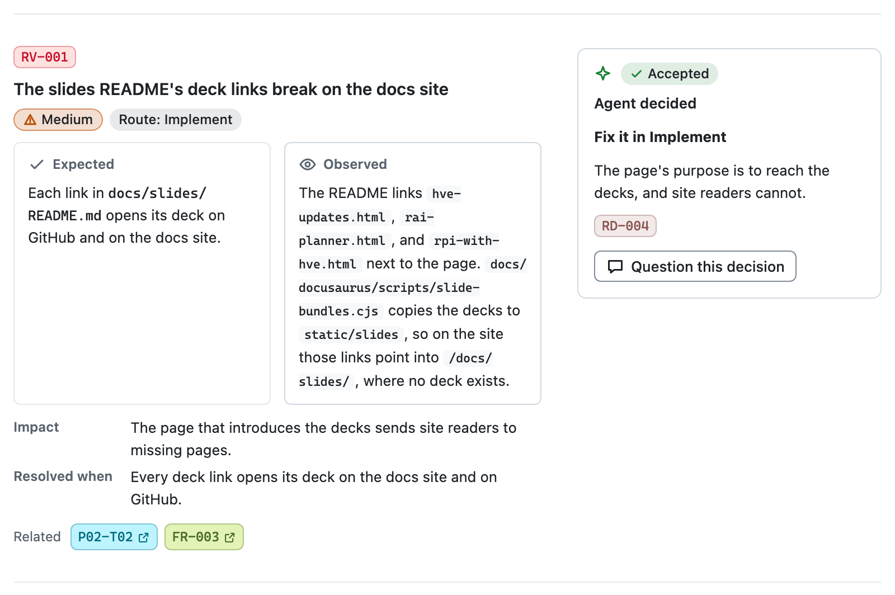
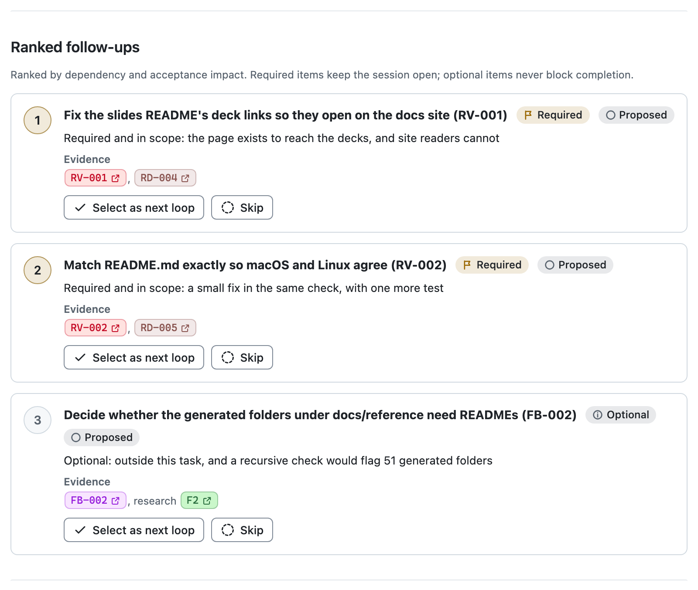
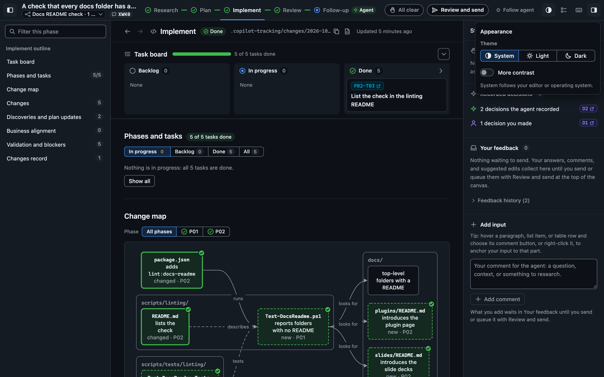

The RPI Workflow canvas shows the session the RPI Agent is working on, one phase at a time, in a panel beside the chat. You read the research and the plan as the agent writes them, answer the decisions it asks you about, watch tasks move during implementation, and work through review findings and follow-ups. Anything you add waits in the canvas until you send it, and the agent reads each item back so you can see how it understood you.

The session's files in `.copilot-tracking/` stay the record. The canvas never changes them; it shows them, collects your input, and passes that input to the agent, which updates the files.

The screenshots follow one session: the RPI Agent building the docs README check from [Your First Full Workflow](../getting-started/first-workflow), in a session set to keep going but check with you.

## Before You Start

You need a host that shows canvases and the hve-core plugin, which carries the canvas.

| Host               | What to turn on                                                                                                                                                                                         |
|--------------------|---------------------------------------------------------------------------------------------------------------------------------------------------------------------------------------------------------|
| VS Code desktop    | Turn on `chat.canvases.enabled`, start a new local session with the Copilot harness, and send a first message. See [Use canvases with agents](https://code.visualstudio.com/docs/agents/run/canvases).  |
| GitHub Copilot app | Canvases open in the app's right side panel. See [Working with canvas extensions in the GitHub Copilot app](https://docs.github.com/copilot/how-tos/github-copilot-app/working-with-canvas-extensions). |
| Copilot CLI        | Turn on experimental features with `--experimental` or `/experimental on`.                                                                                                                              |

The hve-core VS Code extension does not carry canvases. Install the hve-core plugin instead, with the [Copilot CLI](../getting-started/methods/cli-plugins) or from VS Code's Agent Customizations editor as described in [Agent plugins](https://code.visualstudio.com/docs/agent-customization/agent-plugins). VS Code also finds plugins that the Copilot CLI installed.

> [!NOTE]
> Canvases are a preview feature, so a host update can change how they open or look.

## Open the Canvas

Select **RPI Agent** and describe your task. When the host offers the canvas, the agent opens it on its session by itself, once per conversation, and the same panel follows each new loop of the session.

You can also ask the agent to open the RPI Workflow canvas, or open it from the host's canvas list. In VS Code, that is **Add Context (+) > Canvas...** in the chat input or **New Chat (+) > Canvas** in the Chat view; in the Agents window, it is **Add Tab (+) > Canvas**.

A canvas opened from a list doesn't know your session yet, so it shows Not connected:

Choose **Ask the agent**, which sends a one-line request naming this canvas to the chat, or **Copy request** to paste it yourself. The page changes as soon as the agent connects it. **Show the sample session** opens a made-up session with every phase filled in, which is a safe place to try things.

## Find Your Way Around

The canvas has four regions, numbered here on the example's Research phase:

1. The header holds the task and its session, then the canvas badge with its handle (`XWK0` here), which also starts every message this canvas sends to the chat. The phase rail marks the phase the agent works in with **Agent**, and you can read any other phase meanwhile. **Needs you** counts the decisions waiting for you and goes to the next one; **Review and send** opens everything you have not sent; **Live** shows whether the canvas follows the agent.
2. The navigator outlines the phase you are reading and filters it.
3. The document shows the phase's file as rows. Its context bar names the phase, its status, and its file, with Copy and **Open in VS Code**, and shows the agent's next action. The margin beside each row holds decision cards, research lanes, and your comments.
4. The steering panel lists **Needs your input**, **Recorded decisions**, **Your feedback**, and **Add input**.

IDs such as `F2`, `D1`, or `P02-T01` are links. Hover over one to preview the whole item, or select it to go there; **Back** and **Forward** retrace your steps.

While **Live** shows, the canvas moves to the loop and phase the agent works in, backward as well as forward. Choosing another phase, going back, or starting to type input stops following so the page stays where you are. Press **Follow agent**, or `f`, to catch up.

On a narrow panel, the steering panel becomes a drawer below 1360 pixels wide and the navigator below 1024 pixels; the toggles at each end of the header open them.

## Answer Decisions and Send Your Input

### Answer a Decision

In the example, research found that two top-level docs folders have no README, so the agent asked what the check should do about them (D1). It also chose a name for the npm script itself (D2):

To answer, choose an option, add a note if you like, and select **Answer**. **Your own answer** lets you write something else. A decision the agent made offers **Override**, where you pick an alternative or say what to do instead.

### Comment or Suggest an Edit

Rows show **Comment**, and rows that hold a section of the file also show **Suggest an edit**. Both appear when you hover over the row or move focus into it.
A comment can be about a whole row or one part of it: hover a paragraph, list item, or table row and choose its speech bubble, or right-click it. The comment opens in **Add input**, anchored to that part. Say in your own words whether it is a question, context, or something to research.
**Suggest an edit** opens a Markdown editor, and your suggestion shows beside the section until the agent applies it.

### Send It to the Agent

Answers, overrides, comments, and suggestions wait under **Your feedback** until you send them. **Review and send** lists them all. Here it holds the example's answer to D1 and a comment on finding F2:

**Send now** gives the items to the agent at its next step, even in the middle of a task, as one chat message. The chat shows a line such as "RPI canvas XWK0 sent 2 items: 1 answer and 1 comment." **Queue** keeps them in the canvas until the agent's next checkpoint: when it changes phase, finishes a task, asks you something, or ends its turn. Until then, you can take a queued item back.

Before you send, you can edit or discard any item, add a message for the agent, and open the exact text Send now will deliver.

When the RPI Agent asks you a question in the chat, it also offers **Answered in the canvas**. Choose it after answering in the canvas, and the agent collects your answers before it goes on.

### See How the Agent Understood You

After the agent updates its files, it reads each item back. The read-back appears under **Feedback history** in the steering panel:

You don't need to confirm a read-back. If the agent got it wrong, **Correct this** starts a correction that waits to be sent like any other item.

The stages an item moves through

| Stage                | What it means                                                                               |
|----------------------|---------------------------------------------------------------------------------------------|
| Not sent             | Still yours to edit or discard                                                              |
| Queued for the agent | Waiting for the agent's next checkpoint; **Take back** returns it                           |
| Sent                 | Delivered to the chat                                                                       |
| The agent has it     | The agent picked it up: at its next step, in a new turn, after its turn, or from the canvas |
| Read back            | The agent said how it understood the item; it moves to **Feedback history**                 |

Each item shows its stage and since when. A host that does not report pickups leaves an item at Sent until its read-back.

## What Each Phase Shows

Each phase shows what its file holds, wherever the agent is, so you can read a finished phase while the agent works on a later one.

### Research

Research shows a summary with its readiness, what you may not know, the questions, and each finding with its evidence state and confidence. Evidence chips such as `C5` and `W2` open their claim and source in place, and a code source opens the cited file at the cited place. When the agent runs research helpers, **Research lanes** shows each one as queued, running, done, or cancelled. **Ask for more research** opens a comment where you say what else to look into.

### Plan

The Plan view shows a summary with the critique's verdict, the change map, the phases and tasks, the requirements, and the critique's findings. The change map shows what the plan adds and changes and how those parts connect:

Dashed borders mark new parts and thick borders mark changed ones, and each tag names the phases that make the change. **Highlight** shades one phase's parts, and selecting a changed part lists its tasks. The plan's own walk-through of the map sits below it.

### Implement

Implement opens with the task board, which shows the next task ready to start, the task the agent is on with its latest activity, and the task finished last:

Below the board, **Phases and tasks** shows the work in progress by default, with **Backlog**, **Done**, and **All** filters, and an expanded task shows its changes and discoveries. The change map marks each part done, in progress, or still needed. Further down, the changes record lists what changed under each task with its files and validation, then the discoveries and the plan updates they caused.

### Review

Review shows the assessment with a count of findings by severity, then each finding with what was expected and what was observed side by side:

The card beside each finding gives the decision on it and where the work goes next. **Question this decision** starts a comment about that finding. The decision history follows the findings.

### Follow-up

Follow-up ranks the work that remains. Required items keep the session open, and optional ones never block it:

**Select as next loop** and **Skip** each add a request for the agent, which waits in **Review and send** with your other input. Below the list, **Loops in this session** shows each loop the conversation worked on, parent first.

### Earlier Documents

When one session takes on a new request, the new work gets its own research, plan, changes record, and review. A **Document** switcher in the context bar then lists each phase's earlier documents by title and time. An earlier document opens read-only, with a button back to the current one.

## Themes, Accessibility, and Keyboard

The **Appearance** menu in the header offers **System**, **Light**, and **Dark**, plus **More contrast**. System follows your editor or operating system:

The canvas targets WCAG 2.2 AA in every theme and contrast setting. Status always pairs an icon and a word with its color, so nothing depends on color alone.
Forced colors keep every border and edge, and reduced motion turns off animation except the small ring that shows a preview locking.
Everything works from the keyboard. The [style guide](https://github.com/microsoft/hve-core/blob/main/.github/extensions/hve-core/rpi-workflow/STYLE-GUIDE.md) records the palette, measured contrast, and keyboard model.

Keyboard shortcuts

| Key                        | Action                                               |
|----------------------------|------------------------------------------------------|
| `1` to `5`                 | View Research, Plan, Implement, Review, or Follow-up |
| `n`                        | Go to the next item that needs you                   |
| `f`                        | Follow the agent, or stop following                  |
| `[` and `]`                | Previous and next row                                |
| `e`                        | Suggest an edit to the focused row                   |
| `c`                        | Comment on the focused row                           |
| `/`                        | Filter the navigator                                 |
| `b` and `s`                | Show or hide the navigator and the steering panel    |
| `l`                        | Show what the IDs and icons mean                     |
| `?`                        | Show the shortcut list                               |
| `Alt+Left` and `Alt+Right` | Go back and forward                                  |
| `Shift+F10` or `Menu`      | Open the canvas menu for the focused item            |

Single-key shortcuts pause while you type, and the shortcut list has a switch that turns them off.

## Troubleshooting

| Problem                                                  | What to do                                                                                                                                                                   |
|----------------------------------------------------------|------------------------------------------------------------------------------------------------------------------------------------------------------------------------------|
| No canvas menu, or the RPI Workflow canvas is not listed | Check `chat.canvases.enabled`, start a new session with the Copilot harness, and send a message. Install the hve-core plugin; the VS Code extension does not carry canvases. |
| The RPI Agent did not open the canvas                    | Ask the agent to open the RPI Workflow canvas. If it never opens the canvas by itself, update the hve-core plugin, because an older RPI Agent may not.                       |
| The canvas says Not connected                            | Choose **Ask the agent** or **Copy request**.                                                                                                                                |
| The canvas stopped moving with the agent                 | Following stopped when you chose another phase or started typing. Press **Follow agent** or `f`.                                                                             |
| Review and send says it cannot send                      | The host does not accept messages from extensions. Use **Queue**, and the agent collects your items at its next checkpoint.                                                  |
| An item stays at Sent                                    | Some hosts do not report pickups. The read-back still arrives.                                                                                                               |
| **Open in VS Code** is missing                           | The canvas shows that button only when it finds VS Code. Use **Copy path**, or read the file in the canvas.                                                                  |
| A list of problems appears above the phase               | The canvas names what it cannot read in the session's files. The RPI Agent fixes the files it is writing.                                                                    |

The [canvas README](https://github.com/microsoft/hve-core/blob/main/.github/extensions/hve-core/rpi-workflow/README.md) covers the agent actions, storage, security, and known limitations.

## Related Guides

* [Using RPI Together](using-together) walks through a complete RPI lifecycle.
* [Your First Full Workflow](../getting-started/first-workflow) builds the same docs README check step by step.
* [RPI Agent](../reference/agents/hve-core/rpi-agent) describes the agent's modes and state.
* [HVE Core plugin](../plugins/hve-core) lists what the plugin installs, including this canvas.

---

<!-- markdownlint-disable MD036 -->
*🤖 Crafted with precision by ✨Copilot following brilliant human instruction,
then carefully refined by our team of discerning human reviewers.*
<!-- markdownlint-enable MD036 -->
